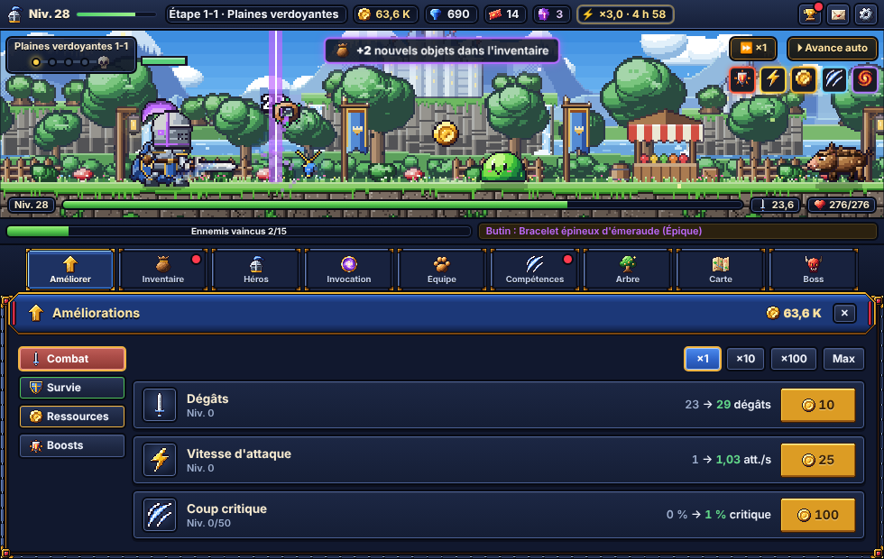
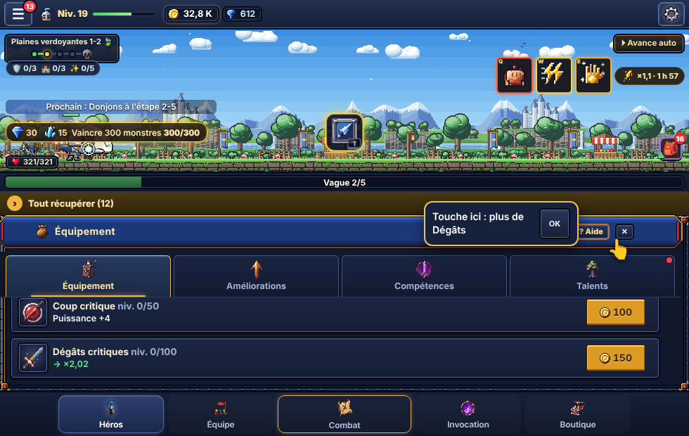
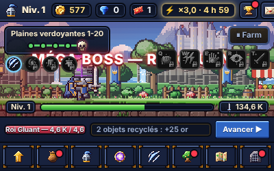
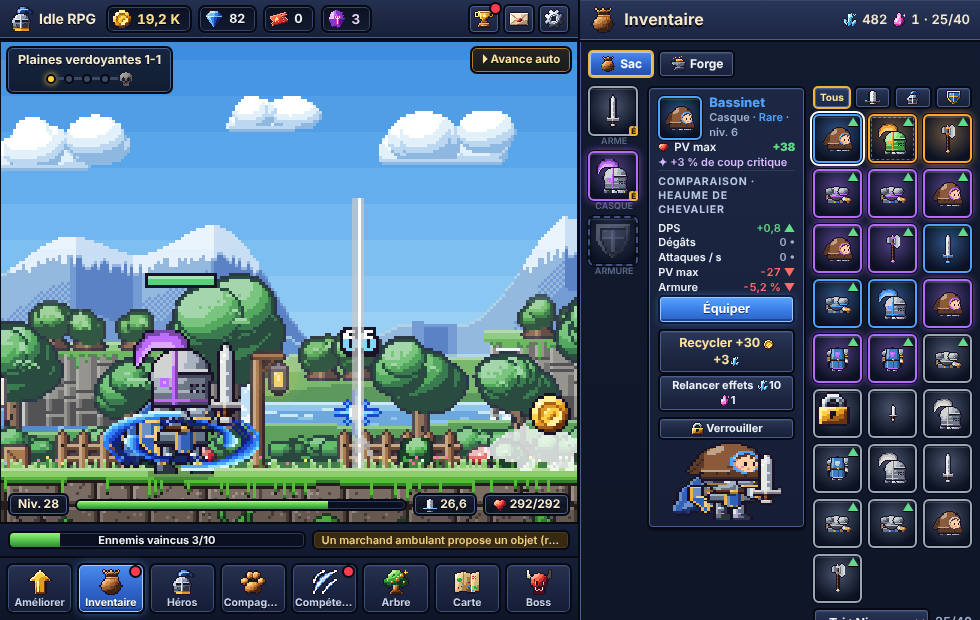
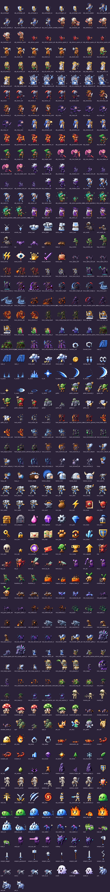

# Ascendrya — prototype jouable

RPG idle 2D en vue de côté et en pixel art, pensé pour tourner dans une petite fenêtre de bureau
pendant que vous faites autre chose. Le héros combat seul, avance dans la campagne et ramasse de l'or
et du butin ; à votre retour, vous équipez, recyclez, améliorez et choisissez la suite.

| Fenêtre standard | Inventaire | Fenêtre mini |
|---|---|---|
|  |  |   |



## Version Windows (exe)

Téléchargez la dernière version dans **Releases** du dépôt GitHub :

- `IdleRPG-3.0.0-setup.exe` : installateur avec raccourcis Bureau et menu Démarrer.

**Mise à jour :** lancez simplement le nouveau `setup.exe` (jeu fermé). Il remplace la version installée
(même identifiant d'application) et conserve la partie, stockée à part dans `%APPDATA%\Idle RPG`
(dossier gardé à l'ancien nom du jeu, de même que l'exécutable `Idle RPG.exe` et les clés `idle-rpg.*`).
La CI le vérifie à chaque construction : installation de la v1, partie sauvegardée, installation de la
nouvelle version par-dessus, puis contrôle d'une seule installation à jour qui reprend la sauvegarde.

L'exe n'est pas signé : si SmartScreen s'affiche, cliquez sur **Informations complémentaires →
Exécuter quand même**. La sauvegarde est dans `%APPDATA%\Idle RPG`. Dans l'onglet ⚙ : **Garder la
fenêtre au premier plan**, fenêtre compacte ou large ; la position et la taille sont mémorisées.

Les exe sont construits par GitHub Actions (`.github/workflows/windows-exe.yml`) sur Windows à
chaque push : tests unitaires, construction (Electron + electron-builder), **lancement réel des deux
exe** (combat, sauvegarde, relance avec restauration), puis publication de la release `v<version>`
de `package.json`. Pour construire soi-même sous Windows :

```bash
npm ci
npm run dist:win                                   # -> dist/*.exe
npm run test:exe -- "dist/win-unpacked/Idle RPG.exe"
npm run desktop                                    # lancer la version bureau sans l'empaqueter
```

## Lancer le jeu dans le navigateur

Prérequis : [Node.js](https://nodejs.org) 18 ou plus. Le jeu lui-même n'a **aucune dépendance**
(Electron ne sert qu'à la version bureau).

```bash
npm run app     # ouvre le jeu dans une petite fenêtre d'application (Chrome ou Edge, mode --app)
npm start       # ou : serveur local, puis ouvrir http://localhost:5173 dans un navigateur
```

Sans Node : `python3 -m http.server 5173` dans ce dossier, puis http://localhost:5173.
(Le jeu ne s'ouvre pas en double-cliquant `index.html` : les modules JavaScript exigent un serveur.)

`npm run app` utilise un profil de navigateur dédié (`~/.idle-rpg-profile`) : la sauvegarde y est
conservée d'une session à l'autre. La sauvegarde est liée à l'adresse (port compris) : gardez le même port.

## Commandes

Tout est à la souris ; le combat n'a besoin d'aucune action. Barre du haut : or, gemmes et tickets
(ouvrent l'invocation), contrats, récompenses, paramètres.

| Onglet | Rôle |
|---|---|
| **Améliorer** | Catégories Combat / Survie / Ressources : effet actuel → suivant, coût |
| **Inventaire** | Sac (équipement porté, fiche avec effets spéciaux et comparaison, grille, filtres, tri, recyclage) et Forge (fabriquer, réaffûter, relancer les effets) |
| **Héros** | 6 chevaliers à collectionner, niveau, statistiques, bonus permanents |
| **Compagnons** *(après le 1er boss)* | Équipe de 3 : le chevalier (fixe) + 2 compagnons ; bonus passif + compétence, amélioration |
| **Compétences** | Frappe rapide, Tourbillon, Cri de guerre, Frappe sacrée ; lancement automatique |
| **Arbre** *(dès l'étape 2-5)* | Renaissance et arbre de talents à 4 branches |
| **Carte** | Carte du monde illustrée, 6 zones, étapes ; avancée automatique |
| **Donjons** *(vers l'étape 2-2)* | Crypte spectrale : butin ciblé, chemin, clés |
| **Boss** *(après le 1er boss)* | Pouvoirs ancestraux, **Réaffronter** pour gagner une charge de relance, maîtrise, synergies |

Trois dispositions : **Barre** (fenêtre très basse, ≤ 190 px : seulement la scène, le niveau et l'or,
comme un jeu de barre des tâches), **Mini** (fenêtre basse : le panneau s'ouvre par-dessus la scène) et **Standard**
(fenêtre ≥ 420 px de haut) : le jeu en bandeau sur toute la largeur, les onglets dessous, l'interface
en dessous. Aucun onglet n'est ouvert au démarrage : un clic ouvre un onglet, un second clic (ou Échap) le
referme et le jeu reprend toute la hauteur. Les portraits des menus (chevalier, compagnons, boss) sont animés.

## Règles du prototype

- **Campagne** : 3 zones de 10 étapes (Plaines, Forêt sombre, Grottes de cristal) ; la dernière zone
  continue à l'infini. 10 ennemis par étape ; une étape sur 5 est un **boss** (★).
- **Boss** : beaucoup plus de PV, récompense en or ×15 et un objet **Rare ou mieux garanti**.
- **Défaite** : le héros recule d'une étape et passe en **mode farm** ; il continue à gagner de l'or.
  Améliorez-le puis appuyez sur **Avancer ▶**.
- **Butin** : 10 % de chance par ennemi. Raretés Commun, Rare, Épique, Légendaire. 3 emplacements
  (arme, casque, armure), visibles sur le héros. Sac de 40 places ; s'il est plein, les nouveaux objets
  sont recyclés en or automatiquement (jamais perdus).
- **Pouvoirs ancestraux** (`src/data/powers.js`) : chaque boss a 5 passifs thématiques (Roi Gluant : survie,
  Loup Alpha : dégâts, Seigneur des Os : butin et boss). La **première victoire** en débloque toujours un.
  **Relancer** coûte de l'or (3 × la récompense du boss, coût fixe) et crée une **proposition** toujours
  différente du pouvoir actuel ; le joueur garde l'actuel ou prend le nouveau. La proposition est sauvegardée :
  rien n'est remplacé sans choix explicite. Rareté tirée selon 55 / 30 / 12 / 3 %, puis pouvoir au hasard
  dans la rareté ; Épique ou mieux garanti après 6 relances sans en obtenir. 2 emplacements actifs.
- **Renaissance** (`src/data/rebirth.js`) : possible à partir de l'étape max 15 (2-5). Fragments gagnés =
  ⌊((étape max − 1) / 5)^1,3⌋. Réinitialise étapes, or et améliorations ; conserve équipement, sac, pouvoirs,
  Codex, talents et exploits. 5 talents : Puissance (+10 % dégâts/niv.), Endurance (+10 % PV), Fortune (+10 % or),
  Chasse (+1 pt de butin), Héritage (+1 emplacement de pouvoir, −25 % relance, +1 emplacement).
- **Verrouillage** : un objet verrouillé n'est jamais recyclé (ni seul, ni en groupe).
- **Hors ligne** : à la relance, les gains sont calculés depuis la dernière sauvegarde, plafonnés à 24 h,
  à 65 % du rythme de farm actif sur l'étape atteinte (sans progression d'étape). Si l'horloge de
  l'ordinateur a reculé, aucun gain n'est appliqué.

## Critères d'acceptation

Tous vérifiés automatiquement dans Chromium par `npm run smoke` (24/24, avec les onglets, filtres, tri et le recyclage groupé) :

| Critère | Statut |
|---|---|
| Le jeu démarre et affiche une scène de combat 2D de côté | ✔ |
| Le héros attaque automatiquement ; les ennemis meurent, donnent de l'or, peuvent lâcher un objet | ✔ |
| Acheter une amélioration avec l'or | ✔ |
| Ouvrir l'inventaire, équiper un objet et voir l'effet sur les statistiques | ✔ |
| Recycler un objet contre de l'or | ✔ |
| Un boss apparaît à un palier et donne une récompense | ✔ |
| Progression sauvegardée et restaurée après fermeture/relance | ✔ |
| Résumé hors ligne cohérent après une absence simulée (et horloge reculée rejetée) | ✔ |
| Interface lisible en petite fenêtre et adaptée au redimensionnement (320×200 à 900×560) | ✔ |
| Aucune erreur JavaScript | ✔ |

## Architecture

```
index.html            page unique
src/main.js           boucle de jeu : simulation (minuterie) + rendu (requestAnimationFrame) + sauvegarde
src/data/             ÉQUILIBRAGE ET CONTENU (aucune logique)
  balance.js          tous les chiffres : coûts, croissance, butin, hors ligne, sauvegarde auto…
  powers.js           pouvoirs ancestraux par boss, probabilités, coût de relance, garantie, emplacements
  rebirth.js          Renaissance (seuil, formule) et talents permanents
  items.js            emplacements, raretés, bases d'objets
  enemies.js          ennemis et boss
  zones.js            zones, palettes de couleurs, décor
src/core/             LOGIQUE DE JEU PURE (testable sans navigateur)
  combat.js           simulation à pas fixe, file d'ennemis, boss, défaite, événements
  stats.js            statistiques du héros (base + améliorations + équipement + bonus)
  powers.js           déblocage, relance, proposition acceptée/refusée, emplacements actifs
  rebirth.js          Renaissance et talents
  bonuses.js          cumul des bonus des pouvoirs actifs et des talents
  economy.js          or et améliorations
  loot.js             génération d'objets depuis les données, raretés, valeur de recyclage
  inventory.js        équiper, recycler, trier, comparer
  offline.js          gains hors ligne
  save.js / state.js  sauvegarde sûre, validation et migration des données chargées (format v4)
src/render/           RENDU
  sprites.js          tous les assets pixel art (grilles de caractères)
  pixel.js            grilles -> canvas (cache), héros composé avec son équipement, police pixel
  scene.js            scène : parallaxe, personnages, effets, secousses
src/ui/               INTERFACE DOM (HUD, panneaux, fenêtre de retour)
tests/                tests unitaires (node --test)
tools/                serveur, lanceur, test navigateur, export des assets
assets/               PNG exportés depuis src/render/sprites.js
```

Points clés :

- **Logique / rendu séparés** : la simulation (`core/`) ne connaît ni le DOM ni le canvas. Elle émet
  des événements (`kill`, `drop`, `bossSpawn`…) que le rendu et l'interface consomment.
- **Indépendant de la fenêtre** : le combat utilise des coordonnées logiques fixes ; la fenêtre ne
  change que ce qu'on voit (plus de ciel ou de décor), jamais la progression.
- **Fenêtre réduite** : la simulation tourne sur une minuterie pilotée par l'horloge murale et rattrape
  le retard ; le rendu s'arrête quand la fenêtre est masquée. Après plus de 10 min d'interruption
  (veille), on applique le calcul hors ligne au lieu de simuler.
- **Hors ligne cohérent** : le rythme de farm est *mesuré* en faisant tourner la vraie simulation
  pendant 180 s sur une copie de la partie, puis extrapolé. Mêmes règles qu'en jeu, sans animations.
- **Sauvegarde sûre** : écriture dans une clé temporaire vérifiée, puis principale ; l'ancienne version
  reste en secours. Toute donnée chargée est validée (valeurs négatives, objets inconnus…).
  Sauvegarde toutes les 10 s, à chaque action et à la fermeture.
- **Données configurables** : objets, ennemis, zones et chiffres sont des données ; ajouter un objet
  ou un ennemi ne demande qu'une entrée dans `src/data/` (+ un sprite).

## Assets

Tous les graphismes sont **générés pour le projet** par des scripts Python (`tools/art/`, aucun asset
externe ou commercial) dans une direction « RPG fantasy 16 bits » : formes ombrées, contour sélectif
sombre, rampes de couleurs à décalage de teinte, lumière venant d'en haut à gauche.

- `npm run art` (`python3 tools/art/build.py`, Pillow requis) régénère tout :
  - `src/render/art.js` : grilles des sprites (chevalier, ennemis, boss, compagnons, icônes) ;
  - `assets/bg/<zone>_<calque>.png` : décors de parallaxe raccordables (lointain, intermédiaire, sol,
    nuages ou plafond) pour les 6 zones ;
  - `assets/ui/worldmap.png` : carte du monde peinte ;
- scripts : `lib.py` (outils de dessin), `knight.py` (chevalier chibi 48×48 en calques et effets
  d'énergie), `enemies.py` (25 ennemis à 2 images, 6 boss, 6 compagnons), `icons.py` (34 icônes),
  `scenery.py` (45 calques de décor et leur manifeste `src/render/bg.js`), `worldmap.py` ;
- le chevalier est composé de calques : cape animée, écu, corps (12 images : respiration, marche,
  attaque en 3 temps, sort, coup reçu, victoire ; chacune donne la main, la rotation de l'arme et le
  décalage de la tête et du buste), armure, casque, arme. Les calques d'équipement utilisent des
  caractères réservés remplacés par les couleurs de l'objet et de sa rareté ; le corps, celles du héros ;
- `npm run export-assets` régénère `assets/sprites/*.png`, `assets/spritesheet.png` et l'icône
  (Playwright requis) ;
- les animations (marche, attaque, coup reçu, mort, victoire, apparition) sont produites par le code.



## Tests

```bash
npm test        # 60 tests unitaires : économie, butin, inventaire (tri, recyclage protégé, verrou), combat, boss,
                # pouvoirs (déblocage, relance, choix, garantie, migration), Renaissance et talents, défaite,
                # hors ligne (plafond, horloge, cohérence avec le farm actif), sauvegarde, sprites
npm run smoke   # test de bout en bout dans Chromium + captures dans docs/screenshots
```

`npm run smoke` et `npm run export-assets` nécessitent Playwright
(`npm i -D playwright && npx playwright install chromium`) ; le jeu lui-même n'en a pas besoin.

## Choix technique : pourquoi pas Godot (pour l'instant)

Le cahier des charges proposait d'évaluer Godot en priorité. Godot n'était pas installable dans
l'environnement de développement (téléchargement du binaire bloqué), ce qui empêchait d'exécuter et de
vérifier quoi que ce soit. Le prototype est donc en **HTML5 Canvas + JavaScript sans dépendance** :

- vérifiable de bout en bout ici (tests unitaires + navigateur réel) ;
- se lance sur n'importe quel PC avec Node ou un navigateur ;
- la logique (`src/core`, `src/data`) est indépendante du moteur et se porte facilement.

La version bureau enveloppe ce même code dans **Electron** (`desktop/`) : vraie fenêtre Windows,
option « toujours au premier plan », position mémorisée, une seule instance, sauvegarde forcée à la
fermeture. Le jeu est servi depuis une origine locale fixe (`app://game`) pour que la sauvegarde
persiste. Reconsidérer Godot reste possible si le projet a besoin d'un moteur complet.

## Limites connues

- « Toujours au premier plan » n'existe que dans la version bureau (exe), pas dans le navigateur.
- Les sauvegardes de l'exe et du navigateur sont séparées ; dans le navigateur, changer de navigateur,
  de profil ou de port repart de zéro. Pas d'export/import de sauvegarde pour l'instant.
- L'exe n'est pas signé (avertissement SmartScreen au premier lancement) et pèse environ 105 Mo
  (Chromium embarqué). Pas de mise à jour automatique.
- Équilibrage indicatif : environ 30 étapes en 30 min de jeu actif, puis des paliers plus lents
  (mesuré par simulation, pas par des tests joueurs).
- Pas de son. Pas d'effets légendaires (le champ `effect` existe mais reste vide).
- Lancer deux fois `npm run app` en même temps peut échouer (port déjà utilisé).

- Les sauvegardes v1/v2 sont migrées : les boss dont l'étape est dépassée donnent un pouvoir (tiré de façon
  déterministe). Une sauvegarde v3 ouverte par une ancienne version perdrait pouvoirs, talents et fragments.
- Renaissance et pouvoirs : équilibrage de premier jet, à ajuster en jeu (seulement 3 boss pour l'instant).

## v5, v6 et v7

Refonte complète de la direction artistique (v5), puis chevalier chibi animé, 25 ennemis animés et
décors enrichis (v6), puis équilibrage, arbre de talents, interface en bandeau et fluidité (v7),
puis 20 héros invocables, donjons des SSR, accessoires, amélioration/fusion d'équipement, missions
journalières/hebdomadaires/mensuelles et démarrage rapide (v7.5), puis mondes de 20 étapes à 4 boss,
difficulté ×2/×3 après le dernier monde, boosts à durée limitée, prestige, musique et sons procéduraux (v7.6),
puis 11 mondes, donjons à difficultés, Codex et collections, synergies, configurations d'équipe et anglais (v7.7),
puis mises à jour en jeu, vitesse des combats ×2/×5/×10, carte zoomable et menus pixel art (v7.8/v7.9),
puis recyclage automatique fiable, menus stables en ×10 et avance auto qui reste cochée (v8.0),
puis raccourcis clavier, clic maintenu, codes cumulables, fusion auto, effets d'équipe et cinématiques (v8.1),
puis Tour de l'Éternité, navigation complète au clavier et méga boss réanimés (v8.2),
puis hauts faits et donjons rééquilibrés (v8.3),
puis progression sans fin, Renaissance multiplicative et aide au joueur (v8.4),
puis arbre de 511 talents, expéditions, ensembles d'équipement, défi de la semaine, journal et fin des gels (v8.5),
puis arbre entièrement visible, barres Boosts / Compétences et code « combats passés » (v8.6),
puis codes secrets sans limite, Tour qui finit et arbre aux couleurs des régions (v8.7),
puis Transcendance, Tour à chrono, SSR revalorisés et achat en masse dans l'arbre (v8.8),
puis coffre et mannequins, compagnons à 4 compétences, Records, transitions et Prime du jour (v8.9),
puis mise à jour depuis le jeu réparée (v8.9.1),
puis installation qui ne remplit plus le disque (v8.9.2),
puis Musée des objets ancestraux et 10 thèmes d'interface (v9.0),
puis vrais styles d'interface par thème et Codex expliqué (v9.0.1),
puis mise à jour depuis le jeu fiable (v9.0.2),
puis thèmes d'interface de luxe et Musée « Exposer tout » (v9.0.3),
puis ennemis mutés, boss de donjon uniques et aura des 5 étoiles (v9.0.4),
puis Encyclopédie et aura « Super guerrier » des 5 étoiles (v9.0.5),
puis 10 classes, héros à collectionner et menus simplifiés (v9.0.6),
puis nouveau chara design des compagnons et des monstres du monde 1 (v9.0.7),
puis animations plus vivantes et équipe sans chevauchement (v9.0.8),
puis compte, sauvegarde cloud et classement (v9.0.9),
puis grande mise à jour de confort : 4 menus, bouton « Prochaine action », téléphone et accessibilité (v9.1.0),
puis sauvegarde en ligne automatique, compte joueur et analytique admin (v9.1.1),
puis création de compte toujours possible et messages de connexion clairs (v9.1.2),
puis écrans allégés, fiches en feuille du bas, récompenses en icônes, Défis et piste du mois (v9.1.3),
et en parallèle sauvegarde en ligne qui ne refuse plus les grosses parties, formulaires de compte fiables et décors corrigés,
renaissances sauvegardées, classement dans le jeu, amis et statistiques de temps (v9.1.3 à v9.1.7),
puis les deux réunies, avec la langue coréenne (v9.1.8) :
voir `docs/RELEASE_NOTES.md`.

## v4

Notes de version v4 : chevalier agrandi, scène sans texte superflu, niveau/XP,
compétences, héros et compagnons (invocation sans achat réel), effets spéciaux et objets signature, forge,
arbre de talents, 6 zones et carte du monde, donjon, contrats, événements, maîtrise et familles de pouvoirs.
**Changer de pouvoir exige une nouvelle victoire contre le boss** (1 charge par victoire, 3 au maximum).

Décisions encore ouvertes (`src/data/powers.js`) : nombre d'emplacements, coût de relance fixe
ou progressif (`rerollCostGrowth`), tirage unique ou choix entre plusieurs résultats.

## Site, préinscription et sauvegarde cloud

- **Site** (`site/`) : page d'accueil avec le bouton « Jouer » (`/play/`), formulaire de préinscription (email + consentement explicite) et [politique de confidentialité](site/confidentialite.html). Le domaine se règle dans `site/config.js` (placeholder `TON-DOMAINE.xyz`).
- **Serveur** (`server/`) : Node 22+, sans dépendance (SQLite intégré via `node:sqlite`). Il sert le site, l'API de sauvegarde et la préinscription.
- **Sauvegarde cloud** (`src/core/cloud-save.js`) : optionnelle. Le jeu reste jouable en local (`localStorage`) si le serveur est indisponible. Pseudo + mot de passe ; suppression du compte et de toutes ses données via `DELETE /api/account`.

### Commandes

```bash
npm run server        # démarre le serveur (écoute 127.0.0.1:8787 par défaut)
npm run build:web     # prépare la version web du jeu dans dist/web (servie sur /play/)
npm test              # tests, dont server.test.js et cloud-save.test.js
```

### Variables d'environnement

Voir [`.env.example`](.env.example). Aucun secret n'est nécessaire pour le moment. Ne jamais committer de `.env`, de base de données (`data/`) ni de jeton.

| Variable | Rôle | Défaut |
|---|---|---|
| `PORT` | port d'écoute | `8787` |
| `HOST` | adresse d'écoute | `127.0.0.1` |
| `DB_FILE` | fichier SQLite | `data/games.sqlite` |
| `SITE_DIR` / `WEB_DIR` | dossiers statiques (site, jeu compilé) | `site/` / `dist/web/` |
| `TRUST_PROXY` | `1` derrière un tunnel de confiance (limitation par IP réelle) | `0` |

### API

| Route | Auth | Rôle |
|---|---|---|
| `POST /api/register` | non | crée un compte `{pseudo, password}` |
| `POST /api/login` | non | renvoie un jeton de session (30 jours) |
| `POST /api/logout` | oui | révoque le jeton |
| `GET /api/save` | oui | `{data, version}` (`data` = JSON de la partie) |
| `PUT /api/save` | oui | `{version, data}` ; 409 si la version serveur a changé |
| `DELETE /api/account` | oui | supprime le compte et ses données (`{password}` requis) |
| `POST /api/preregister` | non | `{email, consent: true}` ; réponse identique que l'email existe ou non |
| `POST /api/preregister/remove` | non | retire un email de la liste |

Les journaux ne contiennent ni email, ni mot de passe, ni contenu de sauvegarde.

### Administration

- Panneau : `/admin/` (site). Connexion par mot de passe administrateur ; le jeton reste en mémoire et expire après 12 h.
- Vue d'ensemble (comptes, joueurs actifs, progression), liste des joueurs (recherche, tri, fiche détaillée, suppression), préinscriptions (liste, retrait, export CSV).
- Activation : définir `ADMIN_PASSWORD_HASH` dans l'environnement du serveur. Le hash se produit ainsi, sans mot de passe dans l'historique du shell :

```bash
node tools/hash-password.mjs < fichier-contenant-le-mot-de-passe
```

Sans cette variable, les routes d'administration répondent 404.

### Compte et synchronisation dans le jeu

Menu Options → « Compte et sauvegarde cloud ». Une fois connecté, la partie se synchronise à l'ouverture, toutes les minutes et à la sortie de l'onglet. Une nouvelle partie jamais jouée ne remplace jamais une sauvegarde cloud.
