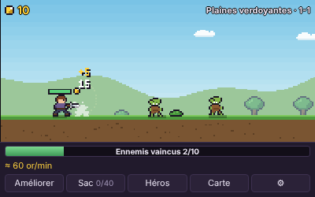
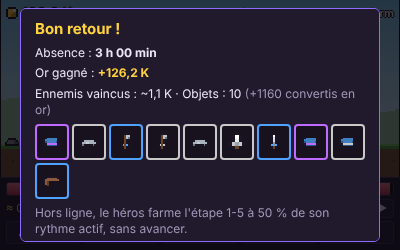

# Idle RPG — prototype jouable

RPG idle 2D en vue de côté et en pixel art, pensé pour tourner dans une petite fenêtre de bureau
pendant que vous faites autre chose. Le héros combat seul, avance dans la campagne et ramasse de l'or
et du butin ; à votre retour, vous équipez, recyclez, améliorez et choisissez la suite.






## Lancer le jeu

Prérequis : [Node.js](https://nodejs.org) 18 ou plus. **Aucune dépendance à installer.**

```bash
npm run app     # ouvre le jeu dans une petite fenêtre d'application (Chrome ou Edge, mode --app)
npm start       # ou : serveur local, puis ouvrir http://localhost:5173 dans un navigateur
```

Sans Node : `python3 -m http.server 5173` dans ce dossier, puis http://localhost:5173.
(Le jeu ne s'ouvre pas en double-cliquant `index.html` : les modules JavaScript exigent un serveur.)

`npm run app` utilise un profil de navigateur dédié (`~/.idle-rpg-profile`) : la sauvegarde y est
conservée d'une session à l'autre. La sauvegarde est liée à l'adresse (port compris) : gardez le même port.

## Commandes

Tout est à la souris ; le combat n'a besoin d'aucune action.

| Onglet | Rôle |
|---|---|
| **Améliorer** | Acheter Dégâts, Vitesse d'attaque, Vitalité avec l'or |
| **Sac** | Voir le butin, comparer avec l'équipement (▲ = meilleur DPS), équiper, recycler, filtrer et trier |
| **Héros** | Portrait équipé, statistiques, records |
| **Carte** | Choisir une étape débloquée, activer ou couper l'avancée automatique |
| **⚙** | Sauvegarder, tester les gains hors ligne (1 h / 8 h / 24 h), réinitialiser |

Échap ferme le panneau ou la fenêtre de retour. Au-delà de 680 px de large, le panneau reste ouvert sur le côté.

## Règles du prototype

- **Campagne** : 3 zones de 10 étapes (Plaines, Forêt sombre, Grottes de cristal) ; la dernière zone
  continue à l'infini. 10 ennemis par étape ; une étape sur 5 est un **boss** (★).
- **Boss** : beaucoup plus de PV, récompense en or ×15 et un objet **Rare ou mieux garanti**.
- **Défaite** : le héros recule d'une étape et passe en **mode farm** ; il continue à gagner de l'or.
  Améliorez-le puis appuyez sur **Avancer ▶**.
- **Butin** : 10 % de chance par ennemi. Raretés Commun, Rare, Épique, Légendaire. 3 emplacements
  (arme, casque, armure), visibles sur le héros. Sac de 40 places ; s'il est plein, les nouveaux objets
  sont recyclés en or automatiquement (jamais perdus).
- **Hors ligne** : à la relance, les gains sont calculés depuis la dernière sauvegarde, plafonnés à 8 h,
  à 50 % du rythme de farm actif sur l'étape atteinte (sans progression d'étape). Si l'horloge de
  l'ordinateur a reculé, aucun gain n'est appliqué.

## Critères d'acceptation

Tous vérifiés automatiquement dans Chromium par `npm run smoke` (11/11) :

| Critère | Statut |
|---|---|
| Le jeu démarre et affiche une scène de combat 2D de côté | ✔ |
| Le héros attaque automatiquement ; les ennemis meurent, donnent de l'or, peuvent lâcher un objet | ✔ |
| Acheter une amélioration avec l'or | ✔ |
| Ouvrir l'inventaire, équiper un objet et voir l'effet sur les statistiques | ✔ |
| Recycler un objet contre de l'or | ✔ |
| Un boss apparaît à un palier et donne une récompense | ✔ |
| Progression sauvegardée et restaurée après fermeture/relance | ✔ |
| Résumé hors ligne cohérent après une absence simulée (et horloge reculée rejetée) | ✔ |
| Interface lisible en petite fenêtre et adaptée au redimensionnement (320×200 à 900×560) | ✔ |
| Aucune erreur JavaScript | ✔ |

## Architecture

```
index.html            page unique
src/main.js           boucle de jeu : simulation (minuterie) + rendu (requestAnimationFrame) + sauvegarde
src/data/             ÉQUILIBRAGE ET CONTENU (aucune logique)
  balance.js          tous les chiffres : coûts, croissance, butin, hors ligne, sauvegarde auto…
  items.js            emplacements, raretés, bases d'objets
  enemies.js          ennemis et boss
  zones.js            zones, palettes de couleurs, décor
src/core/             LOGIQUE DE JEU PURE (testable sans navigateur)
  combat.js           simulation à pas fixe, file d'ennemis, boss, défaite, événements
  stats.js            statistiques du héros (base + améliorations + équipement)
  economy.js          or et améliorations
  loot.js             génération d'objets depuis les données, raretés, valeur de recyclage
  inventory.js        équiper, recycler, trier, comparer
  offline.js          gains hors ligne
  save.js / state.js  sauvegarde sûre, validation des données chargées
src/render/           RENDU
  sprites.js          tous les assets pixel art (grilles de caractères)
  pixel.js            grilles -> canvas (cache), héros composé avec son équipement, police pixel
  scene.js            scène : parallaxe, personnages, effets, secousses
src/ui/               INTERFACE DOM (HUD, panneaux, fenêtre de retour)
tests/                tests unitaires (node --test)
tools/                serveur, lanceur, test navigateur, export des assets
assets/               PNG exportés depuis src/render/sprites.js
```

Points clés :

- **Logique / rendu séparés** : la simulation (`core/`) ne connaît ni le DOM ni le canvas. Elle émet
  des événements (`kill`, `drop`, `bossSpawn`…) que le rendu et l'interface consomment.
- **Indépendant de la fenêtre** : le combat utilise des coordonnées logiques fixes ; la fenêtre ne
  change que ce qu'on voit (plus de ciel ou de décor), jamais la progression.
- **Fenêtre réduite** : la simulation tourne sur une minuterie pilotée par l'horloge murale et rattrape
  le retard ; le rendu s'arrête quand la fenêtre est masquée. Après plus de 10 min d'interruption
  (veille), on applique le calcul hors ligne au lieu de simuler.
- **Hors ligne cohérent** : le rythme de farm est *mesuré* en faisant tourner la vraie simulation
  pendant 180 s sur une copie de la partie, puis extrapolé. Mêmes règles qu'en jeu, sans animations.
- **Sauvegarde sûre** : écriture dans une clé temporaire vérifiée, puis principale ; l'ancienne version
  reste en secours. Toute donnée chargée est validée (valeurs négatives, objets inconnus…).
  Sauvegarde toutes les 10 s, à chaque action et à la fermeture.
- **Données configurables** : objets, ennemis, zones et chiffres sont des données ; ajouter un objet
  ou un ennemi ne demande qu'une entrée dans `src/data/` (+ un sprite).

## Assets

Tous les graphismes sont **dessinés pour le projet** sous forme de grilles de caractères dans
`src/render/sprites.js` (aucun asset externe ou commercial). Ce sont des placeholders propres et
remplaçables :

- modifier une grille met à jour le jeu immédiatement ;
- `npm run export-assets` régénère `assets/sprites/*.png`, `assets/spritesheet.png` (planche ×4)
  et `assets/icon.png` (Playwright requis) ;
- l'équipement est dessiné en calques teintés par les couleurs de l'objet et de sa rareté ;
- les animations (marche, attaque, coup reçu, mort, victoire, apparition, boss) sont produites par le
  code et réutilisées pour tous les sprites.


## Tests

```bash
npm test        # 19 tests unitaires : économie, butin, inventaire, combat, boss, défaite,
                # hors ligne (plafond, horloge, cohérence avec le farm actif), sauvegarde, sprites
npm run smoke   # test de bout en bout dans Chromium + captures dans docs/screenshots
```

`npm run smoke` et `npm run export-assets` nécessitent Playwright
(`npm i -D playwright && npx playwright install chromium`) ; le jeu lui-même n'en a pas besoin.

## Choix technique : pourquoi pas Godot (pour l'instant)

Le cahier des charges proposait d'évaluer Godot en priorité. Godot n'était pas installable dans
l'environnement de développement (téléchargement du binaire bloqué), ce qui empêchait d'exécuter et de
vérifier quoi que ce soit. Le prototype est donc en **HTML5 Canvas + JavaScript sans dépendance** :

- vérifiable de bout en bout ici (tests unitaires + navigateur réel) ;
- se lance sur n'importe quel PC avec Node ou un navigateur ;
- la logique (`src/core`, `src/data`) est indépendante du moteur et se porte facilement.

**Limite connue :** la version navigateur ne peut pas garder la fenêtre **au premier plan**.
Prochaine étape recommandée : empaqueter avec **Tauri** (léger) ou **Electron** pour obtenir une vraie
fenêtre desktop (toujours au premier plan, sans cadre, icône de barre des tâches), en réutilisant le
code tel quel. Reconsidérer Godot reste possible si le projet a besoin d'un moteur complet.

## Limites connues

- Pas d'option « toujours au premier plan » (voir ci-dessus).
- La sauvegarde est stockée dans le navigateur (localStorage) : changer de navigateur, de profil ou de
  port repart de zéro. Pas d'export/import de sauvegarde pour l'instant.
- Équilibrage indicatif : environ 30 étapes en 30 min de jeu actif, puis des paliers plus lents
  (mesuré par simulation, pas par des tests joueurs).
- Pas de son. Pas d'effets légendaires (le champ `effect` existe mais reste vide).
- Lancer deux fois `npm run app` en même temps peut échouer (port déjà utilisé).

## Hors périmètre (phases suivantes)

Compagnons, chasses aux boss, donjons, recyclage automatique par critères, gacha, forge, ensembles,
tour, prestige, défis, boutique, mobile et synchronisation cloud : non implémentés, conformément au
cahier des charges.
