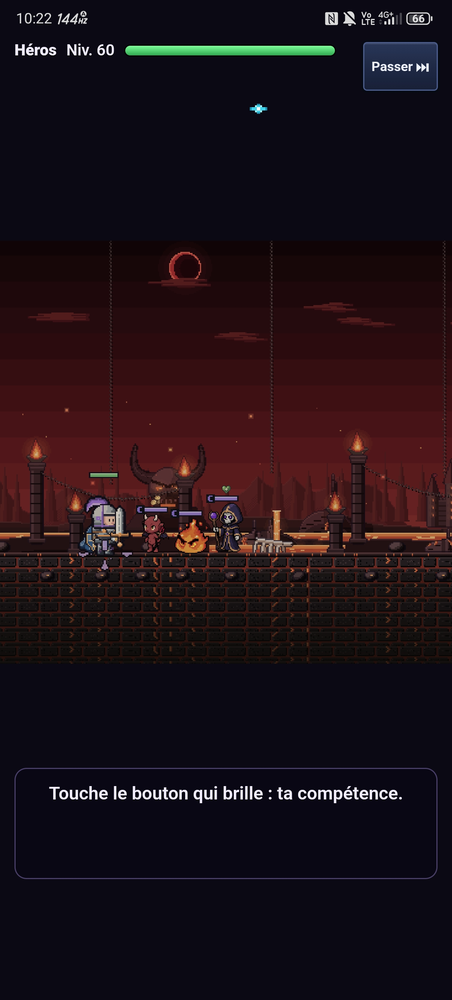
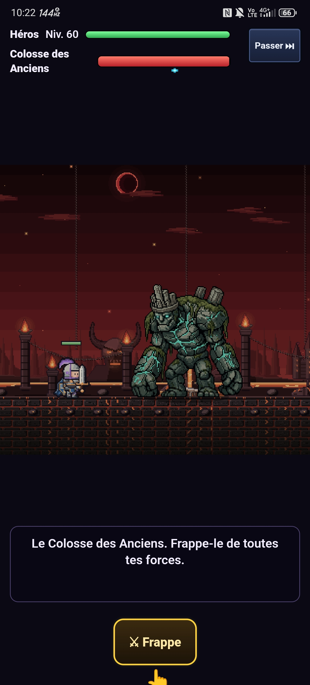
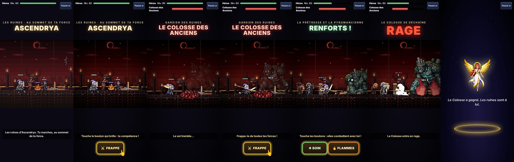
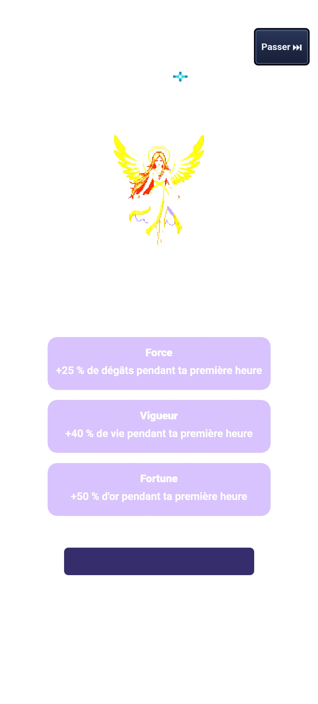
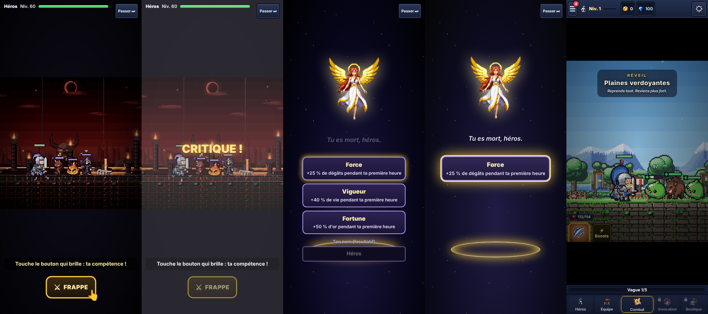
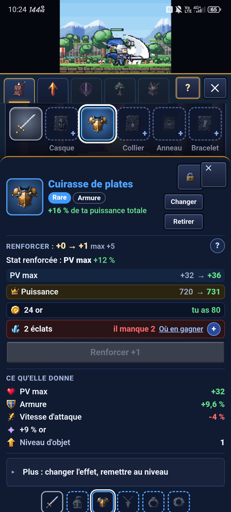
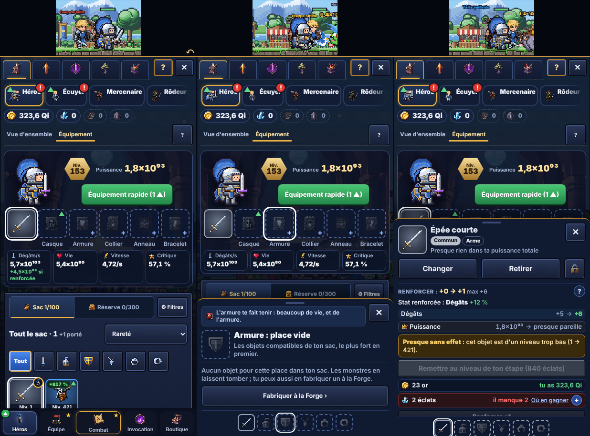
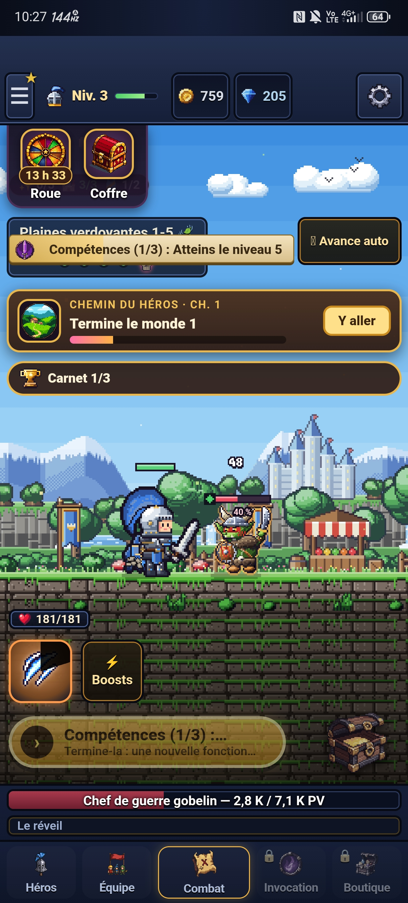
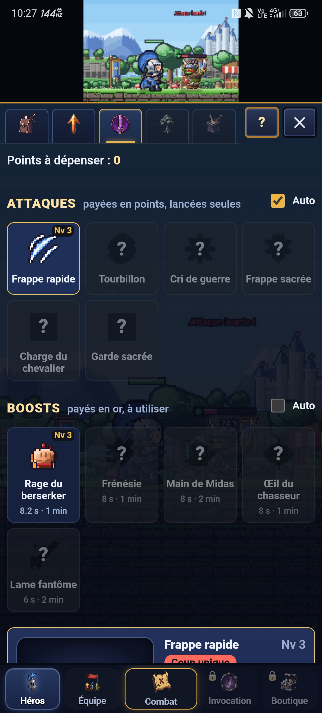
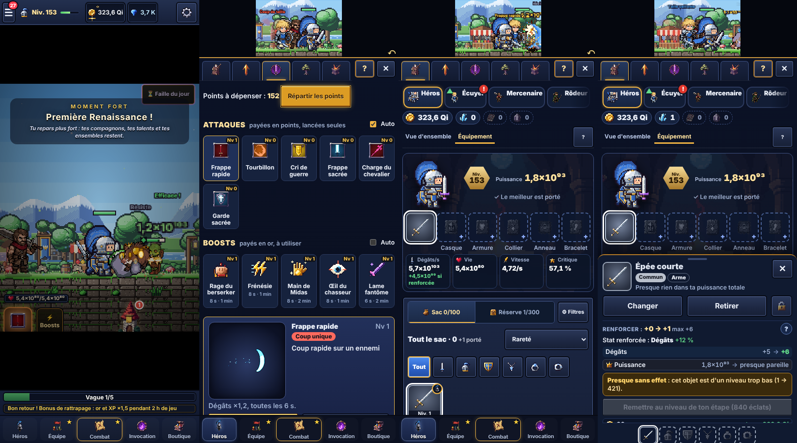

# Ascendrya 10.11.3 : passe téléphone (tuto « film d'action », Équipement stable, écran de jeu propre)

> **Pour Claude** :
> - Copie ce dossier dans le dépôt, sous `docs/prompt-v10.11.3/`.
> - Ouvre avec l'outil Read chaque image citée. `images/joueur/` : captures du joueur sur son téléphone (Android, 1216 × 2688). `images/apres/` : rendu attendu, capturé en 412 × 915.
> - **Le travail est déjà fait** dans la PR #9 (branche `claude/mobile-propre-10.11.3`, commit `558d31c`, CI verte, fusionnable). Le plus simple : fusionner la PR. Sinon, `git apply 10.11.3.patch` sur `main` au commit `1816087f` (10.11.2). Ce document dit **ce que fait** chaque changement, pour le refaire à la main si `main` a bougé.
> - Règle générale : rien n'est supprimé de l'écran sans être remplacé.

## Ce que dit le joueur (24/11, 11 h 12)

> « Je suis sur la version mobile et c'est pas tout bien propre. Le tuto te demande de cliquer sur un bouton et rien ne se passe. Et doit être plus prenant comme un film d'action un peu (à refaire). Quand je me balade dans équipements les fenêtres sautent un peu, puis ça fait pas très ergonomique et jeu mobile. Revois bien tout pour une version mobile propre. »

## Contexte

- Version testée : **10.11.2**, `main` au commit `1816087f` (24/11).
- Test : Playwright en 412 × 915 (`isMobile`, `hasTouch`), partie neuve (prologue, avec `navigator.webdriver` forcé à `false` pour lancer les cinématiques) et `tests/fixtures/endgame.json` (Équipement, Compétences).
- Les changements de style sont dans un nouveau fichier **`src/ui/mobile1012.css`**, chargé en dernier dans `index.html`.

---

## 1. Tuto (prologue) : à refaire en « film d'action »

 

**Constat** :
- « Touche le bouton qui brille » : le bouton est collé tout en bas (`bottom: 24px`). Sur Android, la barre de gestes le coupe (le doigt 👆 est coupé dans la capture 02). Et l'appui fait peu de chose de visible.
- Grand cadre de dialogue vide (hérité de `min-height: 92px`), grands vides au-dessus et au-dessous de la scène.
- Une gemme cyan de la barre du haut dépasse par-dessus le prologue (z-index 9000 trop bas).

**À faire** (`src/ui/prologue.js` + `mobile1012.css`) :
1. **Cartons de titre** qui arrivent en force (zoom 2,6 → 1, flou → net) dans le vide au-dessus de la scène : « ASCENDRYA / Les ruines · au sommet de ta force » (0,3 s), « LE COLOSSE DES ANCIENS / Gardien des ruines » (20,4 s, éclair rouge + secousse), « RENFORTS ! » (50,2 s, vert), « RAGE » (75,2 s, rouge, très grand).
2. **Éclairs d'impact** (calque `.pro-flash`) et secousses : jets de pierre, coups de poing (rouge + vibration 60 ms), rayon, dernier coup.
3. **Ralenti jusqu'à l'appui** (QTE) à 9 s, 24,3 s et 56,2 s : le temps passe à ×0,15, la scène se désature avec un vignettage, le bouton pulse et le doigt apparaît. **Tout l'écran compte** comme appui. Au bout de 6 s réelles, l'action part seule : on ne peut jamais rester bloqué. Remplace l'ancien `autoSkill`.
4. **Retour de l'appui** : éclair, secousse, vibration 45 ms, gros texte au centre : « CRITIQUE ! » ; contre le Colosse « À peine une égratignure… » ; « SOIN ! », « FLAMMES ! » (un appui lance les deux compagnonnes).
5. **Bouton au pouce** : 64 px de haut, majuscules, placé à `max(34px, 5vh)` du bas. Sous-titres façon film (fond noir à 55 %, sans grand cadre), au-dessus du bouton.
6. Bandes de cinéma noires en paysage. Prologue en `z-index: 9900`.
7. Répliques plus courtes : « Touche le bouton qui brille : ta compétence ! », « Frappe-le de toutes tes forces ! », « Touche les boutons : elles combattent avec toi ! ».
8. Pour les tests : `window.__pro = { finish, el, skipTo }`.

Résultat : 

## 2. Réincarnation : l'écran de l'ange délavé

**Cause** : au choix, `.light .pro-rebirth` animait `background: #fff; filter: brightness(3)` sur toute la boîte. Les boutons devenaient illisibles et le champ du nom ressemblait à un bouton vide.

**À faire** : le choix touché brille (halo doré, ×1,05), les autres choix et le nom s'effacent, puis le voile `.pro-white` monte au blanc (1,1 s). L'ange n'a plus de cadre gris (fond transparent, sans ombre). Le champ du nom a son libellé au-dessus, un texte d'exemple « Héros » et 44 px de haut. Le halo doré est caché pendant le choix (il passait sur « Ton nom »).

Résultat : 

## 3. Équipement : les fenêtres qui sautent

**Cause du saut** : `inventory.js`, `afterRender`. À l'ouverture de la fiche (et à chaque changement de personnage), le code faisait `body.scrollTop += …` pour remonter les cases en haut. Toute la page sautait d'environ 110 px. En plus, la hauteur de la feuille changeait d'un objet à l'autre.

**À faire** :
1. Supprimer ce défilement automatique (et `eqPopKey`).
2. Feuille à **hauteur fixe** : `height = max-height = min(82 % de l'écran, max(40 %, place libre sous les cases))`. Elle commence sous les cases, qui restent visibles et touchables.
3. **Tête de la feuille** : poignée centrée, ✕ de 40 px en haut à droite. Le cadenas, « Changer » et « Retirer » passent sur une **rangée de gros boutons de 44 px** sous le nom (le cadenas était sous le ✕).

Résultat : 

## 4. Écran de jeu et onglets sur téléphone

 

1. **Consigne de quête** (`#next-unlock.parchment`) : elle était posée à `top: 100px` fixe et passait sur « Plaines verdoyantes 1-5 » quand la rangée Roue / Coffre poussait la carte. Sur téléphone, `updateNextUnlock` la pose maintenant 6 px sous `#zone-card`. Elle est cachée quand le bouton doré `#next-action` est affiché, car il dit la même chose. Ce bouton affiche maintenant 2 lignes au lieu d'une (`-webkit-line-clamp: 2`).
2. **« Avance auto »** : le caractère `⏵` n'existe pas dans la police Android (carré vide). À remplacer par `▶︎ Avance auto` et `❚❚ Reste sur l'étape`.
3. **Onglets** : le fond du panneau était translucide (84 à 93 %), donc les textes du combat (« Attaque lourde ! ») se voyaient à travers dans Compétences. Sur téléphone, le fond devient opaque (`#0b1226` → `#0a0f1f`).

Résultat : 

## 5. Version et contrôle

- `10.11.3` dans `package.json`, `package-lock.json` et `src/version.js`.
- `npm test` : 809 réussis, 0 échec (CI verte sur la PR #9).
- À revérifier sur un vrai téléphone Android : le bouton du prologue est au-dessus de la barre de gestes, la vibration fonctionne et la fiche d'équipement ne saute plus.
