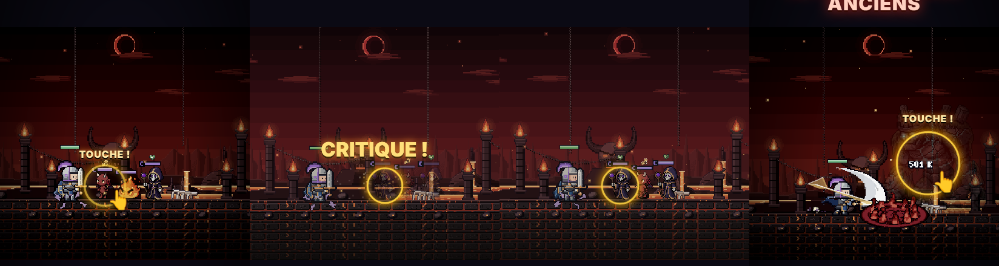
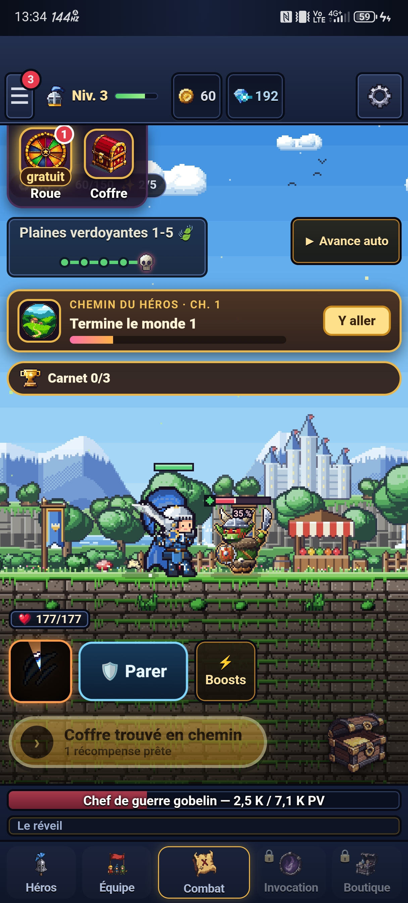
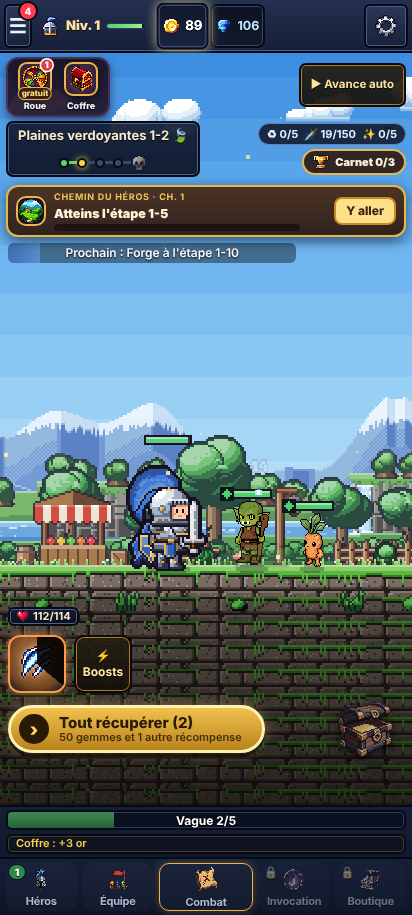

# Ascendrya 10.11.4 : téléphone, 2e tour (tuto « touche le monstre », haut de l'écran compact, cartes de déblocage)

> **Pour Claude** :
> - Copie ce dossier dans le dépôt, sous `docs/prompt-v10.11.4/`.
> - Ouvre avec l'outil Read chaque image citée. `images/joueur/` : capture du joueur (Android). `images/apres/` : rendu attendu, en 412 × 915.
> - **Le travail est déjà fait** dans la PR #10 (branche `claude/mobile-propre-2`, commit `34aa43f0`). Le plus simple : la fusionner. Sinon, `git apply 10.11.4.patch` sur `main` au commit `99b28cab` (10.11.3). Ce document dit ce que fait chaque changement, pour le refaire à la main si `main` a bougé.
> - Il complète la 10.11.3 (prompt `docs/prompt-v10.11.3/`), dont tout reste valable.

## Ce que dit le joueur (24/11, 13 h 38, après avoir testé la 10.11.3)

> « La roue et le coffre se superposent sur autre chose et ça prend beaucoup de place sur l'écran, les icônes sont peut-être trop grandes. Pour le tuto, quand je clique, ça fait des animations mais aucun impact sur les monstres. Pareil pour les infos qui popent à l'écran sur ce qu'on a débloqué : « Essayer maintenant » mène nulle part. Regarde pour recadrer les icônes. »
>
> « Quand tu dis taper, dans le tuto on ne comprend pas qu'il faut taper sur le monstre d'ailleurs. »
>
> « Prends le temps de bien tout corriger. »

---

## 1. Tuto : on touche le monstre, et ça le frappe vraiment

**Constat** : en 10.11.3, l'appui lançait la compétence du héros (`skillAuto`) et des effets d'écran (éclair, « CRITIQUE ! »), mais les monstres ne perdaient presque rien et restaient debout. Le bouton « Frappe » en bas ne disait pas qu'il fallait viser le monstre.

**À faire** (`src/ui/prologue.js`, `src/ui/mobile1012.css`) :
1. Retirer le bouton « Frappe » (il reste dans le HTML, toujours caché). Garder « Soin » et « Flammes » pour les renforts.
2. **Cible sur le monstre** (`.pro-target`) : anneau doré qui pulse, doigt 👆 et « TOUCHE ! », posés chaque image sur le premier monstre vivant pendant les fenêtres `skillPrompt` (9–19 s et 24–48 s). Position : `canvas.getBoundingClientRect()` + `sc.wx(foe.x) + centerShift`, mis à l'échelle par `rect.width / sc.width`. Pour le Colosse, la cible est `fight.boss` : anneau de 104 px, décalé de 20 % de la largeur parce que le Colosse est dessiné large. Le doigt et le texte ne s'affichent que pendant le ralenti.
3. **Chaque appui frappe** : `tapHit` (exporté par `core/combat.js`) 4 fois dans la marche et 2 fois contre le Colosse, avec un éclat (`burst`) sur la cible. Les chiffres de dégâts viennent du moteur (`enemyHit`). Dans la marche, les PV des monstres visibles sont d'abord ramenés à 9 % des dégâts du héros : la salve les fait tomber.
4. Hors ralenti, pendant ces fenêtres, **chaque appui sur l'écran frappe** (au plus un toutes les 250 ms) au lieu de passer à la réplique suivante.
5. Répliques : « Touche les monstres pour frapper ! » et « Touche le Colosse : frappe-le de toutes tes forces ! ».

Résultat :  (avant l'appui, puis « CRITIQUE ! » : les monstres tombent ; enfin, la cible sur le Colosse).

## 2. Haut de l'écran de jeu : Roue et Coffre trop grands, superposés

**Constat** : la rangée d'événements (icônes de 46 px, 130 × 76) recouvrait la barre d'objectifs (`#goals-pill`, « 60/150 · 2/5 », à `top: 44px`). Avec la carte de l'étape, le Chemin du héros et le Carnet empilés, le haut prenait près de 300 px.

**À faire** (téléphone, `max-width: 600px`, `mobile1012.css`) :
- Rangée 1 (en haut) : événements en petites icônes (case de 34 px, image de 28 px, nom en 9 px), et « Avance auto » à droite.
- Rangée 2 (68 px) : la carte de l'étape à gauche ; à droite, la barre d'objectifs, puis le Carnet en puce (sorti de la colonne et posé à `top: -36px` de `#hq-left`).
- Rangée 3 (132 px) : le Chemin du héros, plus compact (monde en 30 px, titre en 12,5 px).
- La consigne `#next-unlock` se pose sous la plus basse des deux : la carte de l'étape ou `#hq-left` (`ui.js`, `updateNextUnlock`).

Résultat :  (le haut de l'écran s'arrête vers 240 px au lieu de 300, sans chevauchement).

## 3. « Essayer maintenant » mène nulle part

**Cause** : `learn.js`, `maybeLearnCard`. La carte « Nouveau » d'une notion arrivait à son étape (Compagnons à l'étape 8, Forge à la 10…) même quand l'onglet était encore fermé par sa mini-quête. `ui.openTab()` ne fait rien sur un onglet fermé (`tabVisible[tab] === false`), donc le bouton était sans effet.

**À faire** :
1. Une carte n'est choisie que si son onglet est ouvert (`!x.tab || ui.tabVisible[x.tab] !== false`). Sinon elle attend, sans être marquée comme vue.
2. Filet de sécurité : après `openTab`, si l'onglet n'est pas ouvert, afficher le message « <Notion> : termine la mini-quête en cours pour l'ouvrir ». Même chose pour les cartes du Bastion (`bastion-cards.js`).

Contrôle : partie neuve avancée à l'étape 9. Améliorations, Équipement, Compétences et Coffre de butin ouvrent leur écran ; Compagnons (encore fermé) attend.

## 4. Divers

- Pastille du bouton Héros : sur téléphone, le chiffre seul (« 1 » au lieu de « 1 objet », qui passait sur l'icône).
- Arène : le bouton « Combattre » collé en bas (`.ct-go`) a un fond plein ; les étages ne se voient plus à travers.

## 5. Version et contrôle

- `10.11.4` dans `package.json`, `package-lock.json` et `src/version.js`.
- `npm test` : 810 réussis, 0 échec.
- Les 21 onglets ont été revus en 412 × 915, sans autre chevauchement relevé.
- À revérifier sur un vrai téléphone Android : la cible tombe bien sur le monstre (le cadrage du canvas diffère selon la densité d'écran).
