# Ascendrya 10.11 : lisibilité et ergonomie (retour en arrière depuis la 10.9)

> **Pour Claude** :
> - Copie ce dossier dans le dépôt, sous `docs/prompt-v10.11/`.
> - Ouvre avec l'outil Read chaque image citée (`images/actuel/`). Les images 01 à 04 sont les captures du joueur ; les autres sont les miennes.
> - Ce prompt passe **avant** la partie 9 (animations) de la 10.10. Les parties 1 à 8 de la 10.10 restent valables : quand un point est déjà demandé là-bas, je renvoie au paragraphe sans le répéter.
> - Règle générale : **rien n'est supprimé de l'écran sans être remplacé**. La 10.9 a caché des informations pour « alléger », et le joueur les a perdues.

## Ce que dit le joueur (23/11, 23 h 18)

> « Tout est mal positionné, plus rien au centre, tout sur la gauche, et ça se superpose pour certains. Même dans Héros les compagnons passent sur les encadrés. Dans les Améliorations je n'ai plus les effets à up. Dans le Bastion je n'avais pas compris que je devais mettre un ouvrier. Bref, vérifie bien la lisibilité et l'ergonomie : là on est moins bien qu'avant. »
>
> « Fais attention également pour la version mobile, que ce soit aussi ergonomique. »

## Contexte

**Version testée** : Ascendrya **10.9.2**, branche `main`, commit `4229fe53` du 23/11 (23 h 11, heure de Paris). Comparée à la **10.8.1** (commit `6f3b1576`).

**Comment** : 22 onglets capturés dans 4 tailles, sur les deux versions, avec la partie de fin de jeu (`tests/fixtures/endgame.json`, `playSeconds` à 1e5 pour afficher l'en-tête complet), puis la même partie avec peu d'or, et une nouvelle partie.

| Format | Taille | Remarque |
|---|---|---|
| Écran du joueur | 2548 × 1390 | Même taille que sa capture 01 (fenêtre agrandie) |
| PC courant | 1920 × 1080 | |
| PC fenêtre | 1116 × 993 | |
| Téléphone | 390 × 844 | |

**Priorités** :
1. Améliorations (§ 1) : c'est une perte d'information, à corriger en premier.
2. Fiche Héros (§ 2) et Bastion (§ 3).
3. Centrage sur grand écran (§ 4 et § 5).
4. Téléphone (§ 6), nouveau joueur (§ 7), contrôle automatique (§ 8).

---

## 1. Améliorations : les effets ont disparu

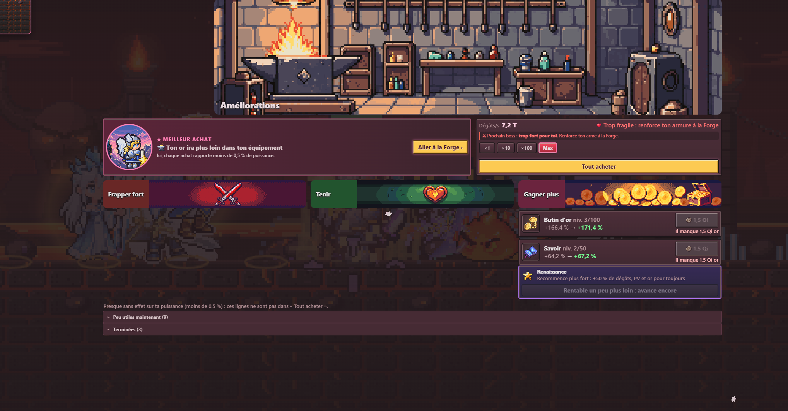

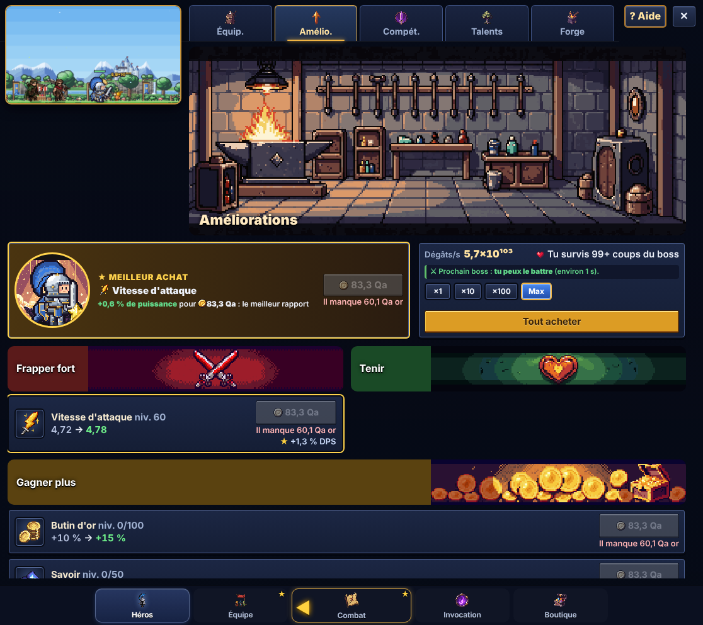

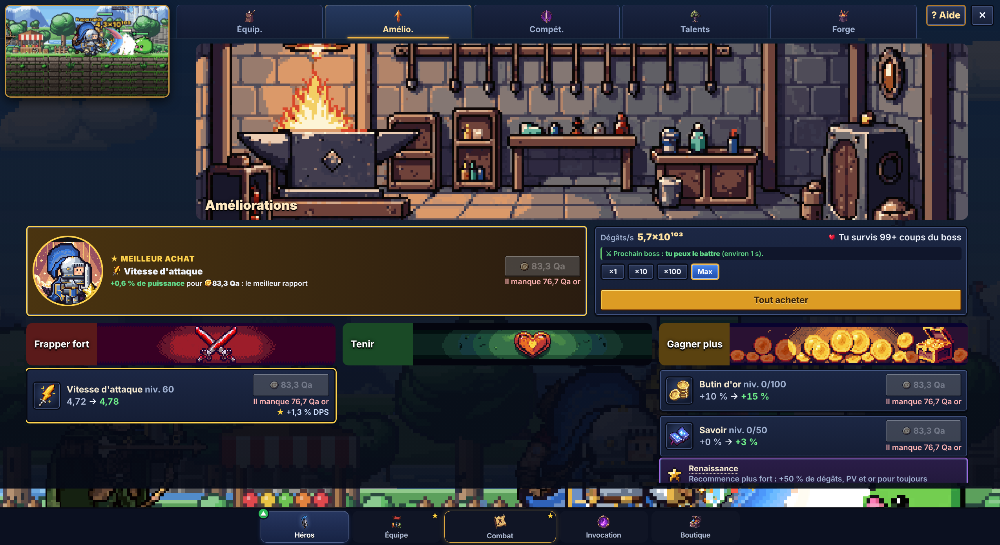

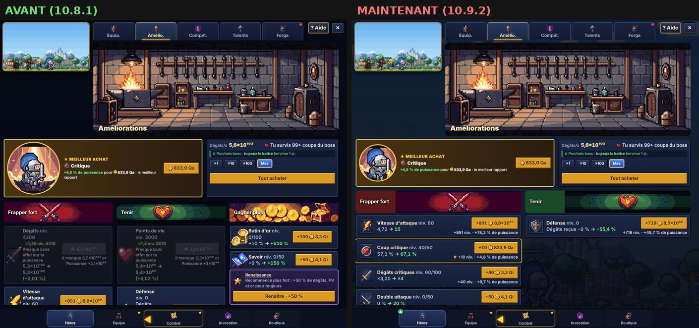

**Constat** :
- Chez le joueur (Terres maudites 6-9, 34,5 Qa d'or), les colonnes **« Frapper fort » et « Tenir » sont vides** : seul le titre illustré reste. Les 9 lignes sont pliées tout en bas dans « Peu utiles maintenant (9) », sous le pli de l'écran. Il ne voit plus ce que fait chaque amélioration ni ce qu'elle coûte.
- Je l'ai reproduit sur la partie de fin de jeu avec peu d'or : en 1116 × 993, « Tenir » est vide à côté de « Frapper fort », et « Gagner plus » passe sur toute la largeur en dessous.
- En 10.8.1, ces lignes restaient **dans leur colonne**, grisées, avec leur effet (« 5,3×10¹⁰² → 5,3×10¹⁰² (+0,01 %) ») et ce qui manque.
- Le bouton « Tout acheter » reste doré quand rien n'est achetable.
- En grand écran, l'image de la forge commence à droite de la mini-fenêtre (x = 390) alors que les cartes commencent à x = 55 : le haut et le bas de la page ne sont pas alignés.

**Cause** : `src/ui/panels/upgrades.js`, ligne 168 : `if (weak && !cat && !beginner) { weakCards.push(html); return ''; }` sort la ligne de sa colonne (partie 6 de la 10.9). Avec peu d'or, `bulkPlan` achète 0 niveau, le calcul se fait sur 1 niveau, le gain passe sous `WEAK_UPGRADE_PCT` (0,5 %), et **toutes** les lignes deviennent « peu utiles ».

**À faire** :
1. Une ligne **ne quitte jamais sa colonne**. Retirer le pli « Peu utiles maintenant » et la phrase au-dessus.
2. Une ligne « peu utile » reste à sa place, en version compacte : icône, nom, niveau, **effet avant → après**, prix. Elle est grisée à 70 % et porte une petite étiquette « peu utile » (au survol : « moins de 0,5 % de puissance, pas dans Tout acheter »). L'effet reste lisible en clair.
3. Ne juger « peu utile » que sur le gain **par niveau** (`count = 1`), jamais sur un achat de 0 niveau faute d'or : manquer d'or n'est pas « peu utile ».
4. Une colonne a toujours au moins ses lignes en cours. Si une colonne n'a plus que des lignes terminées, afficher « Tout est au maximum ✓ » sous son titre, au lieu d'un vide.
5. Équilibrer : 3 colonnes égales en grand écran ; en 1116, 2 colonnes avec « Tenir » puis « Gagner plus » dans la 2e (déjà demandé en 10.10 § 6, l'image de tête à 140 px au plus).
6. « Tout acheter » grisé quand rien n'est achetable, avec « Il manque X or » dessous.
7. Aligner l'image de tête sur la grille des cartes (voir § 5).

**Test** : avec la fixture de fin de jeu et `state.gold = 1000`, chaque colonne affiche au moins une ligne avec son effet « avant → après », dans les 4 tailles. Un test Node vérifie que `render()` ne renvoie aucun `upg-group` sans `upg-card`.

---

## 2. Fiche Héros : le personnage passe sur les cadres

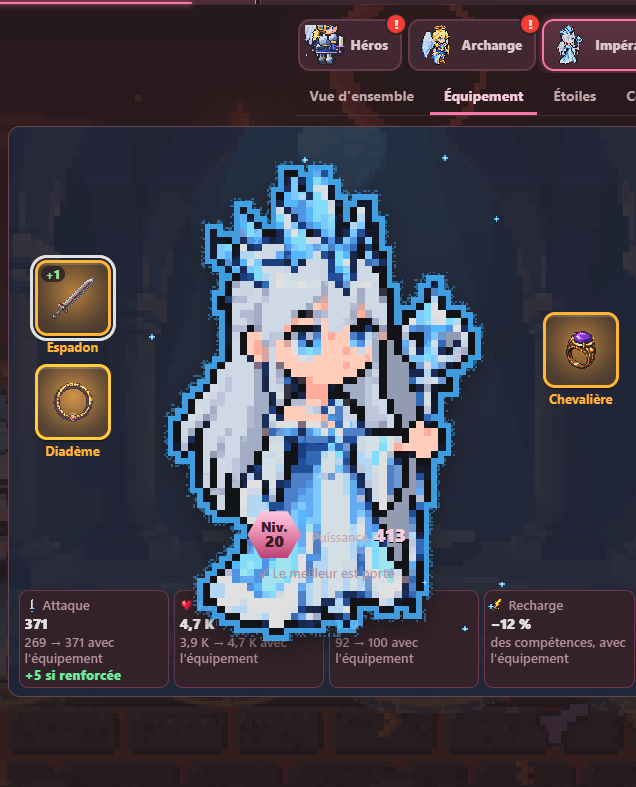

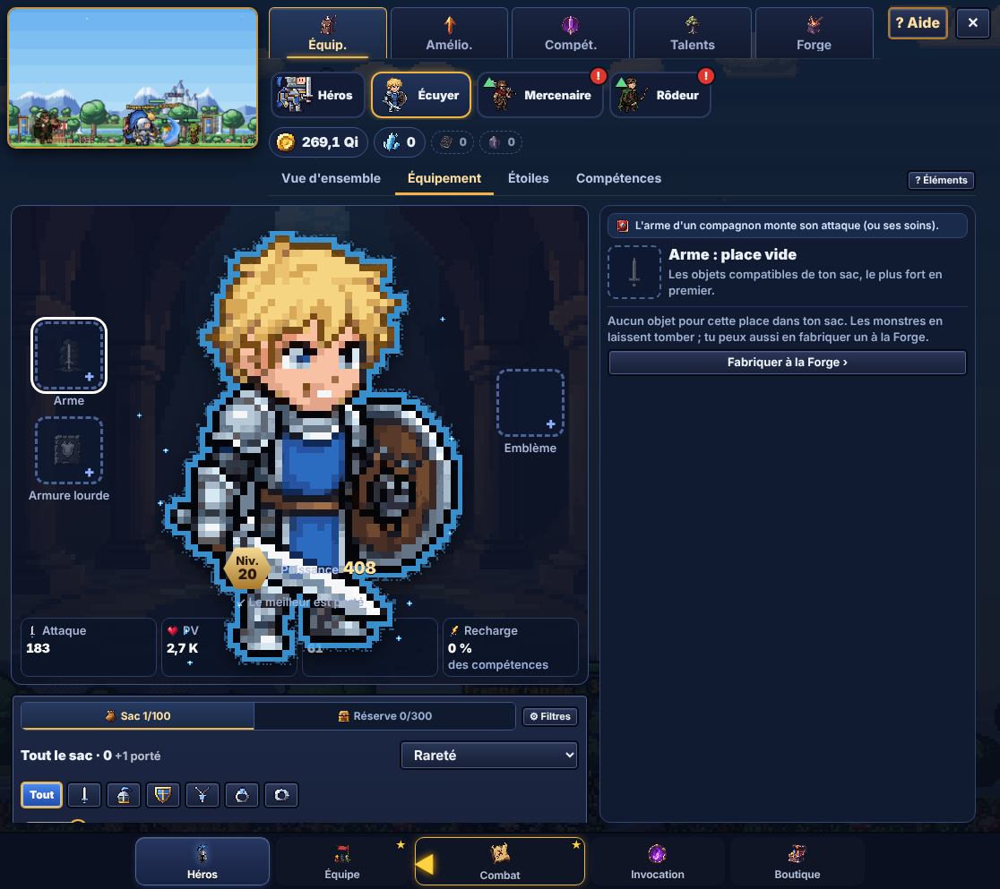

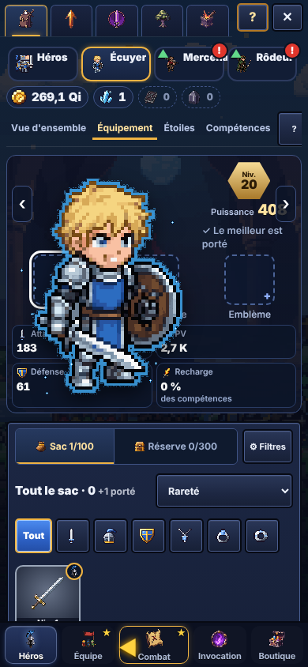

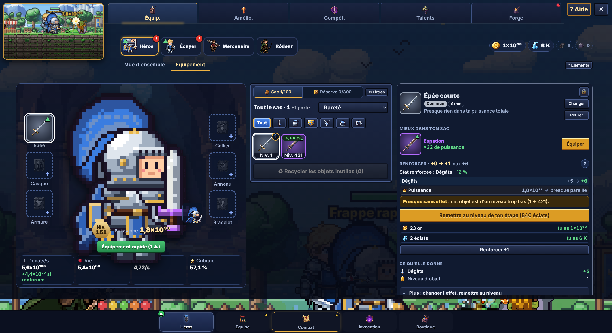

**Constat** :
- Le grand dessin du compagnon (Impératrice chez le joueur, Écuyer chez moi) déborde de sa case : il descend **sur les cadres de statistiques** (Attaque, PV, Défense, Recharge), cache le nom de la 3e carte (on lit « 4,72/s » sans « Vitesse »), et passe sur la pastille « Niv. 20 », « Puissance 408 » et « Le meilleur est porté ».
- Le héros a le même défaut, en plus petit, en 1116 et en grand écran.
- **Téléphone** : le dessin couvre la case « Arme » (on ne peut plus la toucher) et la carte des Dégâts. « Puissance 1,8×10⁹³ » est coupé par la flèche › (« 1,8×1( »). Les noms des onglets de personnage sont coupés (« Écuye », « Mercena »).
- La 10.8.1 avait déjà ce défaut sur le héros ; il est plus visible depuis les dessins HD des compagnons.

**Cause** : `.eq-art-box` (`src/ui/panels/inventory.js`, `figure()`, ligne 156) ne coupe rien. La hauteur de l'image est limitée (`src/ui/hud106.css` ligne 333, `src/ui/page.css` lignes 96 à 102), mais pas la case : l'image dépasse vers le bas et la pastille `.eq-id` est posée par-dessus.

**À faire** :
1. La case du personnage a une hauteur fixe, calculée sur la place libre entre les onglets et la rangée de statistiques. L'image y tient en entier (`object-fit: contain`, centrée en bas). Elle ne passe jamais au-dessus d'une autre case (`overflow: hidden` sur la case, ou `contain: paint`).
2. Niveau et Puissance : **sous** la case, sur une ligne à eux, jamais par-dessus l'image. « Le meilleur est porté » ou « Équipement rapide » sur la même ligne, à droite.
3. Rangée des statistiques : en dessous, sans rien par-dessus. Chaque carte garde son nom (« Vitesse »).
4. Téléphone : dessin à gauche (110 px de large au plus), Niveau et Puissance à droite, puis les 6 cases d'objets **en grille sous le dessin** (2 rangées de 3), jamais derrière lui. Le nombre de Puissance a sa place entière, la flèche › est sortie de la ligne.
5. Onglets de personnage sur téléphone : icône + nom court sur 2 lignes, ou glissement horizontal avec un dégradé sur le bord. Jamais de nom coupé net.

**Test** : pour le héros et les 31 compagnons, dans les 4 tailles, le rectangle de l'image ne chevauche ni une case d'objet, ni une carte de statistique, ni `.eq-id`.

---

## 3. Bastion : on ne comprend pas qu'il faut poser un ouvrier

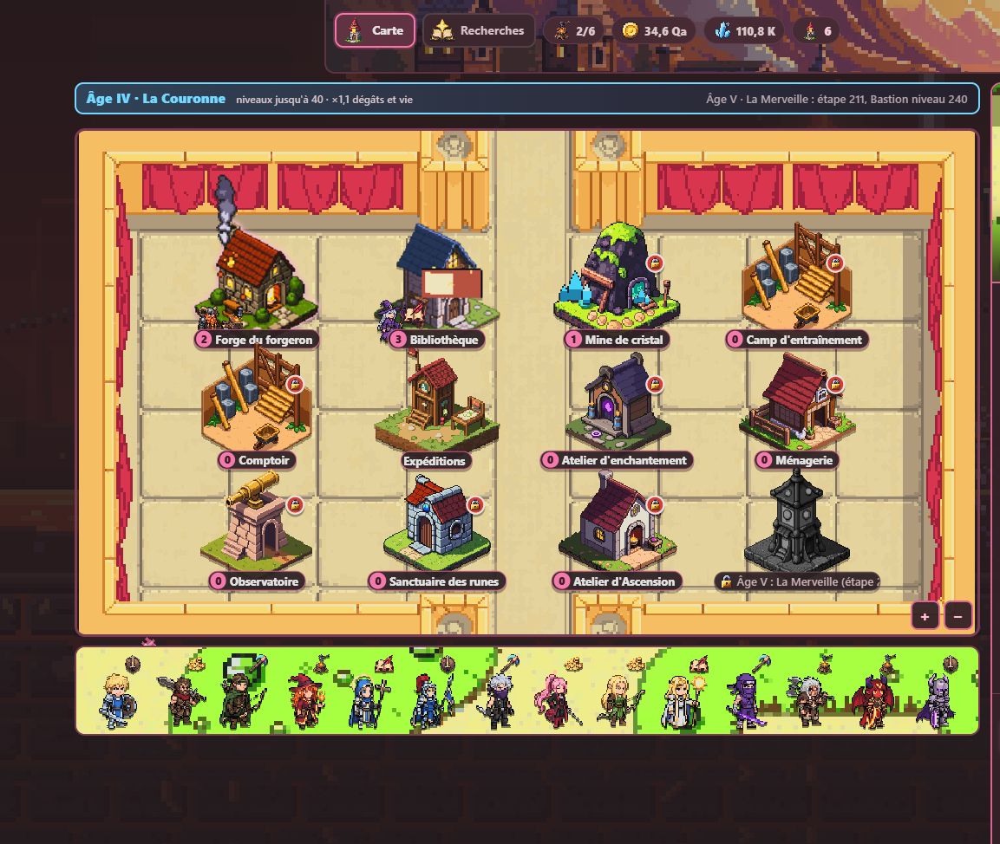

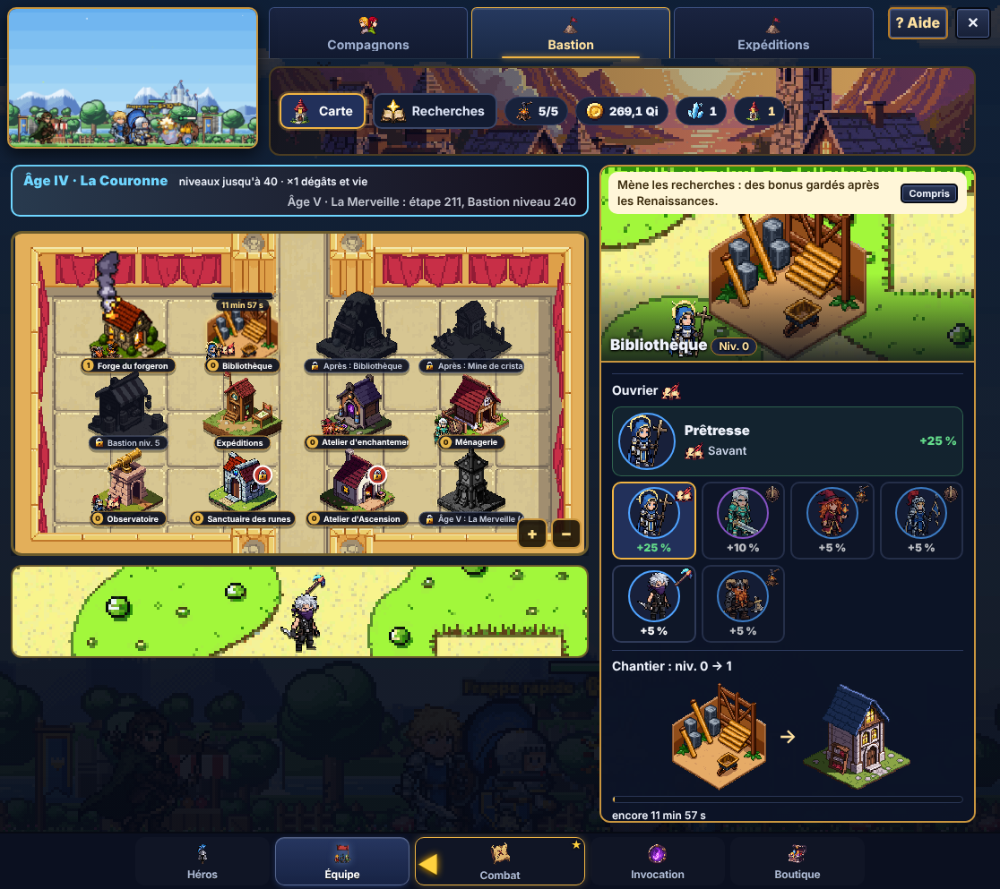

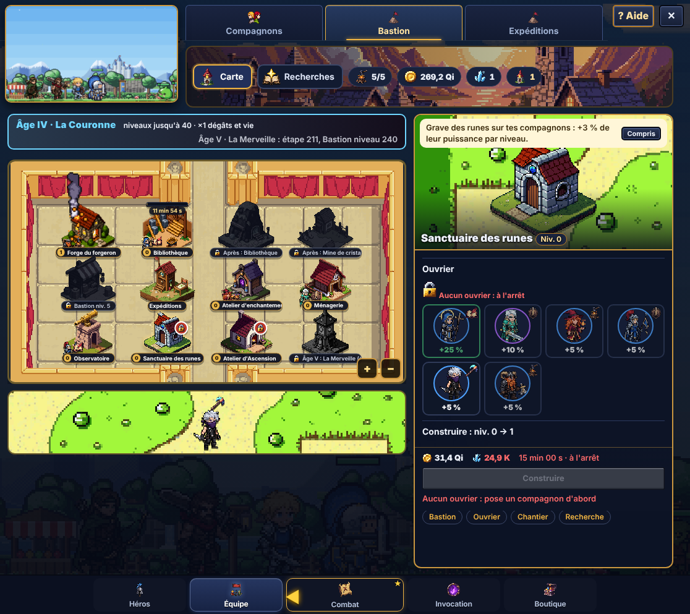

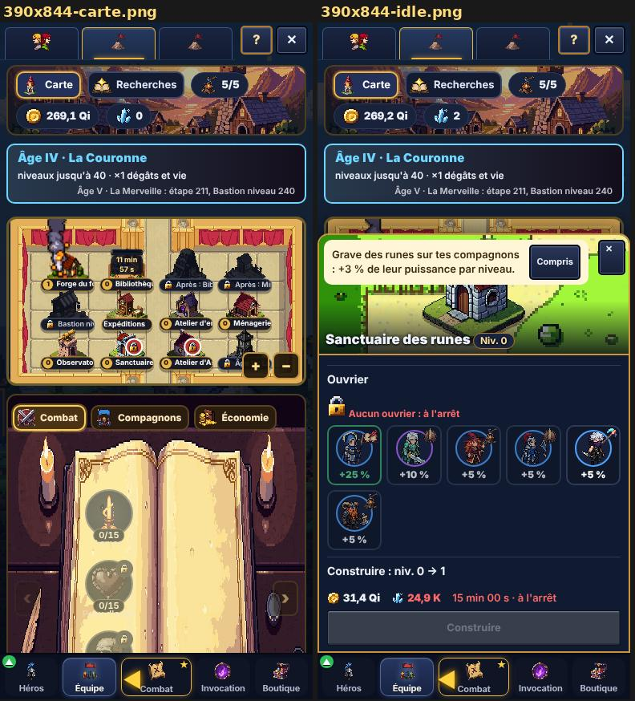

**Constat** :
- Sur la carte, un bâtiment sans ouvrier porte un **rond rouge avec un cadenas** (`.bs-need`, `src/ui/panels/camp.js` ligne 240). Le joueur le lit comme « bâtiment verrouillé », pas comme « il manque quelqu'un ». Chez lui, 8 bâtiments ont ce cadenas, et le « 0 » rose devant leur nom (leur niveau) n'est pas expliqué.
- En haut, la puce « 2/6 » (ouvriers posés / places) n'a ni nom ni icône claire.
- La bande verte sous la carte (`.bs-idlers`) montre 14 compagnons avec un outil, **sans aucun texte**. Un toucher ouvre un bâtiment au hasard.
- Dans la fiche d'un bâtiment sans ouvrier : « 🔒 Aucun ouvrier : à l'arrêt » en petit rouge, puis une grille de portraits avec seulement « +25 % ». Rien ne dit « touche un portrait pour le poser ici ». La raison n'arrive qu'en bas, sous le bouton gris « Construire » : « Aucun ouvrier : pose un compagnon d'abord ».
- La carte est petite en 1116 (500 px de large, étiquettes en 8 px) et la fiche prend la moitié de l'écran.
- Téléphone : à l'ouverture, la carte est couverte par 2 fenêtres (déjà en 10.10 § 2), puis le livre des recherches prend toute la suite de l'écran.

**À faire** :
1. **Badge « ouvrier manquant »** : remplacer le cadenas par une pioche blanche sur fond orange, avec un « + » et une pulsation lente. Le cadenas reste réservé aux bâtiments vraiment fermés (âge, niveau du Bastion).
2. Étiquette du bâtiment sans ouvrier : « + Ouvrier » à la place du chiffre de niveau, en orange.
3. Puce du haut : « 👷 Ouvriers 2/6 ». Si des places sont libres et des compagnons aussi : la puce est orange, et un toucher ouvre le premier bâtiment sans ouvrier.
4. **Bande des compagnons libres** : un titre au-dessus, « Compagnons libres (14) : pose-les dans tes bâtiments », et un bouton « Poser au mieux » qui remplit les places vides avec le meilleur métier pour chaque bâtiment (montrer ce qui a été fait, comme le bandeau « Ton Bastion se met au travail »).
5. Fiche du bâtiment sans ouvrier : en haut, un encadré orange « Ce bâtiment est à l'arrêt : choisis un ouvrier », avec une flèche vers la grille. Sous chaque portrait : nom court et bonus (« Prêtresse +25 % »), le meilleur choix marqué ★. Un toucher pose l'ouvrier, un petit son et l'ouvrier apparaît devant le bâtiment.
6. Bouton « Construire » grisé faute d'ouvrier : son texte devient « Pose un ouvrier d'abord ↑ » et un toucher fait défiler jusqu'à la grille.
7. **Première visite** (une seule fois, après le bandeau « Nouvel âge » et le bandeau de travail, voir 10.10 § 2.5) : une main qui montre un bâtiment avec le badge, puis un portrait, avec la bulle « Pose un compagnon : sans ouvrier, rien n'avance. »
8. Carte en 1116 : la carte prend 60 % de la largeur et la fiche 40 % ; étiquettes en 11 px au moins (noms courts de la 10.10 § 2.1).

**Test** : partie où il reste au moins une place et un compagnon libre. En 1116 et 390, il y a un élément visible « + Ouvrier » ou le badge pioche sur chaque bâtiment ouvert sans ouvrier, et aucun `.bs-need` ne contient `icon_lock`. « Poser au mieux » remplit toutes les places.

---

## 4. Écran de jeu en grand écran : tout est à gauche

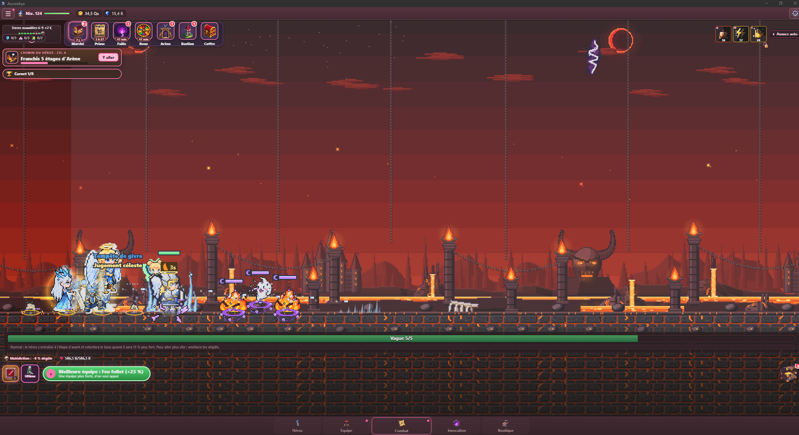

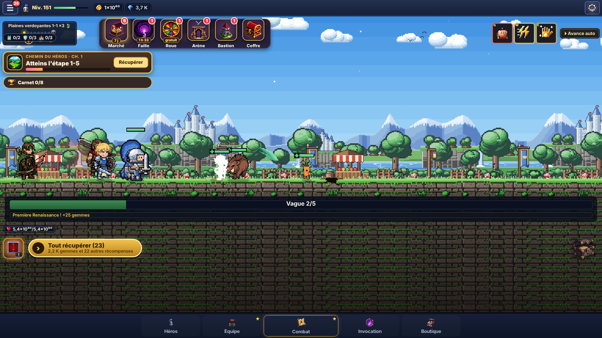

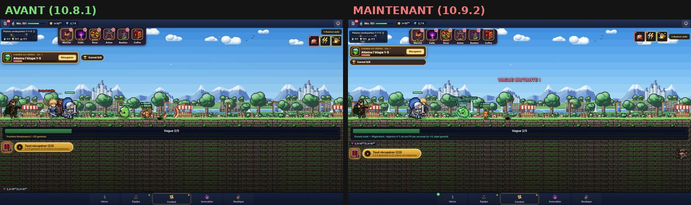

**Constat** (2548 × 1390 et 1920 × 1080) :
- Le combat se joue à gauche : en 2548 px de large, le héros est à x ≈ 500 px et les monstres s'arrêtent avant x ≈ 1 050 px ; en 1920, avant x ≈ 1 000 px. Le reste de la scène est un décor vide.
- Sous la barre de vague, **environ 300 px de mur de briques vide** (en 2548 × 1390). On y trouve seulement, collés à gauche, les PV du héros (petite pastille), l'Ultime et « Tout récupérer » ; le coffre est seul tout à droite.
- La rangée d'événements (Marché, Prime, Faille, Roue, Arène, Bastion, Coffre) est collée à la carte de zone, les boosts et « Avance auto » sont collés à droite : rien n'est au centre.
- La carte « Chemin du héros » et le Carnet s'empilent à gauche, au-dessus de l'équipe.
- Le message de mutation ou de Renaissance est écrit **par-dessus le combat**, en gros, au milieu des monstres.

**Cause** : la position du héros est fixe depuis le bord gauche (`HERO_X`, `src/render/scene.js` ligne 100) ; la scène s'élargit vers la droite sans recentrer le combat. La bande du bas a une hauteur fixe qui ne dépend pas de la taille.

**À faire** :
1. **Combat au centre** : au-delà de 1300 px de large, décaler la caméra pour que le point de rencontre (entre le héros et le premier monstre) soit à 45-50 % de la largeur. L'équipe reste groupée derrière le héros. Le décor continue des deux côtés.
2. **Moins de vide en bas** : la scène grandit en hauteur pour que le sol soit à environ 65 % de la hauteur de la fenêtre ; la bande du bas ne garde que ce qu'il faut (≈ 120 px).
3. **Une rangée d'actions centrée** sous la barre de vague, 1200 px de large au plus : [PV du héros] [Ultime] [Tout récupérer] … [coffre]. Plus d'élément isolé contre un bord.
4. **En-tête** : carte de zone à gauche, boosts et « Avance auto » à droite (inchangés), et la **rangée d'événements centrée** dans l'espace entre les deux.
5. **Barre de vague** : 1400 px de large au plus, centrée, texte en 16 px.
6. Les grands messages (« Vague mutante », « Première Renaissance ») s'affichent dans le ciel, au-dessus du combat, jamais sur les monstres.
7. Rien ne change en 1116 et sur téléphone, sauf la rangée d'actions qui reste groupée.

**Test** : en 1920 × 1080 et 2548 × 1390, le centre du segment héros → premier monstre est entre 40 et 55 % de la largeur ; la hauteur sans aucun élément entre la barre de vague et le menu du bas est inférieure à 160 px ; la rangée d'événements est centrée à ± 5 %.

---

## 5. Onglets en grand écran : volet ou page, et contenu centré

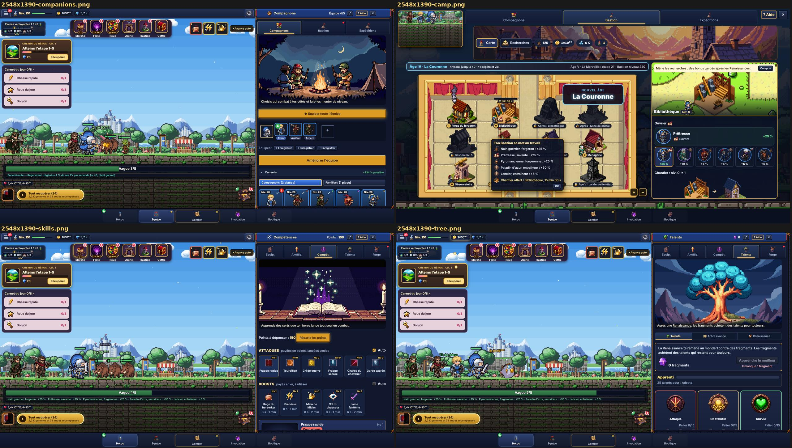

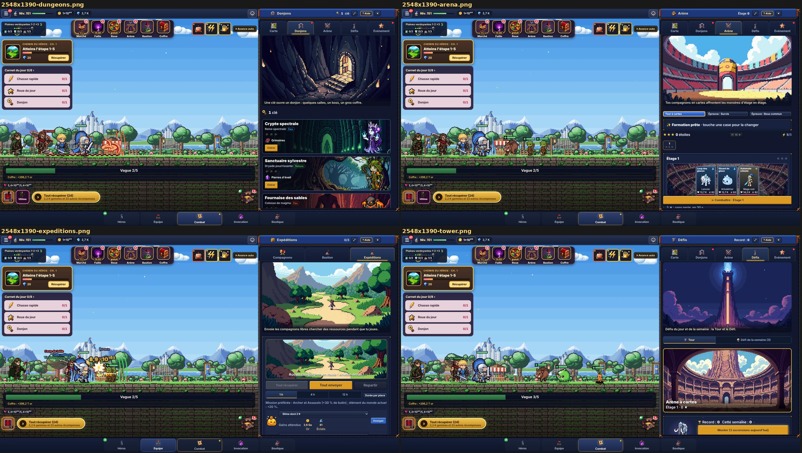

**Constat** :
- Dans un même menu, les onglets n'ont pas la même forme. Menu Héros : Équip., Amélio. et Forge s'ouvrent **en page plein écran**, Compét. et Talents **en volet à droite**. Menu Équipe : Bastion en page, Compagnons et Expéditions en volet. Passer d'un onglet à l'autre fait sauter tout l'écran.
- En page, le haut commence à droite de la mini-fenêtre (x ≈ 390) alors que le contenu commence au bord gauche (x ≈ 55) : rien n'est aligné, et rien n'est centré. Sur 2548 px, les cartes s'étirent sur toute la largeur.
- En volet (1/3 de la largeur), chaque onglet commence par une **illustration de 350 px de haut** et une phrase. Le contenu utile commence à mi-hauteur : Compagnons ne montre ses compagnons qu'en bas, Donjons montre 2 donjons et demi.
- Sous les pages, une bande de 40 px de scène (pixels du décor) coupe le bas du contenu (déjà en 10.10 § 4.4, toujours là en 10.9.2).

**Cause** : `PAGE_TABS` (`src/ui/page.js` ligne 17) ne contient que 4 onglets : `inventory`, `forge`, `camp`, `upgrades`.

**À faire** :
1. **Même forme dans un menu** : à partir de 1300 px de large, tous les onglets des menus Héros et Équipe s'ouvrent en page (ajouter `skills`, `tree`, `companions`, `expeditions` à `PAGE_TABS`). Les autres menus (Combat, Invocation, Boutique, Carnet) restent en volet. En dessous de 1300 px, la règle actuelle reste.
2. **Page centrée** : le contenu d'une page tient dans une colonne de **1600 px au plus, centrée**. La mini-fenêtre reste en haut à gauche, hors de cette colonne. Les onglets du haut, la bannière et les cartes partagent les mêmes bords gauche et droit.
3. **Illustrations des volets** : 120 px de haut au plus. Après la première visite d'un onglet, l'illustration se réduit à une bande de 64 px avec le titre.
4. La page descend jusqu'au menu du bas (10.10 § 4.4).

**Test** : en 1920 et 2548, pour chaque onglet en page, `|marge gauche − marge droite| < 24 px` sur `.pg-main`, et le bord gauche de `.pg-top` égale celui de `.pg-main` à 8 px près. Pour chaque volet, le premier bouton d'action est visible sans faire défiler.

---

## 6. Téléphone : lisibilité et ergonomie

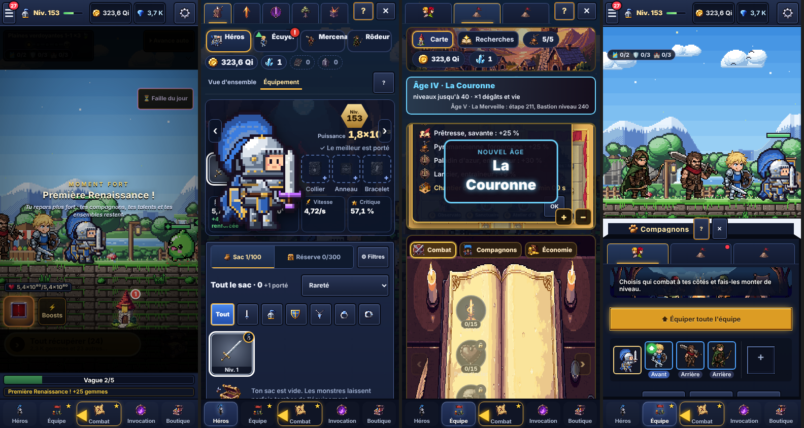

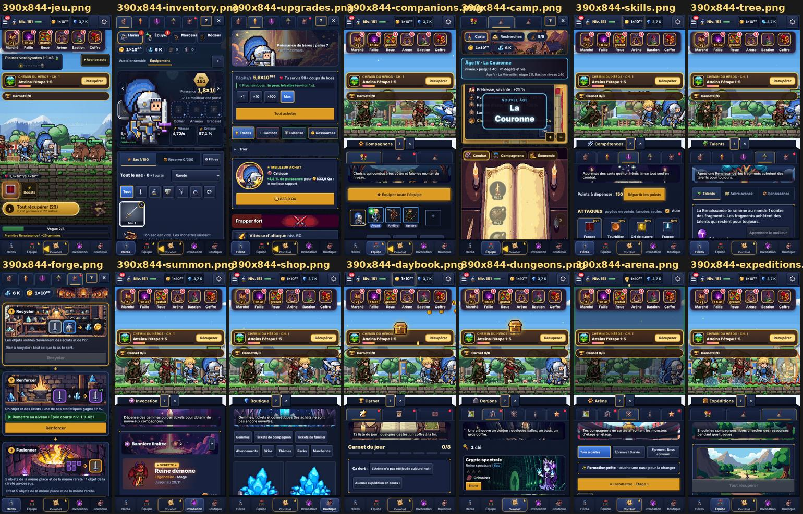

**Constat** (390 × 844) :
- **Panneaux à mi-hauteur** : Compagnons, Compétences, Talents, Invocation, Boutique, Carnet, Donjons, Arène, Expéditions s'ouvrent dans la moitié basse, sous la scène, et commencent par leur illustration. Dans Compagnons, on voit la phrase d'accueil, « Équiper toute l'équipe » et la rangée de l'équipe, mais **aucun compagnon** sans faire défiler (déjà vu en 10.10 § 7.3, toujours là).
- **Écran de jeu** : en haut, la carte de zone et « Avance auto » passent sous un voile sombre quand un message s'affiche ; le grand texte « Première Renaissance ! » est écrit sur l'équipe.
- **Fiche Héros** : voir § 2.4 et § 2.5.
- **Bastion** : voir § 3 ; à l'ouverture, la carte est couverte (10.10 § 2.5).
- **Améliorations** : l'image du héros, la carte des dégâts, les catégories, « Trier » et « Meilleur achat » passent avant la première ligne d'amélioration, qui n'arrive qu'à 760 px de haut.
- Les sous-onglets du haut n'ont qu'une icône (10.10 § 7.3).

**À faire** :
1. Sur téléphone, **tous les onglets s'ouvrent en plein écran** (comme le Bastion aujourd'hui), avec la scène réduite à une bande de 120 px en haut (10.10 § 7.3, à faire dans cette version).
2. Illustration de tête : 96 px au plus sur téléphone, jamais plus d'un quart de l'écran.
3. Améliorations sur téléphone : dans l'ordre, la ligne « Dégâts/s · survie », les quantités et « Tout acheter » sur une seule rangée, puis directement les lignes d'amélioration. « Meilleur achat » devient l'étoile ★ sur la ligne concernée, et le héros en image disparaît (il est déjà dans la scène).
4. Les grands messages de la scène passent en bandeau dans le ciel, jamais sur l'équipe ni sur la carte de zone.
5. Cibles tactiles : 44 px au moins pour tout bouton et toute case d'objet.

**Test** : en 390 × 844, pour chaque onglet, le premier élément d'action (une ligne d'amélioration, un compagnon, un donjon, une offre…) est visible sans faire défiler ; aucun bouton sous 44 px.

---

## 7. Nouveau joueur sur téléphone : deux bulles à la fois

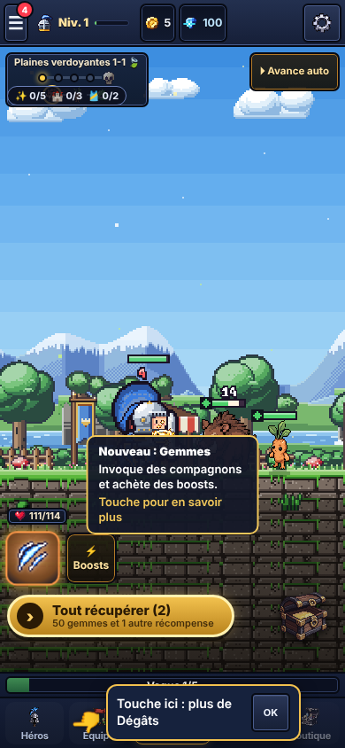

**Constat** (nouvelle partie, 390 × 844, première seconde) :
- Deux bulles sont ouvertes en même temps : « Nouveau : Gemmes » au milieu du combat (elle couvre le héros) et « Touche ici : plus de Dégâts » en bas.
- La main de la seconde bulle pointe **entre Héros et Équipe**, alors que les Dégâts sont dans Héros.
- La bulle du bas couvre la barre « Vague 1/5 » et la moitié du menu.

**À faire** :
1. Une seule bulle à la fois (la règle `calmStart` de la 10.1 vaut aussi pour les bulles « Nouveau : … » : elles attendent que la bulle de tutoriel soit fermée).
2. La main se pose sur le centre du bouton visé (Héros).
3. Les bulles « Nouveau : … » se posent au-dessus de la scène, jamais sur le héros.

---

## 8. Contrôle automatique : ce qu'il doit voir

Le contrôle de la 10.9 (`tools/audit-109.mjs`) n'a rien vu de tout ça. En plus de la 10.10 § 8, ajouter :

1. **Groupe vide** : un titre de groupe (`.upg-group-head`, et tout titre de section illustré) sans aucune ligne sous lui.
2. **Image qui déborde sans couper** : une image dont le rectangle chevauche un autre bloc (carte, case, bouton) de plus de 8 px, même si sa case ne coupe pas (c'est le cas de la fiche Héros).
3. **Centrage** : sur l'écran de jeu et chaque page, écart entre marge gauche et marge droite du contenu.
4. **Vide** : hauteur la plus grande sans aucun élément interactif entre la barre de vague et le menu du bas.
5. **Premier élément utile** : sur téléphone, position du premier bouton d'action de chaque onglet (doit être dans l'écran).
6. Lancer le contrôle avec **2 parties** : la fixture de fin de jeu, et la même avec `gold = 1000` (le cas du joueur).
7. Ajouter la taille **2548 × 1390** (l'écran du joueur) et **1920 × 1080**.

Le test échoue sur : groupe vide, image qui chevauche une carte de statistique ou une case d'objet, combat hors de 40-55 % en grand écran.

---

## 9. Tests de fin

- **Améliorations** : avec `gold = 1000`, chaque colonne montre ses lignes avec leur effet, dans les 4 tailles.
- **Héros** : aucun dessin sur une case ou une carte, pour tous les personnages, dans les 4 tailles.
- **Bastion** : badge pioche et « + Ouvrier » sur chaque bâtiment sans ouvrier, « Poser au mieux » fonctionne, aucun cadenas sauf sur un bâtiment fermé.
- **Écran de jeu** : combat centré et pas de grand vide en 1920 et 2548.
- **Pages** : même forme dans un menu, contenu centré, 1600 px au plus.
- **Téléphone** : tous les onglets en plein écran, premier bouton visible sans défiler.
- **Nouveau joueur** : jamais deux bulles en même temps.
- Une planche de captures dans `docs/screenshots/v10.11/` : pour chaque point, la même vue en 10.9.2 et en 10.11, côte à côte, dans les 4 tailles.
- `npm test` : tout passe.
