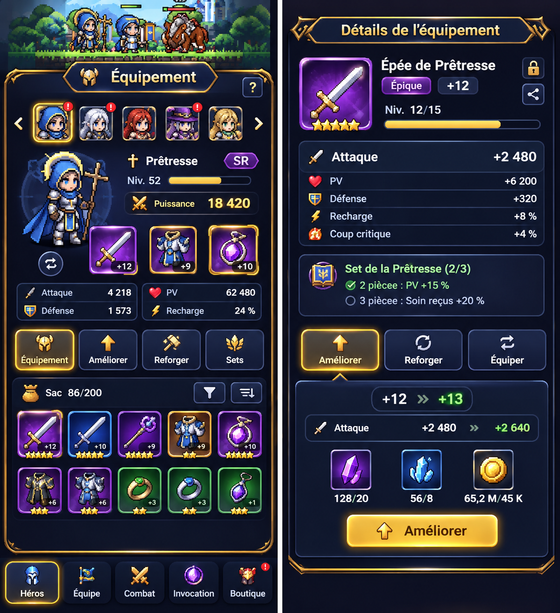

# Ascendrya 10.12 : refonte « vrai jeu mobile » de tous les onglets (téléphone)

> **Pour Claude** :
> - Copie ce dossier dans le dépôt, sous `docs/prompt-v10.12/`.
> - Ouvre avec l'outil Read **la maquette du joueur** (`images/maquette/maquette-equipement-joueur.png`) : c'est la référence visuelle de toute la version. Ouvre ensuite chaque capture citée de `images/actuel/` (412 × 915, version 10.11.4, partie de fin de jeu `tests/fixtures/endgame.json`).
> - Base : `main` au commit `8d25cf14` (10.11.4). Les prompts 10.11, 10.11.3 et 10.11.4 restent valables : rien de ce qu'ils ont corrigé ne doit revenir.
> - **Périmètre : téléphone seulement** (`max-width: 600px`, et l'application Android). Le PC et la grande fenêtre ne changent pas : à la fin, une capture PC en 1116 × 993 et 1920 × 1080 de chaque onglet doit être identique à celle d'avant.
> - Règle générale : **rien n'est supprimé de l'écran sans être remplacé**. Toute action qui existe aujourd'hui reste accessible, au plus à un appui de plus.
> - Travaille par lots (§ 9), un commit par lot, `npm test` vert à chaque commit.

## Ce que dit le joueur (24/11, 15 h 30)

> « Voilà une idée pour les dispositions Équipement et Amélioration. Tu pourrais me faire un nouveau prompt pour que ça colle à l'ensemble de l'appli mobile. Il faut vraiment que ça fasse jeu mobile, comme testé avec Slayer Legend et Capybara Go. »
>
> « Et les autres onglets pareil, fais-les tous. »

## Ce que la maquette dit (à garder partout)

1. **Un écran = un cadre.** Tout l'onglet est dans un grand cadre sombre à bord doré, coins ornés. Il n'y a plus de cartes de styles différents empilées.
2. **Un cartouche de titre** en haut du cadre (icône + nom de l'écran, ex. « Équipement »), avec le « ? » à droite.
3. **Le personnage d'abord** : grand portrait, nom, rang, niveau avec barre, **Puissance** en gros chiffres dorés.
4. **De grosses cases d'objet** (environ 80 px) au cadre de la couleur de la rareté, avec « +N » en bas à droite.
5. **Les statistiques en 2 × 2**, icône à gauche et valeur alignée à droite.
6. **Une rangée de 4 gros boutons-onglets avec icône et nom** (Équipement, Améliorer, Reforger, Sets). Celui qui est choisi a un bord doré.
7. **Le sac en grille de 5 colonnes**, avec sa tête (« Sac 86/200 », filtre, tri).
8. **La fiche de détail en plein écran** : en-tête « Détails de l'équipement », grande case, nom, rareté, « +12 », cadenas ; puis les statistiques (la principale en grand), le set, une rangée de 3 actions (Améliorer, Reforger, Équiper) et le panneau de l'action choisie (« +12 » » « +13 », coûts en cases « 128/20 », gros bouton doré « Améliorer »).
9. **Un seul gros bouton doré par écran** : l'action principale. Les autres boutons sont sombres à bord clair.
10. **Pas de texte en paragraphe** : des étiquettes courtes, des icônes, des chiffres. L'explication passe dans le « ? ».

---

## 1. Le kit commun (`src/ui/mobile-kit.css` et `src/ui/mobile-kit.js`)

Crée un petit kit de composants, chargé après `mobile1012.css` dans `index.html`, et utilisé par **tous** les onglets sur téléphone. Toutes les règles sont dans `@media (max-width: 600px)` ou sous `#app.m-phone` (classe posée par `ui.js` quand `this.phone` est vrai). Aucune règle ne touche le PC.

**Couleurs (variables CSS)** : fond du cadre `#121a33` → `#0b1124` ; carte intérieure `#18223f` ; bord doré `#c9a14a` (clair `#f3d27a`) ; texte `#eef2ff` ; texte doux `#9fb0d8` ; vert gain `#5be37d` ; rouge manque `#ff6b6b`. Couleurs de rareté : celles de `rarity108.css` (ne pas en inventer).

**Typographie** : titres en 900 (graisse maximale) ; chiffres en `font-variant-numeric: tabular-nums` ; Puissance en 26 px doré ; textes au moins 13 px, et jamais de texte sous 11 px.

**Composants** (noms de classes à utiliser) :

| Classe | Rôle | Détails |
|---|---|---|
| `.m-frame` | Le cadre d'un écran | Bord doré de 2 px, coins ornés en CSS (4 petits losanges), rayon 18 px, ombre intérieure. Il occupe toute la largeur moins 8 px de chaque côté. |
| `.m-title` | Cartouche de titre | Bandeau centré à bouts biseautés (`clip-path`), icône de 28 px et nom en 22 px ; « ? » à droite en 40 × 40. Il remplace le titre actuel du panneau. |
| `.m-tabs` | Onglets d'un menu | 4 ou 5 boutons de 64 px de haut, **icône et nom** (aujourd'hui, les sous-onglets du haut n'ont que des icônes : on ne sait pas où on va). Le choisi a un bord doré et une lueur. |
| `.m-modes` | Rangée de modes dans un écran | Comme sur la maquette (Équipement, Améliorer, Reforger, Sets) : 4 boutons égaux de 72 px de haut, icône de 30 px et nom. |
| `.m-card` | Bloc intérieur | Fond `#18223f`, bord de 1 px `#2c3a66`, rayon 12 px, 10 px de marge intérieure. |
| `.m-tile` | Case d'objet ou de récompense | 64 px dans une grille (80 px pour les places portées). Fond en dégradé de la couleur de la rareté, bord de 2 px de la même couleur, « +N » en bas à droite, pastilles de rareté en bas (voir plus bas), point rouge « ! » en haut à droite. |
| `.m-stat` | Ligne de statistique | Icône de 20 px, nom à gauche, valeur alignée à droite ; la version `.big` (statistique principale) fait 18 px sur fond plus clair. |
| `.m-btn-gold` | Action principale | Hauteur 56 px, dégradé doré, texte sombre en 900, icône à gauche. **Un seul par écran visible.** |
| `.m-btn` | Action secondaire | 44 px, fond sombre, bord `#3a4a80`. |
| `.m-cost` | Coût | Case de 56 px avec l'icône de la ressource, et dessous « ce que tu as / ce qu'il faut » (vert si assez, rouge sinon). |
| `.m-bar` | Barre de progression | 8 px, fond `#0b1124`, remplissage doré (ou vert pour les PV). |
| `.m-sheet` | Fiche plein écran | Elle monte par-dessus l'onglet, en laissant visibles la bande de scène et la barre du bas. Elle a son propre `.m-title`, avec une flèche « ‹ » à gauche pour revenir et un ✕ à droite. Elle défile seule (`overscroll-behavior: contain`). |
| `.m-chip` | Filtre ou état court | 32 px de haut, arrondi ; il remplace les rangées de boutons-filtres. |
| `.m-empty` | État vide | Illustration, une phrase, un bouton. Il n'y a jamais un cadre vide. |

**Pastilles de rareté** : la maquette montre des étoiles sous les objets. Le jeu n'a pas d'étoiles d'objet, et il ne faut pas en inventer. Affiche à la place **une pastille par rang de rareté**, de la couleur de la rareté : 1 pour Commun, 2 pour Rare, 3 pour Épique, 4 pour Légendaire, 5 pour Mythique, 6 pour Astral, 7 pour Ascendant (ordre de `RARITIES`, `src/data/items.js`). L'objet se lit comme dans la maquette, avec un sens réel.

**Fichier `mobile-kit.js`** : de petites fonctions qui rendent ces blocs en HTML (`mTitle(icon, label, help)`, `mTabs(items, current)`, `mTile(item, opts)`, `mStat(icon, label, value, big)`, `mCost(icon, have, need)`, `mSheet(title, body)`), pour que chaque panneau les utilise au lieu de son propre HTML. Les `data-action` existants ne changent pas.

**Ornements** : tout en CSS d'abord (dégradés, `clip-path`, pseudo-éléments). Si le rendu doré ne suffit pas, liste les 3 images à faire dans `LISTE-PIXELLAB.md` (coin de cadre 32 px, bout de cartouche 48 × 56, fond de case d'objet 64 px), sans bloquer la version.

**Stabilité** (le joueur s'est plaint des « fenêtres qui sautent ») :
- Les hauteurs du haut de chaque écran sont **fixes** (cartouche, onglets, bloc du personnage). Changer de mode ou de personnage ne fait pas bouger ce qui est au-dessus.
- Ouvrir ou fermer une fiche ne change jamais le défilement de la page (`panel-body.scrollTop` identique avant et après).
- Les images ont une taille réservée (`width`/`height` ou `aspect-ratio`) : rien ne bouge quand elles arrivent.

---

## 2. Héros › Équipement (maquette, partie gauche)

Captures actuelles : `01b-equipement-heros.png`, `01e-equipement-compagnon.png`, `01-inventory.png`.

**De haut en bas, dans un `.m-frame`** :

1. **Cartouche « Équipement »** + « ? » (l'aide d'aujourd'hui, `elements-help` compris).
2. **Rangée des personnages** : portraits ronds-carrés de 56 px (Héros, puis les compagnons de l'équipe), avec flèches ‹ › si la rangée déborde. Point rouge « ! » si une amélioration attend (règle de `heroTodo` / `unitTodo`). Le choisi a un bord doré. Ça remplace les boutons `eq-who` actuels, coupés (« Écuye. »). Même action `gear-who`.
3. **Bloc personnage** (hauteur fixe 176 px) :
   - à gauche, le grand portrait animé (le canvas `figure()` actuel, 140 px), et dessous le bouton rond ⇄ = **Équipement rapide** (`eq-quick`), avec sa pastille de nombre ;
   - à droite : nom et classe (ex. « Héros · Chevalier », ou « Écuyer » pour un compagnon) ; la pastille de rang du compagnon (sa rareté, comme « SR » sur la maquette) ; « Niv. 153 » et une barre d'expérience ; puis **Puissance** en gros chiffres dorés dans un cadre (`.m-card`, icône d'épées croisées).
   - Les ressources d'aujourd'hui (or, éclats, matériaux, `resourceBand`) passent en petites puces sous le cartouche, à droite. Elles ne prennent plus une ligne entière.
4. **Places portées** : des `.m-tile` de 80 px. Le héros en a 6 : 2 rangées de 3 (Arme, Casque, Armure, puis Collier, Anneau, Bracelet). Un compagnon en a 3 : 1 rangée. Une place vide montre la silhouette (`slot_empty_*`) et un « + » ; « ▲ » si mieux dans le sac. Toucher une place ouvre la fiche (§ 3).
5. **Statistiques en 2 × 2** (`.m-stat`) : Héros = Dégâts/s, Vie, Vitesse, Critique ; compagnon = Attaque, PV, Défense, Recharge (les mêmes que `tiles()`). La ligne verte « +4,5×10⁸⁹ si renforcée » passe dans la fiche d'objet, pas ici.
6. **Rangée de modes** (`.m-modes`) : **Équipement · Améliorer · Reforger · Sets**.
   - *Équipement* (par défaut) : le sac en dessous (point 7).
   - *Améliorer* : la liste des objets portés, une ligne par objet : case, nom, « +3 » » « +4 », coûts en `.m-cost`, bouton « Améliorer » (`upgrade-item` ou `gear-up` selon le porteur). En haut, un bouton doré **« Tout améliorer »**, qui renforce dans l'ordre du meilleur gain par or tant qu'il y a de quoi payer. S'il n'existe pas encore, crée-le dans `main.js` en appelant la même fonction en boucle. C'est ce que le joueur appelle « Amélioration ».
   - *Reforger* : les objets portés qui ont un effet spécial, avec « Changer l'effet » (`reforge`), « Relance orientée » (`target-reroll`) et « Remettre au niveau » (`sharpen`) ; plus un lien vers la Forge pour Recycler et Fusionner.
   - *Sets* : les ensembles en cours (contenu de `setsBanner` et `setLine`) : nom, pièces portées « 2/3 », bonus obtenus ✓ et bonus suivants ○, comme le bloc « Set de la Prêtresse » de la maquette.
   - Les onglets « Vue d'ensemble / Équipement / Étoiles / Compétences » d'un compagnon restent : « Étoiles » et « Compétences » deviennent deux modes de plus, **seulement pour un compagnon** (la rangée défile horizontalement s'il y en a plus de 4). « Vue d'ensemble » est retirée : son contenu est déjà dans le bloc personnage et les modes.
7. **Sac** (`.m-card`) : tête « 💰 Sac 86/200 » (avec Réserve en 2e choix, comme aujourd'hui), bouton filtre (entonnoir) et bouton tri. Les filtres de place (Tout, Arme, Casque…) passent dans le menu de l'entonnoir, avec les réglages du sac, les builds et « Équiper pour ». Ils ne prennent plus une rangée permanente. Puis la **grille de 5 colonnes** de `.m-tile` de 64 px, avec le gain « +817 % » en pastille verte en haut quand l'objet est meilleur. Toucher un objet ouvre la fiche (§ 3).

## 3. Fiche « Détails de l'équipement » (maquette, partie droite)

Captures actuelles : `01c-fiche-objet-haut.png`, `01d-fiche-objet-bas.png`. Aujourd'hui, c'est une feuille du bas de 40 à 82 % de l'écran, longue et dense : 14 blocs empilés.

**Devient une `.m-sheet` plein écran** (sous la bande de scène, au-dessus de la barre du bas) :

1. **Cartouche « Détails de l'équipement »**, « ‹ » pour revenir, ✕.
2. **En-tête** : grande case de 96 px (pastilles de rareté dessous) ; à droite, le nom (sur 2 lignes au plus, sans « … ») ; la pastille de rareté et la pastille « +12 » ; « Niv. 12/15 » avec une barre dorée. Dans le jeu, c'est **le renforcement +N sur le maximum** (`upgradePreview().level` / `.max`). Le niveau d'objet (« Niveau d'objet 421 ») va en petit dans les statistiques. Colonne de droite : cadenas (`lock`) et un bouton « ⋯ » qui ouvre un petit menu (Ranger en Réserve `to-stash`, Exposer au Musée `to-museum`, Recycler `recycle`). Pas de bouton « partager » : il n'existe pas dans le jeu.
3. **Statistiques** (`.m-card`) : la principale en `.m-stat.big` (Dégâts pour une arme, Vie pour une armure…), puis les autres, puis les effets spéciaux (✦) et le grand effet (`majorLine`).
4. **Set** (s'il y en a un) : comme la maquette, avec l'icône du set, « (2/3) », un ✓ vert pour les bonus actifs et un ○ pour les suivants.
5. **Comparaison** (seulement pour un objet du sac) : « +817 % de puissance si tu l'équipes » en vert, ou « −12 % » en rouge.
6. **Rangée de 3 actions** (`.m-modes`, 64 px) : **Améliorer · Reforger · Équiper** (« Changer » si l'objet est porté). Une petite flèche relie le bouton choisi au panneau dessous, comme sur la maquette.
7. **Panneau de l'action** (hauteur fixe : passer d'une action à l'autre ne fait rien sauter) :
   - **Améliorer** : « +12 » » « +13 » en gros (vert à droite) ; la ligne de la statistique qui monte, avant » après ; « Puissance avant » après » ; les coûts en `.m-cost` (éclats « 128/20 », or « 65,2 M/45 K ») ; le gros bouton doré **« Améliorer »** (`upgrade-item`, ou `gear-up` pour un compagnon). Au maximum : « Renforcé au maximum (+5) » et ce qui débloque la suite (`blockBanner`). Si le gain est presque nul : le message « Presque sans effet » de la 10.4, et le bouton doré devient « Remettre au niveau (840 éclats) » (`sharpen`) ; « Améliorer » passe alors en bouton secondaire.
   - **Reforger** : « Changer l'effet » (`reforge`), « Relance orientée » (`target-reroll`, avec les 2 appuis de confirmation d'aujourd'hui), « Changer le type » (`reroll-type`), « Remettre au niveau » (`sharpen`). Chacun en ligne : icône, nom, coût, bouton.
   - **Équiper / Changer** : pour un objet du sac, ce qui change avant » après (`compareRows`), puis le bouton doré « Équiper » (`equip`, ou `gear-equip` pour un compagnon). Pour un objet porté, la liste des objets du sac qui vont à cette place (le `changeSheet` actuel), du meilleur au moins bon, et « Retirer » en bouton secondaire.
8. **Navigation entre les places** : on glisse à gauche ou à droite sur l'en-tête pour passer à la place suivante (même ordre que la bande `eq-strip`). La bande `eq-strip` en bas de la fiche est retirée : la fiche est plein écran, la flèche « ‹ » ramène aux places.

## 4. Héros › Améliorations (l'or)

Captures : `02-upgrades.png`, `02b-ameliorations-bas.png`.

- Cartouche « Améliorations ». Bloc du haut à hauteur fixe : Dégâts/s et survie (« Tu survis 99+ coups du boss »), la ligne « Prochain boss », puis `.m-chip` ×1 · ×10 · ×100 · Max et le bouton doré **« Tout acheter »**.
- Les 3 familles (Frapper fort, Tenir, Gagner plus) deviennent **3 modes** (`.m-modes` avec les illustrations actuelles réduites en icônes de 30 px), au lieu de 3 longues colonnes à faire défiler.
- Chaque amélioration est une ligne `.m-card` de hauteur fixe (84 px) : icône 48 px dans une `.m-tile` ; le nom et « niv. 4200 » ; l'effet avant » après (vert) ; « +40 niv. · +9,7 % de puissance » ; à droite, un bouton d'achat de 96 px avec l'or en `.m-cost` compact. L'étiquette « peu utile » et la ligne grisée de la 10.11 restent.
- Le sélecteur « Trier » passe dans un bouton tri (icône) à côté des chips.

## 5. Les autres onglets (même kit, même ordre partout)

Chaque onglet suit le **même squelette** : `.m-frame` → `.m-title` → (onglets du menu `.m-tabs` en haut du cadre si le menu en a plusieurs) → bloc d'en-tête à hauteur fixe → contenu en `.m-card` ou en grille de `.m-tile` → **un** `.m-btn-gold` pour l'action principale (repris par la barre `phone-action` collée en bas quand il sort de l'écran).

Le tableau dit, pour chaque onglet, ce qui ne va pas aujourd'hui et ce qu'il devient.

| Onglet (capture) | Aujourd'hui | Devient |
|---|---|---|
| **Compétences** (`03-skills`) | Grille de cases correcte, mais la fiche de la compétence choisie est en bas, coupée, et le grand cadre noir de l'aperçu est vide | Cases en `.m-tile` (5 par ligne, nom dessous, « Nv 1 »), deux modes « Attaques / Boosts » au lieu de deux titres, « Auto » en interrupteur dans la tête. Toucher une compétence ouvre une `.m-sheet` (aperçu animé, effet, niveau suivant, bouton doré « Apprendre » / « Améliorer »). |
| **Talents** (`04-tree`) | 3 onglets texte, un paragraphe d'explication, un gros bloc « Attaque » | Modes « Talents · Arbre avancé · Renaissance ». Le paragraphe part dans le « ? ». La tête montre les fragments en `.m-cost` et « Apprendre le meilleur » en doré. Les paliers deviennent un chemin de nœuds ronds (54 px) ; toucher un nœud ouvre une `.m-sheet`. |
| **Forge** (`05-forge`) | 3 grandes affiches (Recycler, Renforcer, Fusionner) avec flèches entre elles | Modes « Recycler · Renforcer · Fusionner ». Chaque mode : l'illustration réduite à 120 px de haut, une phrase, la zone d'objets en grille de `.m-tile` et un bouton doré. |
| **Compagnons** (`06-companions`) | Deux gros boutons jaunes l'un sous l'autre, formation en petites cases, grille de cartes | Bloc formation en tête (Avant / Arrière, places de 64 px, bouton ⇄ « Équiper toute l'équipe »). Modes « Compagnons · Familiers ». Les cartes en grille de 3, au format de la maquette (portrait, Niv., étoiles du compagnon, qui existent vraiment, et rareté). « Améliorer l'équipe » devient le seul bouton doré. Toucher une carte ouvre la fiche du compagnon dans le même gabarit que la § 2 (portrait, statistiques, modes Équipement, Étoiles, Compétences). |
| **Bastion** (`07-camp`) | La bannière « Nouvel âge » se superpose à une carte qui se superpose déjà à la liste | Une seule fenêtre à la fois : l'annonce d'âge devient une `.m-sheet` avec un bouton « Continuer », et rien ne passe dessus. Modes « Carte · Recherches · Ouvriers ». Les ressources en puces dans la tête. |
| **Expéditions** (`08-expeditions`) | Listes déroulantes (`<select>`) pour choisir le compagnon et la durée | **Plus aucun `<select>` sur téléphone** (vrai pour tous les onglets) : on touche la place, et une `.m-sheet` montre les compagnons libres en grille de `.m-tile`. La durée passe en `.m-chip` 1 h · 4 h · 12 h. « Tout envoyer » en doré. |
| **Carte** (`09-campaign`) | Pile de blocs (Revanche, Arène, monde, carte) | En-tête : monde actuel, étape, barre, « Prochain boss ». Puis la carte en grand. La Revanche et l'Arène deviennent deux `.m-card` compactes de 64 px sous la carte. |
| **Donjons** (`10-dungeons`) | Belles bannières, mais boutons « Entrer » petits et clés en haut à gauche | Clés en `.m-cost` dans la tête. Chaque donjon garde sa bannière (hauteur fixe 120 px), avec « Entrer » en bouton de 44 px à droite et la récompense en icône. |
| **Arène** (`11-arena`) | Se joue dans la scène : le panneau occupe la moitié basse, avec un titre différent des autres | Garder la scène (règle de la 10.11), mais le panneau prend le même cadre, cartouche et onglets que les autres. « Combattre » est le bouton doré collé en bas. |
| **Défis / Tour** (`12-tower`) | Texte dense (« Carapace : encaisse −60 %… ») | Modes « Tour · Défi de la semaine ». Étage en grande case, nom et 2 icônes de règles (détail au « ? »). « Monter » en doré. |
| **Événement** (`13-event`) | Plusieurs styles de cartes (cartes claires roses au milieu de cartes sombres) | Même kit : cartes sombres, barre dorée, bouton secondaire. L'affiche de l'événement reste en tête (hauteur fixe 160 px). |
| **Invocation** (`14-summon`) | Correct dans l'ensemble, boutons ×1 et ×10 de 4 couleurs | Bannière en tête, puis 2 gros boutons : « ×1 » en secondaire, « ×10 » en doré, avec le coût en icône. Les favoris en grille de `.m-tile`. |
| **Boutique** (`15-shop`) | 8 boutons d'onglets en 2 rangées | `.m-tabs` qui défilent horizontalement (une rangée, icône et nom). Les offres en grille de 2 `.m-card`. |
| **Carnet** (`16-daybook`) | Cartes beiges claires (autre style), blocs « Ça dort » | Cartes sombres du kit. La barre « 0/8 » et le coffre du jour dans la tête. Chaque tâche : icône, nom, barre, bouton « Y aller » secondaire (un seul doré : « Récupérer » quand prêt). |
| **Missions** (`17-contracts`) | Bandeaux violets différents, tâches avec grand vide | Modes « Jour · Chroniques · Semaine · Mois · Hauts faits » (avec pastilles). Tâches en lignes de 64 px. |
| **Encyclopédie** (`18-encyclopedia`) | Noms coupés au milieu des mots (« Équipeme nts », « Compagno ns ») | Grille de 3 `.m-card` avec nom sur 2 lignes **sans coupure de mot** (`hyphens: none; overflow-wrap: normal`). Les paliers en barre unique. |
| **Apparences** (`19-looks`) | Long texte en tête, vitrine | En-tête : portrait et nom de l'apparence équipée. Grille de 3 `.m-tile` d'apparences. La vitrine animée s'ouvre en `.m-sheet`. |
| **Boss / Panthéon** (`20-boss`) | Longue liste de lignes « ??? » identiques | Grille de 3 cases (silhouettes), « 0/48 couronnes » dans la tête. La fiche du boss en `.m-sheet`. |
| **Classement** (`21-ranking`) | Mur de 11 boutons de filtre | Un `.m-chip` « Étape ▾ » ouvre la liste des critères en `.m-sheet` ; « Tout le monde / Mes amis » en modes. L'état « non connecté » devient un `.m-empty`. |
| **Guilde** (`22-guild`) | 3 colonnes de texte serré | `.m-empty` illustré avec les 3 avantages en icônes et un bouton doré « Créer mon compte ». |
| **Statistiques** (`23-stats`) | Grandes cases inégales, puis petites cases | Grille régulière de 2 colonnes de `.m-card` de même hauteur (icône, chiffre, libellé). Le sélecteur « Monde » devient des `.m-chip`. |

**Aussi** :
- **Menus** : la barre du haut de chaque menu (aujourd'hui une rangée d'icônes seules, plus « ? » et ✕) devient `.m-tabs` avec les noms (« Équipement », « Améliorations », « Compétences », « Talents », « Forge » pour Héros). ✕ reste en haut à droite du cadre.
- **Fenêtres** (`#modal`) : même cadre et même cartouche que les écrans.
- Les bulles et la barre du bas de l'écran de jeu ne changent pas (déjà traitées en 10.11.3 et 10.11.4).

## 6. Ce qu'il ne faut pas faire

- Ne pas changer les règles du jeu, les coûts ni les gains. C'est une version **d'affichage**. Seule exception : « Tout améliorer » (§ 2.6), qui enchaîne une action existante.
- Ne pas ajouter d'étoiles d'objet, de « SR / SSR » ou de bouton « partager » qui n'existent pas dans le jeu (voir les pastilles de rareté, § 1).
- Ne pas toucher au PC (§ 0).
- Ne pas cacher une information sans la remettre ailleurs (le « ? » ou une `.m-sheet`).

## 7. Accessibilité et confort

- Cibles d'au moins 44 × 44 px, 8 px entre deux boutons.
- Texte d'au moins 11 px, et chiffres importants d'au moins 15 px.
- Contraste : texte doux `#9fb0d8` sur `#121a33` au minimum (≥ 4,5:1).
- `prefers-reduced-motion` : pas de lueur animée sur les boutons.
- Chaque `.m-tab` a son `aria-selected` et chaque `.m-sheet` son `role="dialog"` et son `aria-label`.

## 8. Contrôle automatique (à ajouter dans `tools/`)

Un script `tools/mobile-audit.mjs` (Playwright, `isMobile`, `hasTouch`) en **390 × 844 et 412 × 915**, sur la partie de fin de jeu et sur une partie neuve, ouvre chaque onglet, chaque mode et une fiche d'objet, et vérifie :
1. aucun défilement horizontal (`scrollWidth <= clientWidth` sur `#panel-body`) ;
2. aucun chevauchement entre deux boutons visibles (rectangles qui se croisent de plus de 2 px) ;
3. chaque bouton visible fait au moins 44 px de haut ;
4. chaque onglet a un `.m-title` et au plus un `.m-btn-gold` visible à l'écran ;
5. aucun `<select>` visible ;
6. ouvrir puis fermer une fiche laisse `#panel-body.scrollTop` inchangé, et passer d'un mode à l'autre ne déplace pas le haut du cadre (même `top` à 1 px près) ;
7. aucun texte coupé au milieu d'un mot (comparer `scrollWidth` des libellés courts).

Il écrit les captures dans `docs/screenshots/v10.12/` (une par onglet et par mode) et sort en échec au moindre défaut. Le lancer dans `npm test` sous une variable (`MOBILE_AUDIT=1`) pour ne pas ralentir la CI.

Et la vérification du PC : `node tools/capture.mjs` en 1116 × 993 et 1920 × 1080, avant et après, comparaison pixel à pixel. La différence doit être nulle, à part la scène animée.

## 9. Ordre de travail (un commit par lot)

1. Kit (`mobile-kit.css`, `mobile-kit.js`, classe `#app.m-phone`), menus en `.m-tabs`, et le script d'audit (il échoue au début, c'est normal).
2. Héros › Équipement (§ 2).
3. Fiche « Détails de l'équipement » (§ 3).
4. Héros › Améliorations (§ 4), Compétences, Talents, Forge.
5. Équipe : Compagnons (et sa fiche), Bastion, Expéditions.
6. Combat : Carte, Donjons, Arène, Défis, Événement.
7. Invocation, Boutique.
8. Quêtes et Profil : Carnet, Missions, Encyclopédie, Apparences, Boss, Classement, Guilde, Statistiques.
9. Audit vert sur tout, vérification du PC, planche avant / après dans `docs/screenshots/v10.12/`, version `10.12.0` (`package.json`, `package-lock.json`, `src/version.js`), notes de version.

À chaque lot, ouvre la capture de l'onglet avec l'outil Read et compare-la à la maquette : même cadre, même cartouche, mêmes boutons. Si un écran ne ressemble pas à la même application que l'Équipement de la maquette, il n'est pas fini.
