# Ascendrya 10.6 : un écran de jeu vivant, des quêtes et des événements qui donnent envie, et le reste du 10.5

> **Pour Claude, avant de commencer :**
> - Copie ce dossier tel quel dans le dépôt, sous `docs/prompt-v10.6/`.
> - **Ouvre avec l'outil Read chaque image citée** au moment où sa partie arrive. `images/actuel/` montre le jeu 10.4.0 tel qu'il est, `images/maquettes/` le résultat attendu, et `images/reference/` le modèle.
> - Ce prompt **contient tout ce qui reste du prompt 10.5**, qui n'a pas été appliqué en 10.4.0. Il le remplace.

## Contexte

**Version testée** : Ascendrya 10.4.0, le 21/11, sur la partie du joueur (niveau 91, Grottes de cristal 3-17, 4,6 T d'or).

**Ce qui a été fait** :
- **177 écrans sur PC** (1116 × 993), **173 sur téléphone** (390 × 844) et 8 dans une **fenêtre large** (2536 × 1011, celle du joueur sur sa capture).
- **L'Arène** : la Tour à cartes jouée, les épreuves ouvertes.
- **Un donjon** joué jusqu'au bout.
- **Une partie neuve** (`?learn`).
- **La part d'image de chaque onglet**, mesurée.

**Ce que le joueur demande (21/11)** :
- « revoir que tous les menus soient bien illustrés et compréhensibles, un grand accent sur l'ergonomie » ;
- « je veux que l'ergonomie soit nickel, avec des animations à certains endroits qui en valent la peine » ;
- « vérifie si le coffre est bien placé : est-ce que ça vaut le coup de le mettre ici ? » ;
- « ça manque de quêtes sur l'écran de jeu et d'événements. Il faudrait de bonnes illustrations, et que ça donne envie, comme sur Slayer Legend et Capybara ».

**Règles** :
1. **Le modèle reste le Carnet** (`images/reference/carnet-modele.png`). On y voit :
   - une bannière dessinée et une phrase ;
   - des tuiles avec une grosse icône, un titre, une ligne, une barre et un bouton ;
   - 15 mots au plus par tuile.
2. **Toutes les images viennent de PixelLab**, par l'API, comme `art104`. La liste est dans `pixellab/LISTE-PIXELLAB.md`.
3. **S'inspirer sans copier.** Les références Slayer Legend et Capybara Go! servent seulement à montrer une disposition : colonnes d'icônes d'événement, quête toujours visible. Les noms, les dessins et les textes restent ceux d'Ascendrya.
4. **Animations** : seulement là où elles aident à comprendre (partie 6). Toutes respectent le réglage « réduire les animations ».
5. Ne rien casser. Chaque partie se termine par ses tests.

**Ordre conseillé** :

| Étape | Partie |
|---|---|
| 1 | 1 : coffre |
| 2 | 2 : écran de jeu (quêtes et événements) |
| 3 | 3 : événement |
| 4 | 4 : équipement |
| 5 | 5 : améliorations et tri |
| 6 | 7 : fenêtre large |
| 7 | 8 : débutant |
| 8 | 6 : animations |
| 9 | 9 : petits défauts |
| 10 | 10 : tests |

---

## 0. Ce que la 10.4.0 a bien fait (à garder)

- **Le prompt 10.4 est appliqué en entier.**
  - Pages plein écran pour le Personnage, la Forge et le Bastion.
  - Bastion sous Équipe, avec son village, ses ouvriers, son arbre de recherches dans un grand livre et « Pendant ton absence ».
  - Donjons en bannières, avec une page de 64 mots.
  - Compétences : une animation chacune, et 60 icônes.
  - Coffre vivant.
  - Avant → après honnête (« presque sans effet »).
- **Revue complète** : aucune erreur JavaScript sur PC ni sur téléphone. Les seules erreurs réseau viennent du serveur en ligne, injoignable pendant le test.
- **Part d'image** :

| Écran | Part d'image |
|---|---|
| Bastion | 113 % |
| Donjons | 171 % |
| Tour | 108 % |
| Carte | 70 % |
| Arène | 67 % |
| Expéditions | 55 % |

---

## 1. Coffre de butin : il n'est pas à la bonne place

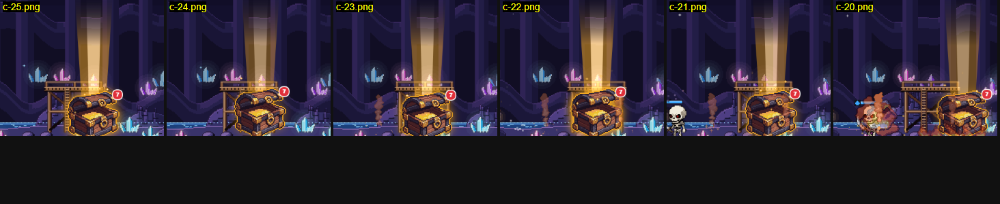

**Constat** :
- Le coffre est dessiné dans la scène, **au milieu du terrain de combat** : x ≈ 745 sur 1116 en PC, x ≈ 1521 sur 2536 en fenêtre large, juste à côté de l'équipe sur téléphone.
- **Les monstres apparaissent et meurent sur lui** : squelette collé au coffre, explosions par-dessus.
- Son rayon doré monte au milieu des dégâts et attire l'œil loin du combat.
- Sa place change avec la largeur de la fenêtre.
- **Conclusion : ça ne vaut pas le coup de le garder là.**

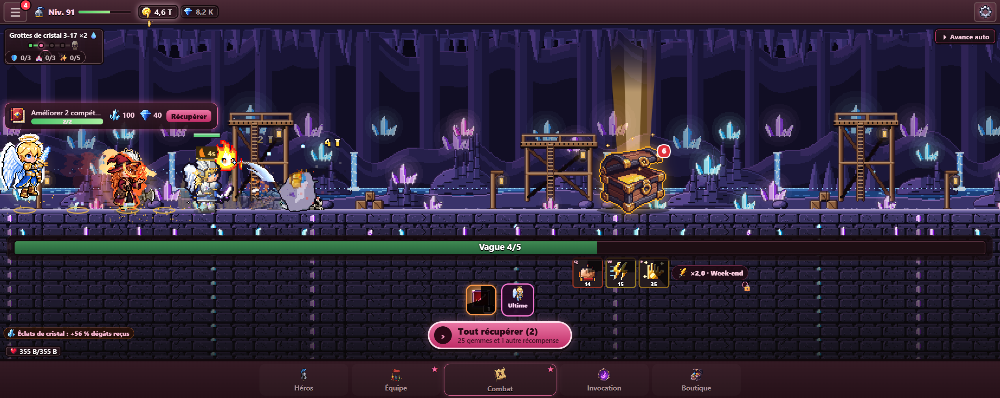

**À faire** (maquette `images/maquettes/01-ecran-de-jeu-quetes-evenements.png`) :
- **Le coffre quitte le terrain.** Il se pose **en bas à droite**, sur la bande sous le combat, à côté de « Tout récupérer » : toujours au même endroit, dans toutes les tailles, sans rien recouvrir.
  - Taille : 110 à 124 px sur PC, 72 px sur téléphone.
  - Sa pastille du nombre reste lisible.
- **Les animations de la 10.4 restent** (flottaison, lueur, étincelles, couvercle, bulle de rareté, flash Légendaire). L'objet part toujours du monstre et décrit un arc **jusqu'au coffre, en bas à droite**. Le trajet est plus long, donc plus visible.
- Le rayon ne s'allume que pour un Épique ou mieux. Il est plus court (jusqu'à la bande de combat, pas au-delà).
- Toucher le coffre ouvre toujours le tri (partie 5).

**Tests** :
- Le coffre ne chevauche jamais un monstre ni un héros, en 1116 × 993, 1280 × 720, 2536 × 1011 et 390 × 844.
- Sa position à l'écran est la même d'une vague à l'autre.

---

## 2. Écran de jeu : des quêtes et des événements toujours visibles

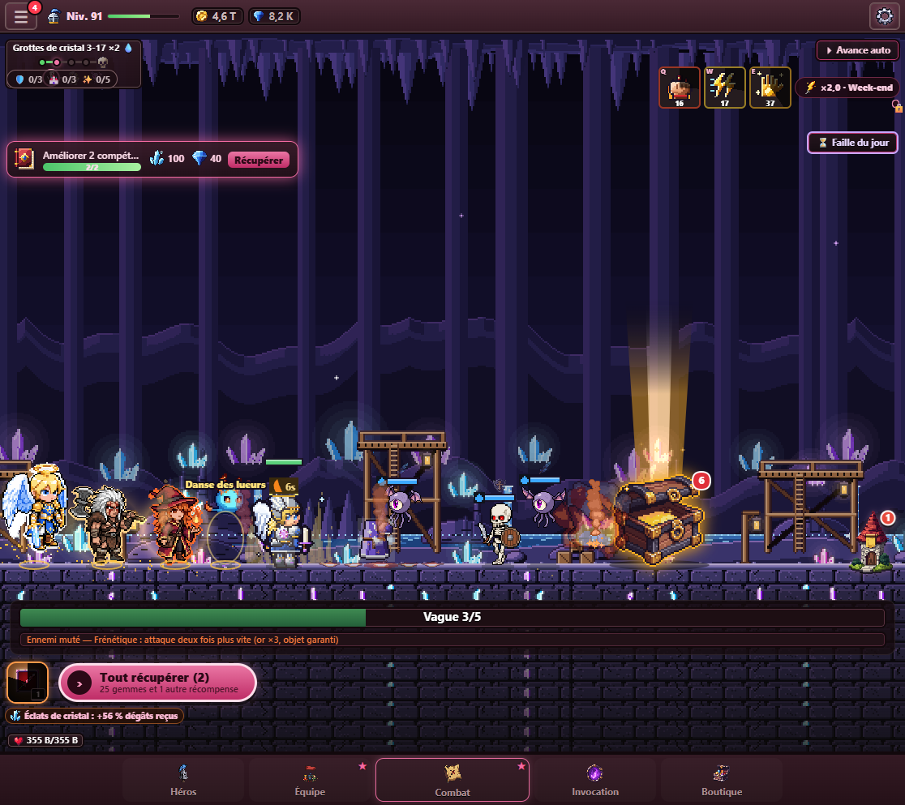

**Constat** :
- La moitié haute de l'écran est vide : plafond de grotte.
- **Une seule quête est visible** : un bandeau de 360 × 45 (« Améliorer 2 compét… », texte coupé).
- **Un seul événement est visible** : la puce texte « ⏳ Faille du jour ».
- Le Carnet du jour, les Missions, l'événement **Marché des Lueurs** (en cours, 6 j/14), la Roue et l'Arène ne sont visibles qu'en ouvrant les menus.
- La tour du Bastion est seule dans son coin.

**Ce qu'on retient des jeux de référence (disposition seulement)** :

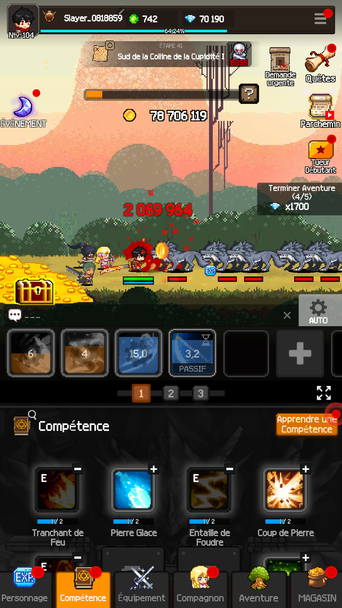

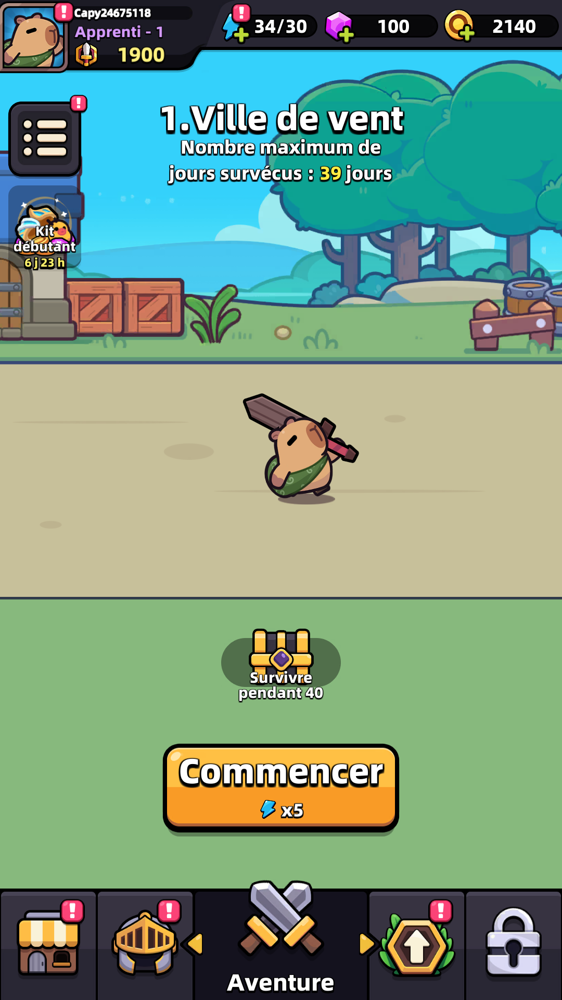

On y voit :
- une **colonne d'icônes d'événement dessinées** sur un côté, avec un minuteur et une pastille rouge ;
- une **quête principale toujours visible**, avec sa récompense ;
- un **bouton qui brille** quand il y a quelque chose à prendre.

**Maquette** :

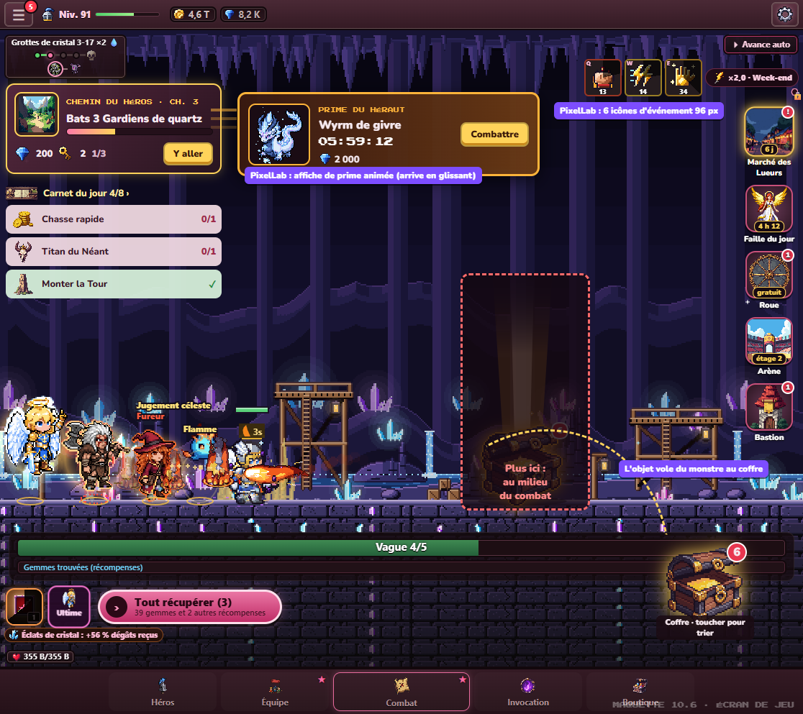

**À faire** :
1. **Carte « Chemin du héros »** en haut à gauche, sous la carte de zone (≈ 300 × 120), à la place du bandeau de quête actuel :
   - l'image du monde en 64 px (PixelLab) ;
   - « CH. 3 » et le titre de l'étape en cours, **sur une ligne, jamais coupé** ;
   - une barre, la récompense en icônes, et un bouton « Y aller » ou « Récupérer ».
   - Quand une quête est finie, la carte s'illumine d'or, les icônes de récompense volent vers la barre du haut, et la quête suivante glisse à sa place.
2. **« Carnet du jour » en 3 lignes** sous la carte :
   - les 3 tâches les plus proches de la fin, chacune avec son icône en 32 px et « 0/1 » ;
   - une tâche finie passe en vert avec ✓ ;
   - le titre « Carnet du jour 4/8 › » ouvre le Carnet.

   Sur téléphone, cette liste se replie en une seule puce « Carnet 4/8 ».
3. **Colonne d'événements à droite**, sous les boosts : 5 ou 6 icônes PixelLab de 66 px, chacune avec son nom, un minuteur et une pastille.
   - Dans l'ordre : Marché des Lueurs (événement en cours), Faille du jour, Roue, Arène, Bastion (la tour actuelle rejoint cette colonne), puis le Coffre du jour.
   - L'icône la plus urgente (minuteur sous 1 h, ou récompense prête) pulse doucement.
   - Sur téléphone : 4 icônes, et « + » pour le reste.
4. **« Prime du Héraut »** : un événement court qui arrive en glissant en haut au centre, comme une affiche de prime.
   - Contenu : un boss de donjon ou un mini-boss en portrait, un minuteur (6 h), la récompense, et « Combattre ».
   - Une à deux fois par jour, refusable. C'est la vitrine des donjons et des boss.
   - Elle se range dans la colonne d'événements si on ne la touche pas.
5. **Rien d'autre ne s'ajoute.** La barre de vague, le Sceau (« Tout récupérer ») et les compétences restent où ils sont.

**Tests** :
- En 1116 × 993 : la quête, 3 tâches et 5 événements sont visibles sans ouvrir de menu, et rien ne recouvre l'équipe ni les monstres.
- En 390 × 844 : la quête et 4 icônes d'événement sont visibles, sans chevauchement.
- Finir une quête déclenche l'éclat, le vol des récompenses et la quête suivante.

---

## 3. Événements : une page qui donne envie

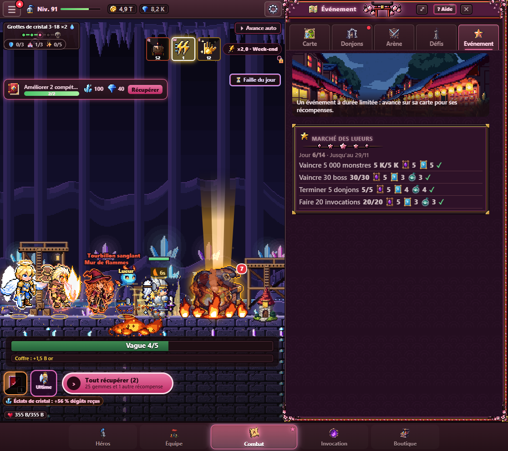

**Constat** :
- L'onglet Événement montre une bannière et **4 lignes de texte** (« Vaincre 5 000 monstres 5 K/5 K 5 5 ✓ ») avec des icônes de 16 px.
- La phrase d'aide dit « avance sur sa carte », mais **il n'y a pas de carte**.
- Rien ne montre ce qu'on gagne à la fin.
- Part d'image : **17 %**.

**Maquette** :

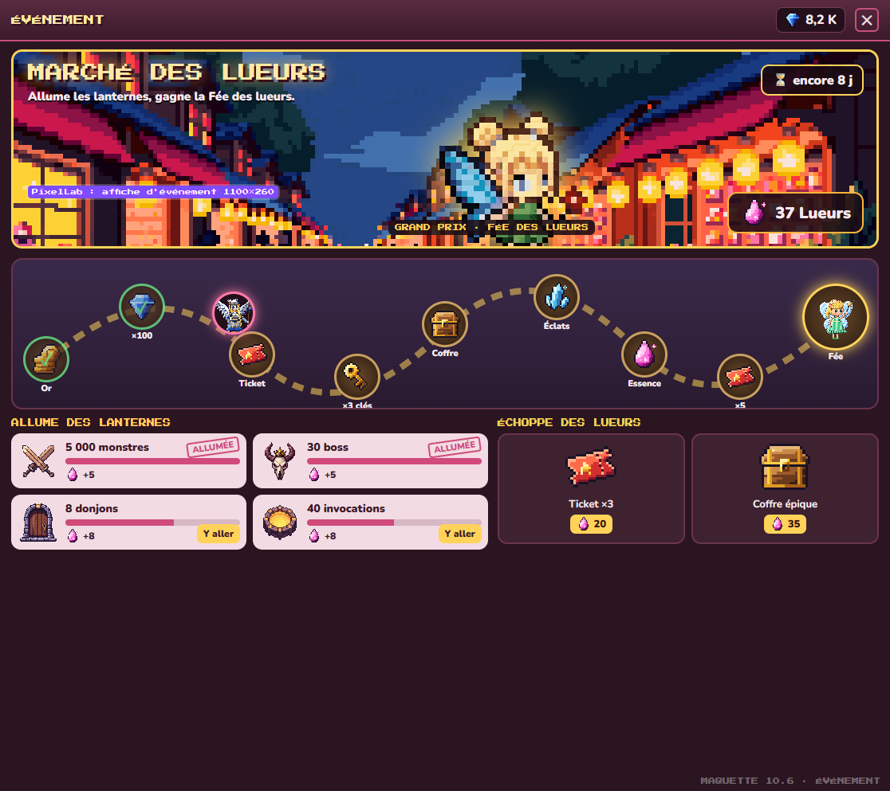

**À faire** :
1. **Affiche de l'événement** (PixelLab, 1100 × 260). Elle porte :
   - le nom en grand et une phrase (« Allume les lanternes, gagne la Fée des lueurs. ») ;
   - le minuteur (« encore 8 j ») ;
   - la monnaie de l'événement (« 37 Lueurs ») ;
   - **le grand prix dessiné en grand** (compagnon, familier ou apparence).
2. **La carte de l'événement** : un chemin dessiné avec 10 étapes (lanternes éteintes ou allumées), une récompense en icône à chaque étape, et le portrait du héros à l'étape atteinte. Le grand prix est au bout, entouré d'or.
   - Quand on atteint une étape, la lanterne s'allume, le portrait avance, et la récompense saute dans le coffre.
3. **Missions de l'événement** en tuiles Carnet : une icône de 52 px, un titre court, une barre, la récompense en Lueurs, et un tampon « ALLUMÉE » ou « Y aller ».
4. **Échoppe de l'événement** : 4 à 6 objets illustrés, avec leur prix en Lueurs.
5. **Un modèle réutilisable** : chaque futur événement fournit son affiche, sa lanterne (ou l'équivalent), son grand prix et ses missions. Le moteur ne change pas. Cela va avec le plan « jeu service » (des événements toutes les 2 semaines).

**Tests** :
- Part d'image de l'onglet Événement d'au moins 50 %.
- 60 mots au plus hors tuiles.
- Le grand prix est visible sans défiler.

---

## 4. Équipement : le filtre par case et la fenêtre d'objet (repris du 10.5)

**Constat en 10.4.0** :
- **Pas de filtre.** Toucher la case « Arme » (`eq-slot=weapon`) laisse le sac à **54 objets sur 54**, puis toucher « Anneau » aussi.

  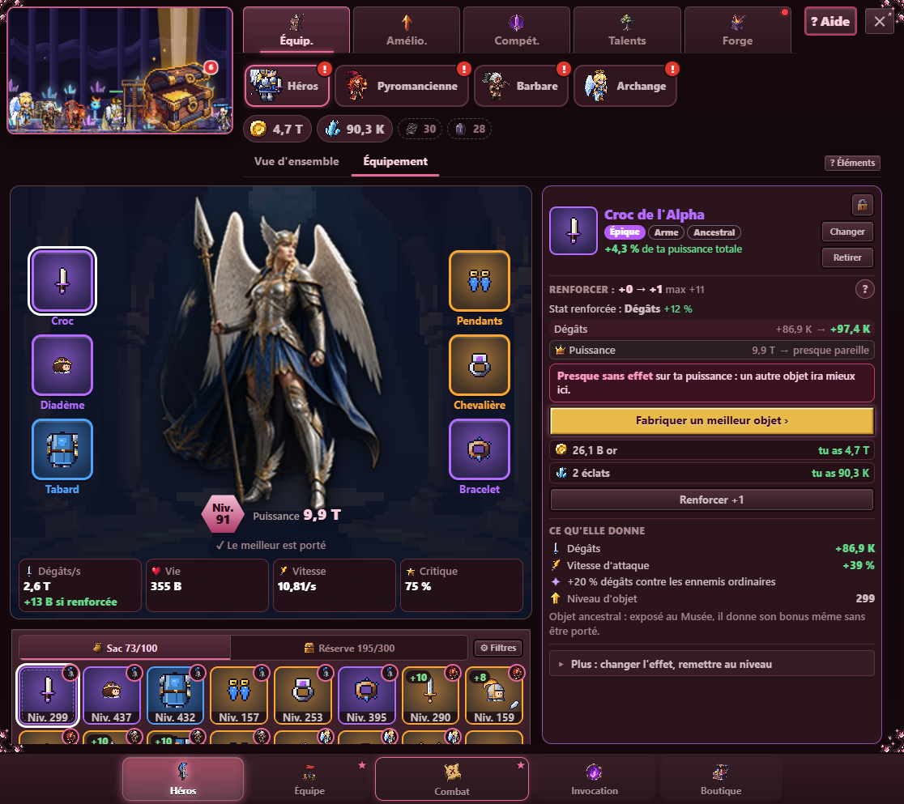

- **Pas de fenêtre d'objet.** Toucher un objet du sac met à jour la fiche de droite, mais rien ne s'ouvre là où on a touché. Les icônes d'objets sont toujours les sprites de 16 px agrandis.

  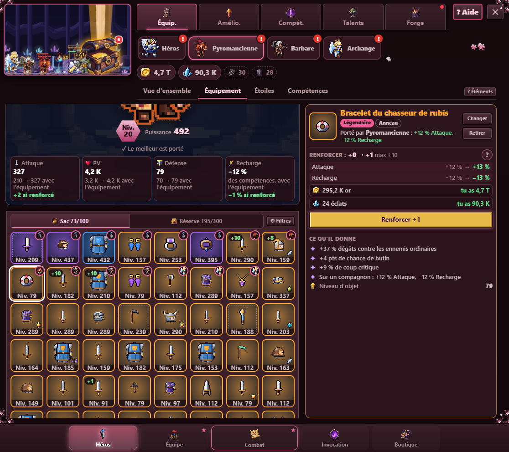

**Maquettes** :

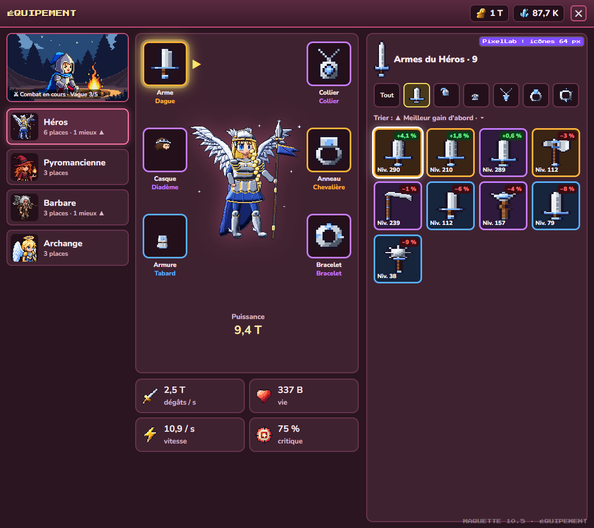

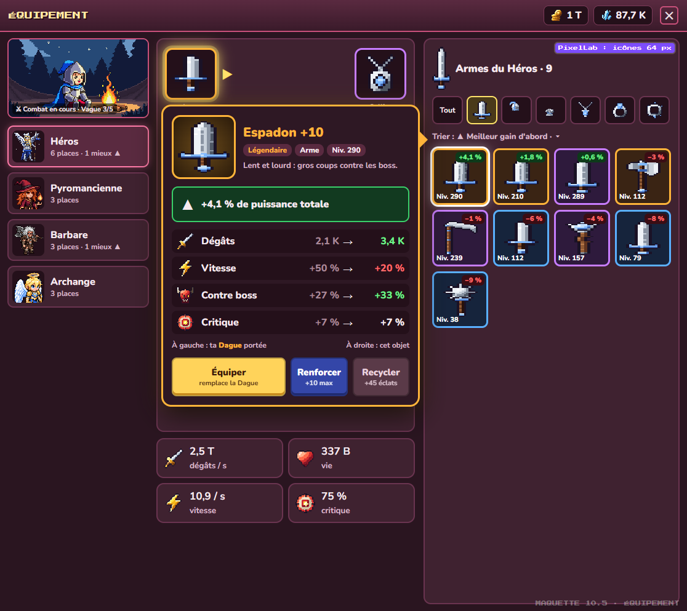

**À faire** :
1. **Toucher une case filtre le sac sur cette place.** Le titre devient « Armes du Héros · 9 », avec 7 puces illustrées (Tout, Arme, Casque…).
2. **Tri « Meilleur gain d'abord »**, et une pastille +x % (vert) ou −x % (rouge) sur chaque objet.
3. **Fenêtre de l'objet** à côté de l'objet touché, ou en feuille du bas sur téléphone. Elle contient :
   - l'icône en 104 px ;
   - une phrase sur ce que fait l'objet ;
   - le verdict en bandeau vert ou rouge ;
   - les statistiques qui changent (« porté → celui-ci ») ;
   - les boutons **Équiper**, **Renforcer** et **Recycler**.
4. **Icônes d'objets en 64 px** (PixelLab P1).
5. **Animation** : en équipant, l'objet vole dans sa case, et la Puissance défile jusqu'à sa nouvelle valeur (0,6 s).

**Tests** :
- Case Arme : le sac n'affiche que des armes.
- Un toucher sur un objet ouvre une fenêtre visible.

---

## 5. Améliorations et tri du coffre (repris du 10.5)

**Améliorations**

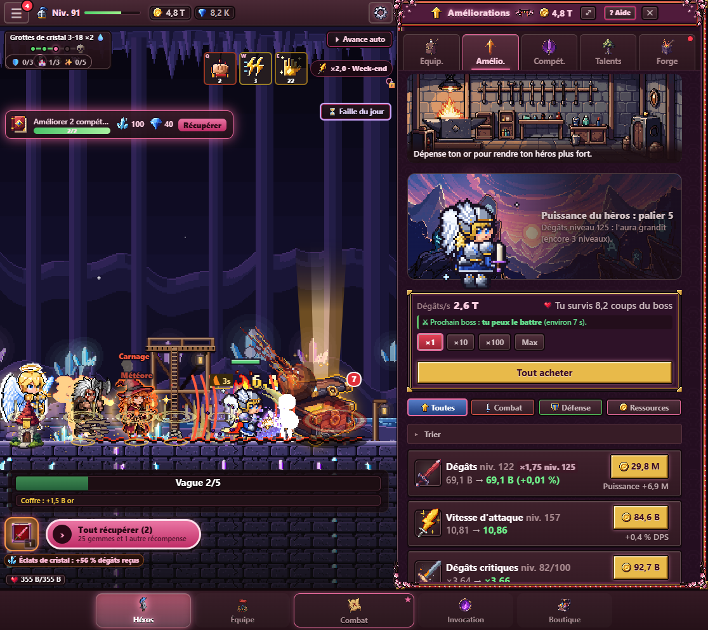

Constat :
- C'est mieux en 10.4 : un bandeau, « Puissance du héros : palier 5 » et « Tu survis 8,2 coups du boss ».
- Mais la liste propose encore « Dégâts niv. 122 → 125 : 69,1 B → 69,1 B (+0,01 %) » avec un bouton jaune.
- Le meilleur achat ne se distingue pas.
- L'écran reste dans le volet étroit.

À faire (maquette `images/maquettes/05-ameliorations.png`) :
- la carte « ★ Meilleur achat » avec sa raison en image ;
- 3 groupes dessinés (Frapper fort, Tenir, Gagner plus) ;
- les tuiles du Carnet ;
- tout gain sous 0,5 % en grisé, et sorti de « Tout acheter » ;
- la page plein écran.

**Tri du coffre**

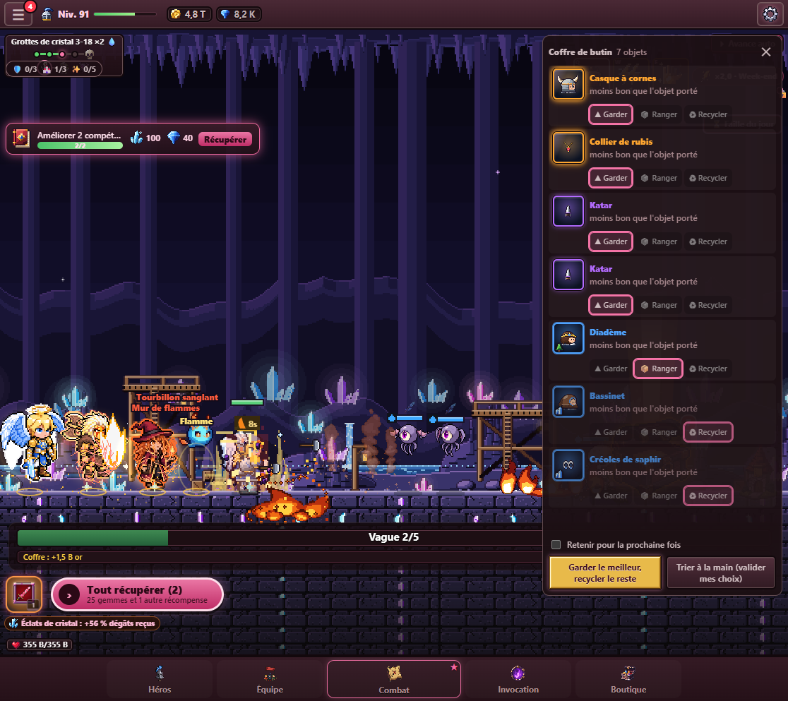

Constat : toujours une liste de lignes « moins bon que l'objet porté » avec 3 petits boutons.

À faire :
- une grille d'icônes de 64 px avec la pastille de gain et le choix proposé dessiné sur l'objet ;
- toucher un objet ouvre sa fenêtre (partie 4) ;
- 2 gros boutons.

**Recherches** (pour info, c'est bien fait en 10.4)

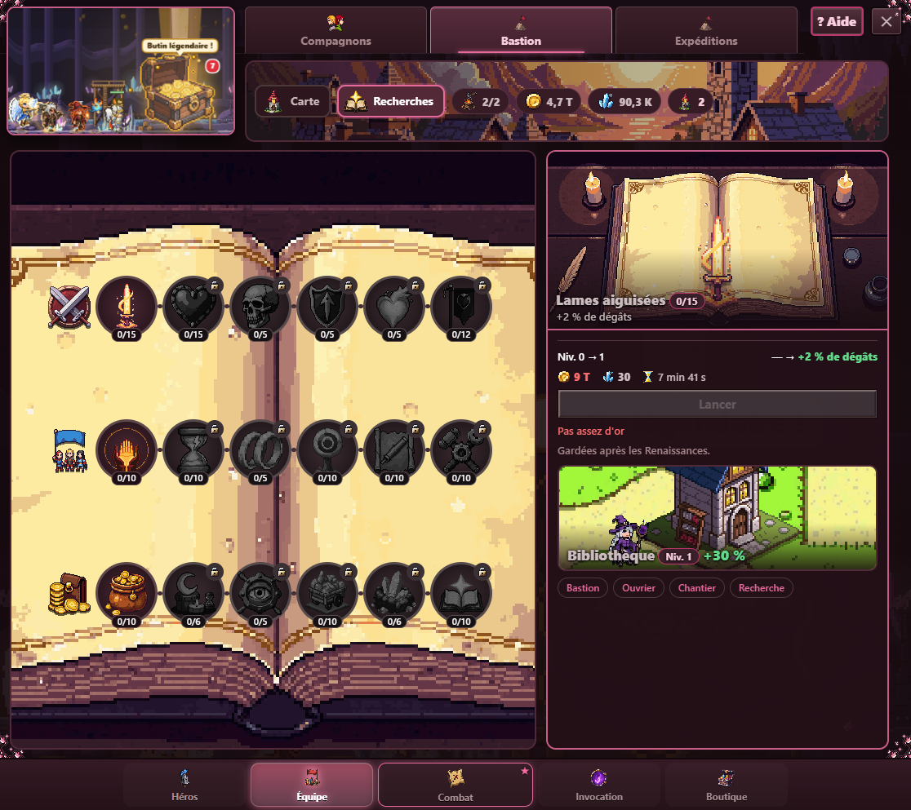

Le livre est réussi. Deux retouches :
- les médaillons verrouillés sont trop sombres : passer à 70 % d'opacité, avec le cadenas ;
- écrire le nom en 1 ou 2 mots sous chaque médaillon.

---

## 6. Animations : là où elles valent la peine

À faire, chacune courte (0,3 à 0,8 s) :

| Où | Animation | Pourquoi |
|---|---|---|
| Quête finie (écran de jeu) | éclat doré, icônes de récompense qui volent vers l'or et les gemmes en haut, quête suivante qui glisse | voir qu'on a gagné quelque chose, et où ça va |
| Équiper un objet | l'objet vole dans sa case, la Puissance défile | relier l'action au gain |
| Acheter une amélioration | l'icône pulse, « maintenant → après » défile | sentir le gain |
| Recherche terminée | le trait s'allume jusqu'au médaillon suivant, qui se retourne | montrer ce qui s'ouvre |
| Événement | la lanterne s'allume, le portrait avance | donner envie de continuer |
| Icône d'événement urgente | pulsation douce (1,2 s) | attirer l'œil sans crier |
| Prime du Héraut | l'affiche glisse et tremble légèrement à l'arrivée | marquer la nouveauté |
| Coffre | l'arc de l'objet jusqu'au coffre en bas à droite (partie 1) | relier le butin au coffre |

**À ne pas faire** : animer les listes, les textes ou les boutons au repos.

**Test** : avec « réduire les animations », il ne reste que les déplacements utiles (objet qui vole, portrait qui avance), sans pulsation.

---

## 7. Fenêtre large : la mise en page ne suit pas

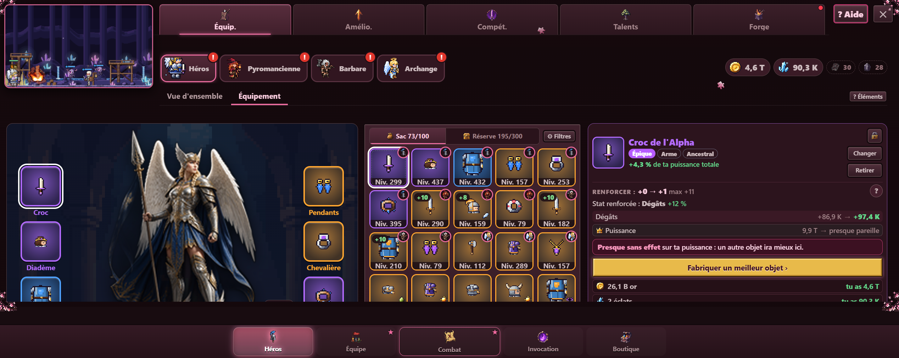

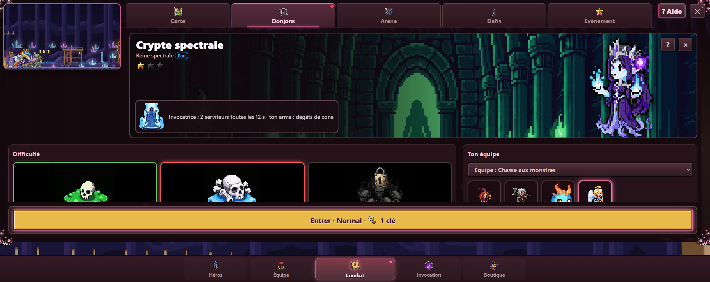

**Constat en 2536 × 1011** :
- **Écran de jeu** : le combat tient dans le tiers haut et la moitié basse est un mur de briques vide. La barre de vague traverse tout l'écran. Les compétences et « Tout récupérer » flottent au milieu.
- **Héros coupé** : l'Archange est coupé au bord gauche.
- **Page Personnage** : le personnage est coupé à mi-corps, et le sac et la fiche sont coupés en bas.
- **Page Donjon** : les 3 tuiles de difficulté sont de grands carrés noirs avec une petite icône. « Tu gagnes » et les portes sont sous le pli.

**À faire** :
- Les pages plein écran gardent une largeur de contenu de **1600 px au plus**, centrée. Au-delà, le décor de la page remplit les côtés.
- La hauteur se calcule pour que tout tienne en 1011 px, sans défiler.
- L'écran de jeu garde le rapport de la scène : le combat s'agrandit en hauteur au lieu de laisser une bande vide. La barre de vague et les boutons restent collés sous le combat.
- L'équipe commence à 40 px du bord gauche au moins.

**Test** : en 2536 × 1011 et en 1920 × 1080, aucune page ne défile pour l'essentiel, et aucun personnage n'est coupé.

---

## 8. Débutant : le Sceau propose la Fusion avant que la Forge soit ouverte

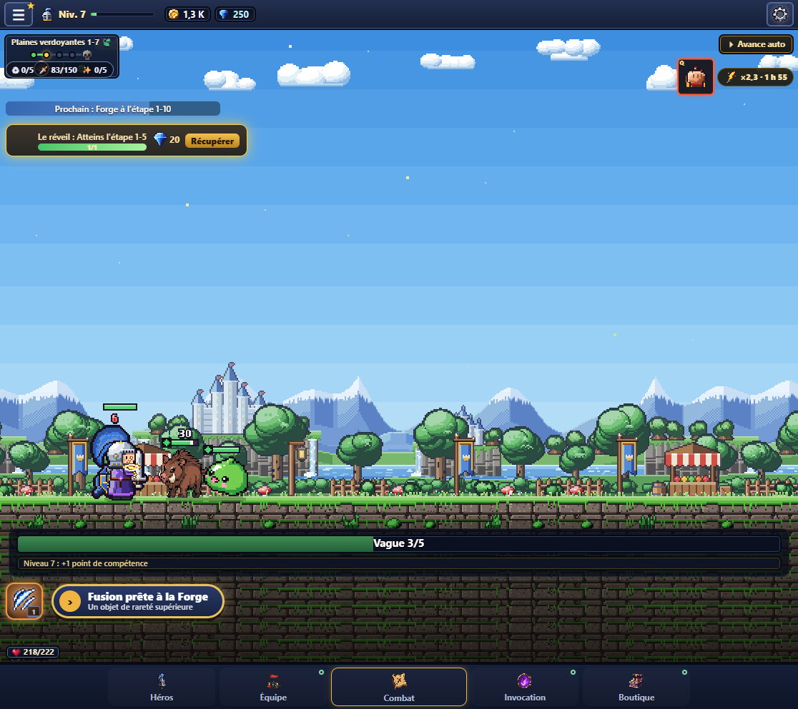

**Constat** (partie neuve) :
- À l'étape 1-7, le Sceau dit « **Fusion prête à la Forge** ». La ligne au-dessus annonce « Prochain : Forge à l'étape 1-10 ».
- Le joueur est envoyé vers un écran qui n'est pas encore ouvert. Pendant ce temps, la quête « Le réveil : Atteins l'étape 1-5 » attend d'être récupérée.
- **Cause probable** : `src/core/guide.js`, ligne 137 :

  ```js
  const open = (tab) => (ctx.visible ?? {})[tab] !== false;
  ```

  Un onglet absent de `ctx.visible` est considéré comme ouvert. La ligne 204 propose donc la fusion dès que `fusionReady` est vrai.
- **Correction** : tester le déblocage (`isUnlocked(state, 'forge')`) pour les onglets qui en ont un.
- **Mesure** : la partie neuve atteint l'étape 7 et le niveau 7 en 5 min, contre l'étape 11 et le niveau 9 en 10.3.

**Test** : avant l'étape 1-10, le Sceau ne parle jamais de la Forge, de la Fusion ni du Renforcement.

---

## 9. Petits défauts

- **CSP** : `src/ui/ui.js`, ligne 3235, carte de bénédiction de donjon (`boon-card`). Le `onerror="this.remove()"` en ligne est bloqué par la CSP : 6 erreurs en console pendant un seul donjon. Utiliser l'écouteur commun de `src/ui/common.js` (ligne 46).
- **Téléphone** :
  - le bandeau des onglets (`HEADER`) déborde de l'écran dans 15 onglets ;
  - la rangée des personnages de l'équipement coupe « Archange » ;
  - les bannières de donjon débordent du volet.
- **Écrans encore sous 20 % d'image** : Missions (14 %), Talents (16 %), Boutique (16 %), Événement (17 %, partie 3), Boss (17 %), Compagnons (19 %). Voir la liste PixelLab, partie P2.
- **Bandeau de quête coupé** : « Améliorer 2 compét… ». La carte de la partie 2 règle ce point.

---

## 10. Tests de fin

- **Captures** : chaque écran en 1116 × 993, 2536 × 1011 et 390 × 844, rangées dans `docs/screenshots/v10.6/`, à côté des maquettes.
- **Mesures** :
  - au moins 35 % d'image dans chaque onglet ;
  - au moins 50 % pour l'Événement ;
  - au plus 15 mots par tuile.
- **Coffre** : jamais sur un monstre ou un héros.
- **Écran de jeu** : une quête, 3 tâches et 5 événements visibles.
- **Équipement** : le filtre par case et la fenêtre d'objet fonctionnent.
- **Débutant** : aucun conseil vers un écran fermé.
- **PixelLab** : les fichiers P0 et P1 existent dans `assets/ui/art106/`.
- **Revue complète des menus** : aucune erreur, CSP comprise.
