# Ascendrya 10.7 : finitions après le test de la 10.6.0

> **Pour Claude, avant de commencer :**
> - Copie ce dossier tel quel dans le dépôt, sous `docs/prompt-v10.7/`.
> - **Ouvre avec l'outil Read chaque image citée** quand sa partie arrive. Les dossiers :
>   - `images/joueur/` : captures envoyées par le joueur ;
>   - `images/actuel/` : jeu 10.6.0 testé ;
>   - `images/maquettes/` : résultat attendu.

## Contexte

**Version testée** : Ascendrya 10.6.0, le 21/11 au soir, sur la partie du joueur (niveau 106, Montagnes gelées 5-14). Formats :

| Format | Taille | Écrans |
|---|---|---|
| PC, fenêtre du joueur | 1116 × 993 | 176 |
| Téléphone | 390 × 844 | 173 |
| Fenêtre large | 2536 × 1011 | quelques-uns |

Une partie neuve a aussi été jouée.

**Résultat** : aucune erreur JavaScript, aucune image cassée, aucun « NaN ».

**Le prompt 10.6 est appliqué presque en entier**, et c'est un vrai pas en avant :
- quête « Chemin du héros », Carnet en 3 lignes, colonne d'événements, Prime du Héraut ;
- coffre en bas à droite ;
- Marché des Lueurs illustré ;
- filtre par case et fenêtre d'objet ;
- icônes d'objets en 64 px ;
- Améliorations en page ;
- tri du coffre en grille ;
- fenêtre large corrigée pour les pages.

**À garder.**

**Ce que le joueur dit (21/11, 23 h)** :
- « quand on lance le jeu, on me rebalance à chaque fois les mêmes news que j'ai eues » (`images/joueur/01-nouveau-equipement-a-chaque-lancement.png`) ;
- « les icônes de Bastion et des autres, à mettre juste en dessous de la bande » (`images/joueur/02-icones-evenements.png`) ;
- « que tous les menus et onglets soient bien faciles à comprendre et complets ».

**Règles, inchangées** :
- **Toutes les images viennent de PixelLab**, par l'API (`tools/art/pl939_api.py`).
- **Le Carnet reste le modèle de tuile.**
- **S'inspirer sans copier.**
- **Chaque partie se termine par ses tests.**

**Ordre conseillé** : 1, 2, 3, 4, 5, 6, 7.

---

## 1. Les cartes « Nouveau » reviennent à chaque lancement (bug, à faire en premier)

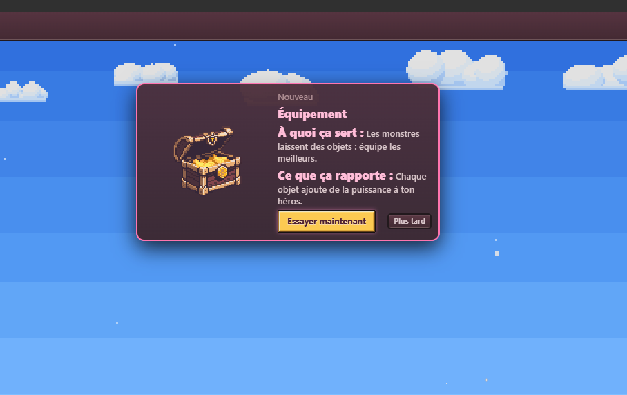

**Reproduit** :
1. La sauvegarde du joueur contient `ui.learned` avec les 10 notions déjà vues (`upgrades`, `inventory`, `skills`, `lootbag`, `summon`, `forge`, `contracts`, `tower`, `dungeons`, `defis`).
2. Je recharge la page (comme une relance du jeu) : la carte « Nouveau · Améliorations » s'affiche.
3. `__idle.state.ui.learned` vaut `["upgrades"]`.
4. Je relance : la même carte revient.

Une notion s'ajoute à chaque session, mais la liste repart de zéro à chaque chargement. Le joueur revoit donc « Améliorations », puis « Équipement », puis « Compétences », etc.

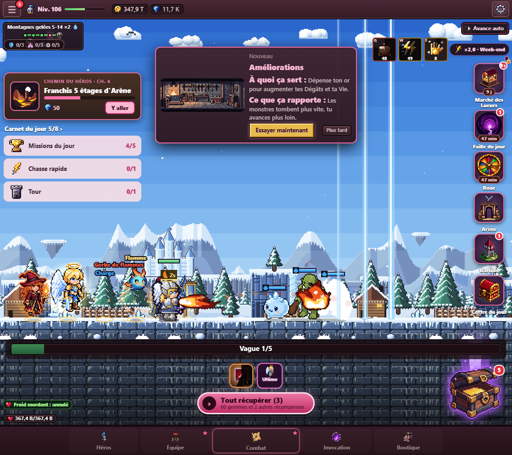

**Cause** : `src/core/state.js`, fonction de chargement (vers les lignes 630 à 700).
- Les champs de `raw.ui` sont recopiés un par un dans une liste blanche.
- **`learned` et `seenRes` n'y sont pas** : ils sont écrits dans la sauvegarde, mais jamais relus.
- Même famille de risque pour tout champ `ui` ajouté depuis la 10.1 : à vérifier un par un.

**Correction** :

```js
if (Array.isArray(raw.ui.learned)) state.ui.learned = raw.ui.learned.filter((x) => typeof x === 'string' && /^[a-z]{2,16}$/.test(x)).slice(0, 32);
if (Array.isArray(raw.ui.seenRes)) state.ui.seenRes = raw.ui.seenRes.filter((x) => typeof x === 'string' && /^[a-z]{2,16}$/.test(x)).slice(0, 32);
```

**Pour les joueurs déjà touchés** : au chargement, marquer comme vue toute notion dont l'étape est déjà dépassée, quand `records.bestStage` est au-delà de l'étape de la notion et que la partie a plus de 30 boss vaincus. Ainsi, plus aucune carte ne revient.

**Garde-fou général** : ajouter un test qui sauvegarde un état où chaque champ de `ui` est rempli, le recharge, et vérifie que tout revient. Ce test aurait attrapé ce bug.

**Tests** :
- Recharger trois fois la partie du joueur : aucune carte « Nouveau ».
- Une partie neuve voit chaque carte une seule fois, même en rechargeant entre deux cartes.

---

## 2. Icônes d'événements : une rangée juste sous la bande du haut

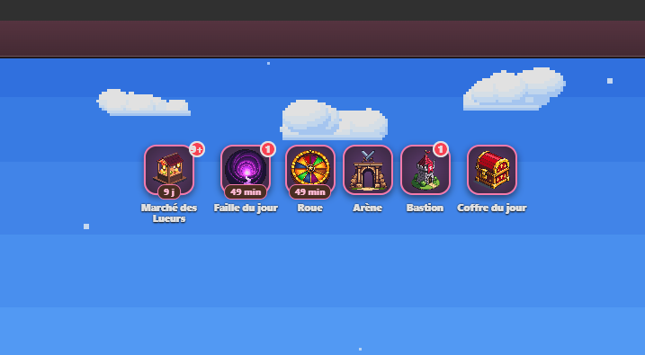

**Constat** :
- **PC (1116 × 993)** : la colonne de droite (Marché, Faille, Roue, Arène, Bastion, Coffre du jour) descend jusqu'au sol du combat. Elle chevauche la maison du décor et passe à côté des monstres.

  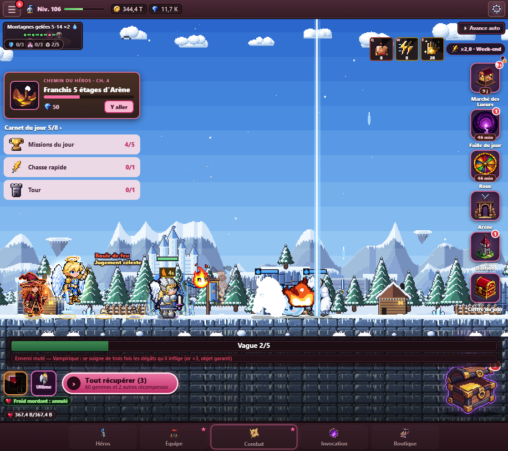

- **Volet ouvert** (Compagnons, Missions…) : la colonne se tasse **sur le combat**. Les icônes Arène, Bastion et Coffre du jour couvrent les monstres.

  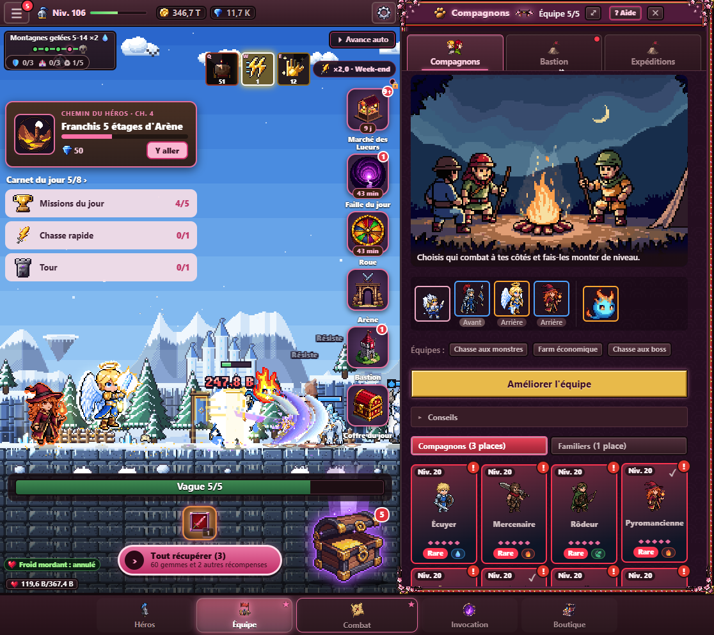

- **Fenêtre large** : les icônes forment une rangée qui flotte au milieu du ciel, et la carte de quête flotte au-dessus de l'équipe.

  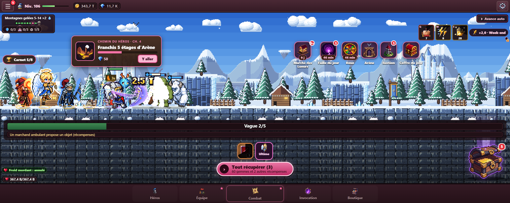

**À faire** (maquettes `images/maquettes/01-evenements-sous-la-bande-pc.png` et `02-…-large.png`) :
- **Une seule rangée horizontale, accrochée juste sous la bande du haut** (sans espace), dans tous les formats.
  - Elle commence après la carte de zone, à gauche.
  - Elle s'arrête avant les boosts Q/W/E, à droite.
  - Ordre : Marché, Faille, Roue, Arène, Bastion, Coffre du jour.
- **Icônes de 56 px**, avec le nom en dessous sur une ligne, le minuteur sur l'icône et la pastille en haut à droite.
- Fond : un bandeau sombre aux coins bas arrondis, qui prolonge la bande du haut.
- **Toujours la même place**, volet ouvert ou fermé. Quand un volet s'ouvre, la rangée se coupe à la largeur restante, et ce qui dépasse passe dans un bouton « + ».
- **Téléphone** : la même rangée sous la bande, avec 4 icônes et « + ».
  - Les noms tiennent sur une ligne : « Marché », « Faille », « Roue », « Arène », « Bastion », « Coffre ». Aujourd'hui on lit « Marché … » et « Faille du … ».
- **Prime du Héraut** : elle glisse juste sous cette rangée.
- **La carte « Chemin du héros » et le Carnet** restent à gauche, sous la carte de zone. En fenêtre large, ils se calent sous la carte de zone au lieu de flotter au-dessus de l'équipe.

**Tests** :
- En 1116 × 993, 2536 × 1011 et 390 × 844, volet ouvert et fermé : aucune icône d'événement ne chevauche un héros, un monstre ou le coffre.
- La rangée touche la bande du haut, sans espace entre les deux.

---

## 3. Équipement : 4 retouches

1. **Titre « accessory du Héros · 35 »** (fenêtre large, partie du joueur).

   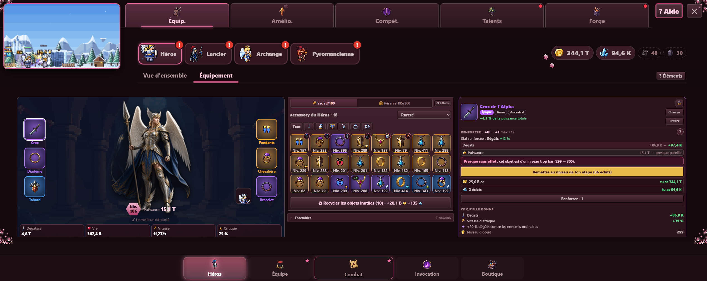

   - La sauvegarde garde `ui.slotFilter = 'accessory'` (ancien filtre). `state.js`, ligne 637, l'accepte encore.
   - `inventory.js`, ligne 322 : `PLURAL` n'a pas d'entrée `accessory`, donc le mot anglais s'affiche, et aucune puce n'est allumée.
   - **Correction** : au chargement, `accessory` devient `all`.
2. **Le nombre ne correspond pas à la grille** : « Armes du Héros · 8 », mais 12 objets affichés (les 4 armes portées par les compagnons s'ajoutent). Écrire « 8 · +4 portées », ou séparer les objets portés par une petite ligne.
3. **La fenêtre d'objet** marche bien (verdict, porté → celui-ci, 3 boutons) :

   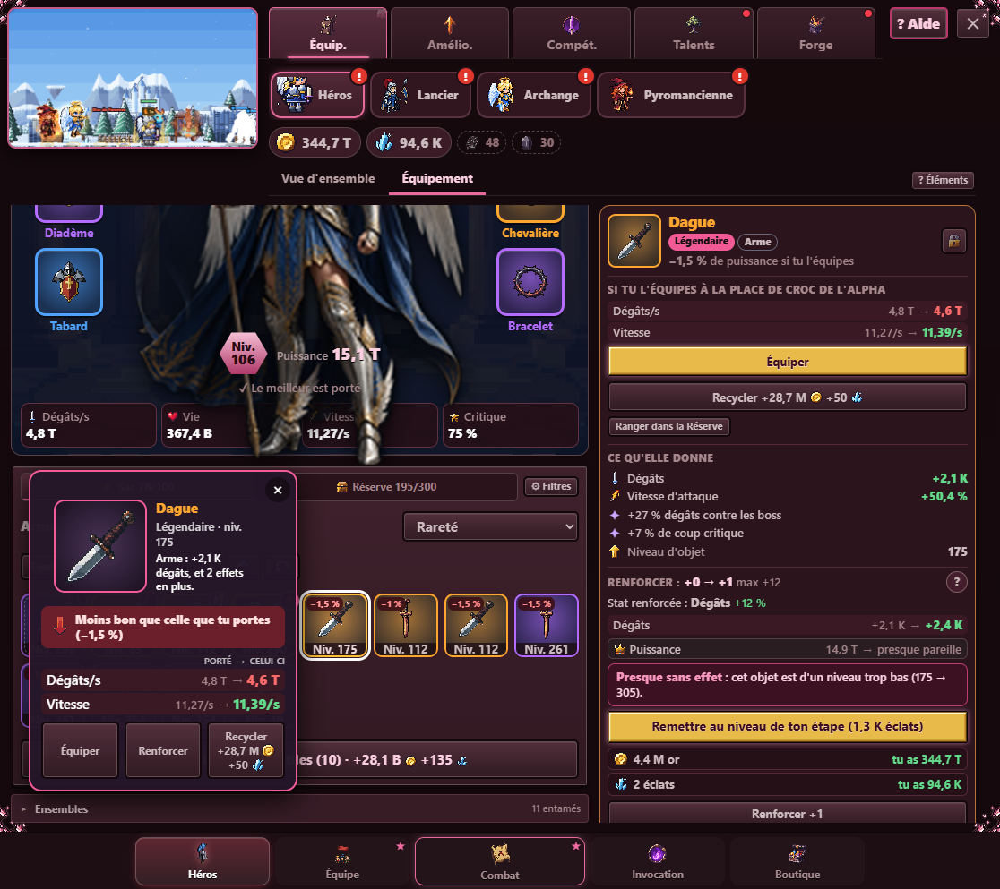

   Mais la fiche de droite répète exactement la même chose (Équiper, Recycler, ce qu'elle donne). Quand la fenêtre est ouverte, la fiche de droite reste sur **l'objet porté**, pour comparer côte à côte. Ajouter aussi la petite flèche qui relie la fenêtre à l'objet touché.
4. **Compagnon affiché en sprite flou** : toucher une arme portée par le Lancier ouvre son onglet. Le Lancier s'y affiche en sprite de combat agrandi ×6, flou, à la place d'une illustration.

   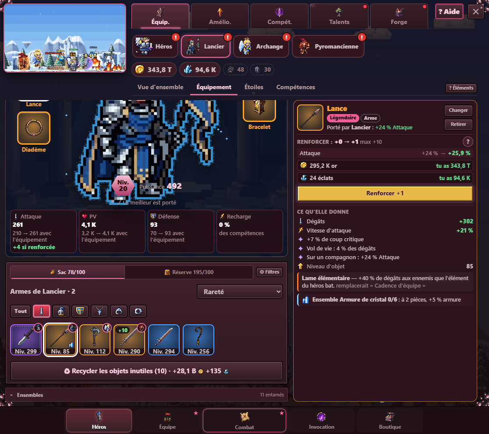

   Utiliser son portrait HD (`assets/hd/px/ally_*.webp`), comme pour le héros. Sinon, un agrandissement entier (×3 ou ×4) avec `image-rendering: pixelated`.

**Tests** :
- Une sauvegarde avec `slotFilter: 'accessory'` affiche « Tout le sac », avec la puce « Tout » allumée.
- Le nombre du titre correspond à ce qui est affiché.

---

## 4. Améliorations : le « Meilleur achat » n'apparaît pas, et les conseils se contredisent

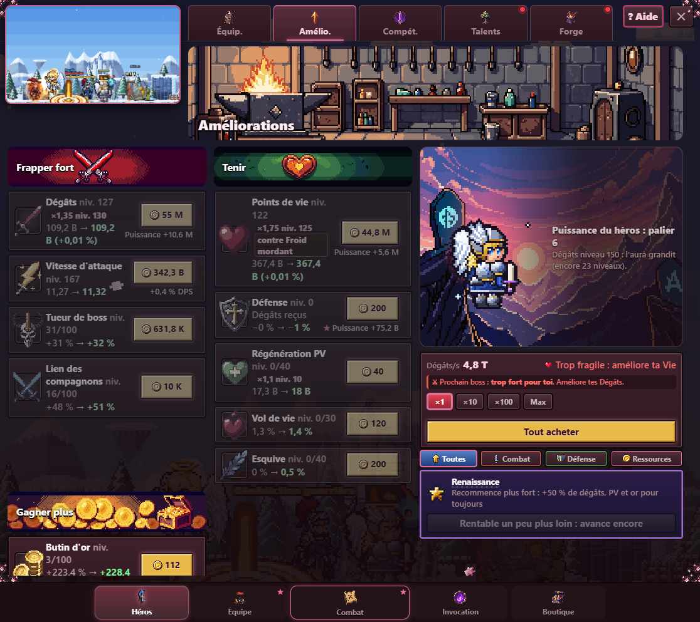

**Constat** (partie du joueur, 343 T d'or) :
- **Aucune carte « ★ Meilleur achat »** dans la page : elle n'est pas dans le DOM.
- **Presque toutes les lignes sont grisées.** À ×1, Dégâts et Points de vie donnent « +0,01 % », alors que le joueur a assez d'or pour des dizaines de niveaux.
- **Les conseils se contredisent** :
  - le bandeau dit « Trop fragile : améliore ta Vie », mais la ligne Points de vie est grisée ;
  - « Prochain boss : trop fort pour toi. Améliore tes Dégâts », mais Dégâts est grisé.
- **Des prix minuscules sont grisés** (« Défense 200 », « Régénération 40 »). Le joueur ne comprend pas pourquoi une amélioration à 40 d'or n'est pas proposée.
- **Mise en page** : le groupe « Gagner plus » passe sous la colonne « Frapper fort » et laisse un trou. L'illustration « Puissance du héros » prend un tiers de la page.

**À faire** (maquette `images/maquettes/03-ameliorations.png`) :
1. **Juger le gain sur le mode choisi.** Avec « Max », le gain est celui de tous les niveaux qu'on peut s'offrir, et c'est ce gain qui décide du grisé. Le mode par défaut, pour une partie avancée, est « Max ».
2. **La carte « ★ Meilleur achat » est toujours là** dès qu'un achat rapporte quelque chose. Si rien ne rapporte plus de 0,5 %, elle le dit en image : « Ton or ira plus loin dans ton équipement », avec un bouton vers la Forge.
3. **Le conseil du bandeau et le meilleur achat disent la même chose.** S'il conseille la Vie, la ligne Vie est mise en avant. Il ne conseille jamais une ligne grisée.
4. **Mise en page** : 3 colonnes égales (Frapper fort, Tenir, Gagner plus). La carte « Meilleur achat » et « Tout acheter » vont au-dessus, sur toute la largeur. L'illustration du héros se réduit à un médaillon de 120 px dans la carte « Meilleur achat ».

**Tests** :
- Partie du joueur : la carte « Meilleur achat » est visible.
- Aucune contradiction entre le bandeau et les lignes grisées.

---

## 5. Illustrations : deux soucis

1. **La bannière des Compétences montre des lettres sans sens** (« A o 1 E B a S k U s »), un défaut de génération PixelLab.

   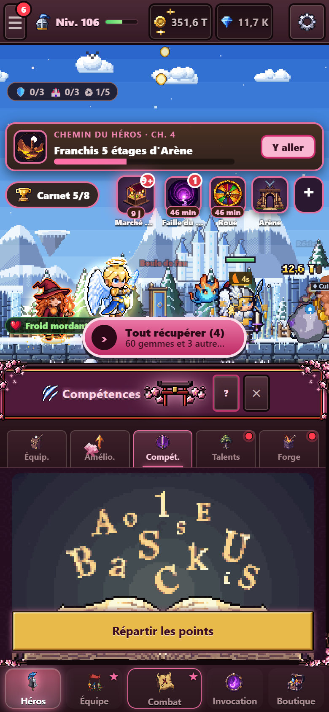

   Refaire `assets/ui/art101/banner_skills.png` avec `no text, no letters` dans le prompt, par exemple : « an open spellbook with glowing runes and floating magic symbols, no text, no letters ». Vérifier de la même façon toutes les bannières : aucune lettre inventée.
2. **Onglets encore sous 35 % d'image**, mesurés à ma façon (surface des images sur surface de l'onglet, défilement compris) :

   | Onglet | Part d'image |
   |---|---|
   | Statistiques | 18 % |
   | Missions | 21 % |
   | Boutique | 25 % |
   | Boss (Profil) | 26 % |
   | Compagnons | 27 % |
   | Apparences | 27 % |
   | Carnet | 30 % |
   | Compétences | 34 % |

   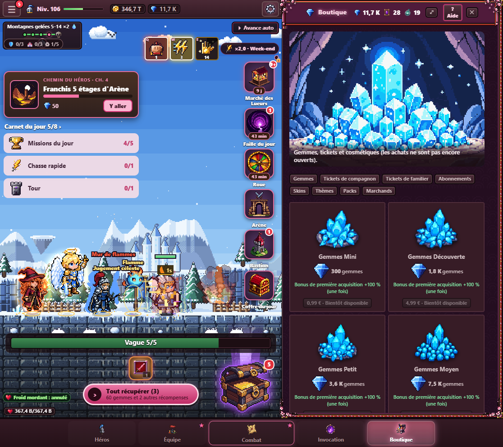

   Pour chacun, l'idée est la même :
   - les lignes de texte deviennent des tuiles Carnet, avec une icône de 48 à 64 px ;
   - les grandes listes (Statistiques, Apparences) sont groupées sous des têtes dessinées.

---

## 6. Écran de jeu en fenêtre large

Les pages tiennent maintenant, c'est bien. Mais sur l'écran de jeu en 2536 × 1011, le combat occupe encore le haut, et **un tiers de l'écran sous la barre de vague reste un mur de briques vide**. On y voit seulement « Tout récupérer » et 2 boutons au milieu.

Au choix :
- agrandir la scène jusqu'à la barre de vague ;
- ou poser dans cette bande le coffre, le Sceau et les compétences, alignés en une seule rangée.

**Test** : en 2536 × 1011, pas de zone vide de plus de 150 px de haut sous le combat.

---

## 6 bis. Skins du héros : 5 illustrations ne collent pas au jeu

Le joueur : « pour le héros, le skin ne colle pas du tout avec le jeu, revoir les skins du héros également ».

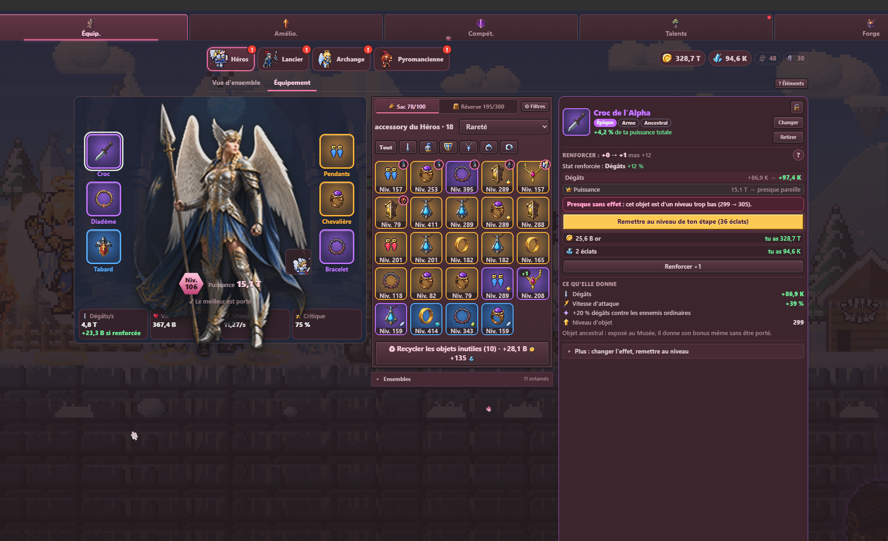

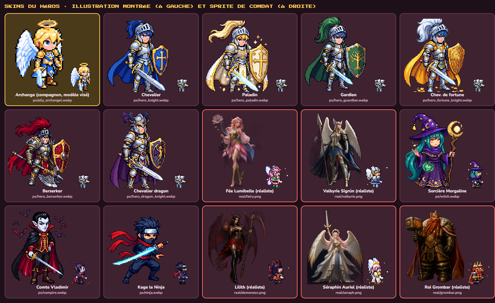

**Constat** (planche : l'illustration montrée à gauche, le sprite de combat à droite) :

1. **5 skins utilisent une peinture réaliste** de `assets/hd/real/` : Fée Lumibelle, Valkyrie Sigrún, Lilith, Séraphin Auriel et Roi Grombar. C'est `HD_REAL` dans `src/data/hd-real.js`, importé par `tools/art/import_real.py`. On le voit sur :
   - la page Personnage (en grand, 300 px et plus) ;
   - les Apparences ;
   - l'invocation.

   **Elles ne ressemblent pas non plus au personnage du combat** :
   - la Valkyrie est peinte en femme brune, de taille adulte, alors que son sprite est une petite guerrière blonde chibi ;
   - Séraphin a les cheveux roses en combat et une robe blanche sur la peinture ;
   - Grombar est un nain réaliste.
2. **Les 6 héros de base ont la même illustration** (le même chevalier, casque, épée et bouclier), seules les couleurs changent. Le **Berserker** y tient une épée et un bouclier, alors que sa classe se bat à la hache. Rien ne distingue le Gardien du Chevalier de fortune, sinon la couleur de la cape.
3. Les bons exemples, au style du jeu : Sorcière Morgaline, Comte Vladimir, Kage le Ninja, et l'Archange (compagnon), qui sert de modèle.

**À faire** :
1. **Retirer `assets/hd/real/`** du jeu. `HD_REAL` devient vide, et `import_real.py` est retiré.
2. **Refaire ces 5 skins avec PixelLab**, avec la méthode de `tools/art/pl10_fiches.py` :
   - image de départ = le sprite de repos du skin (`skin_<id>_idle.png`) ;
   - palette verrouillée, même pose, rien d'ajouté ;
   - modèle de style : `hd/px/ally_archangel.webp` ;
   - sorties : `assets/hd/px/<id>.webp` et sa vignette ;
   - vérifier avec `tools/art/check_fidelity.py`.

   Prompts (anglais, à ajouter au style commun) :

   | Skin | Prompt |
   |---|---|
   | `fairy` | a small cheerful flower fairy with pink hair, leaf dress and translucent wings, holding a glowing wand, chibi proportions like the game sprite |
   | `valkyrie` | a young blonde valkyrie with a winged silver helmet, white and blue armor, feathered wings and a spear, chibi proportions like the game sprite |
   | `demoness` | a playful demon girl with small horns, dark purple hair, red and black outfit, bat wings, a curved scythe, chibi proportions, not sexualized |
   | `seraph` | a radiant angel with pink hair, a golden halo, white and gold robe, large white wings, holding a holy sword, chibi proportions |
   | `grombar` | a sturdy dwarf king with a braided orange beard, golden crown, heavy fur cloak and a big war hammer, chibi proportions |

3. **Les 6 héros de base ont chacun une silhouette et une arme de leur classe.** Même méthode, depuis leur sprite de classe :

   | Héros | Ce qui le distingue |
   |---|---|
   | Chevalier | épée et bouclier, cape bleue |
   | Paladin | marteau sacré et bouclier doré, auréole légère |
   | Gardien | grand bouclier-tour, armure lourde verte |
   | Chevalier de fortune | rapière et bourse dorée, pièces qui volent |
   | Berserker | **hache à deux mains**, sans bouclier, fourrures, cheveux rouges en bataille |
   | Chevalier dragon | lance, armure à écailles violettes, petit dragon sur l'épaule |

4. **Garder la cohérence avec le combat** : l'illustration montrée en grand doit être le même personnage que le sprite qui se bat (couleurs, coiffure, arme). Ajouter un test qui place côte à côte l'illustration et le sprite de chaque skin dans `docs/screenshots/v10.7/skins.png`, pour validation par le joueur.

**Tests** :
- Aucune image de `assets/hd/real/` n'est affichée nulle part.
- `check_fidelity.py` passe pour les 14 skins.
- La planche des skins est jointe aux captures.

---

## 7. Tests de fin

- **Relances** : 3 relances de la partie du joueur, aucune carte « Nouveau ».
- **Icônes d'événements** : la rangée est sous la bande, en 3 formats, volet ouvert et fermé.
- **Équipement** : plus de « accessory », et le titre compte juste.
- **Améliorations** : le « Meilleur achat » est visible, sans contradiction.
- **Bannières** : aucune lettre inventée.
- **Skins** : aucune peinture réaliste ; 14 skins fidèles à leur sprite de combat.
- **Captures** : chaque écran en 1116 × 993, 2536 × 1011 et 390 × 844, dans `docs/screenshots/v10.7/`.
- **Revue complète des menus** : toujours aucune erreur.
