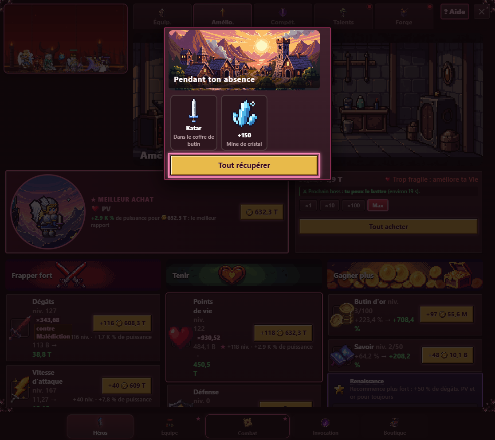
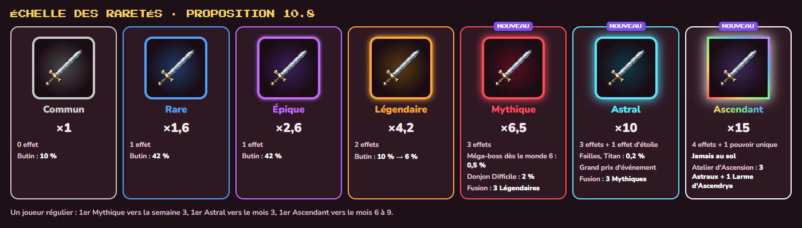
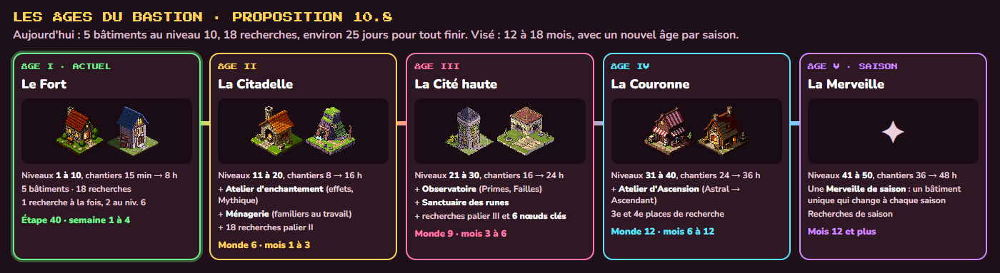
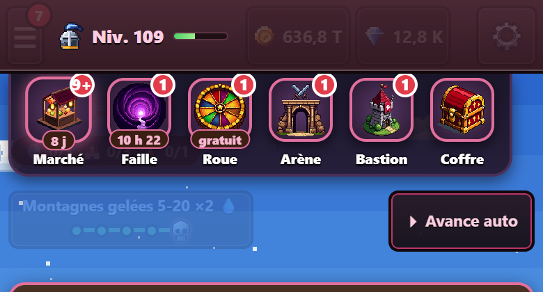

# Ascendrya 10.8 : faire durer le jeu (rythme, économie, nouvelles raretés, Âges du Bastion)

> **Pour Claude, avant de commencer :**
> - Copie ce dossier tel quel dans le dépôt, sous `docs/prompt-v10.8/`.
> - Ouvre avec l'outil Read chaque image citée.
> - Les sorties brutes des simulations sont dans `images/mesures/`.
> - Ce prompt complète le 10.7 : sa partie 6 ter (téléphone) n'est pas encore faite, elle est reprise en partie 6.

## Contexte

**Version testée** : la branche `claude/loving-volta-vrc4mx` (10.7, pas encore publiée), le 22/11, sur la partie du joueur.
- Niveau 109, étape max 522 (Failles).
- 6,1e14 d'or, 0 Renaissance.
- 12,4 h de jeu réel en 21 jours.

**Ce qui a été fait** :
- Revue de tous les menus : 180 écrans sur PC, 177 sur téléphone. Aucune erreur, aucune image cassée, aucun « NaN ».
- Les deux simulations du dépôt, lancées telles quelles :
  - `tools/sim-bastion.mjs` : 7 jours, 2 connexions de 20 min par jour ;
  - `tools/sim-economy.mjs` : 6 mois, 2 000 tirages par profil.

**Le prompt 10.7 est appliqué** :
- les cartes « Nouveau » ne reviennent plus (vérifié avec 3 relances) ;
- rangée d'événements sous la bande ;
- équipement corrigé (plus de « accessory », bon nombre d'objets) ;
- « Meilleur achat » présent ;
- skins du héros en pixel art ;
- bannière des Compétences sans lettres.

**À garder.**

**Ce que demande le joueur (22/11)** :
- vérifier que l'ergonomie et les illustrations sont intégrées partout et compréhensibles ;
- **pousser le jeu plus loin** ;
- **son équilibrage, pour un jeu en service continu qui doit durer** ;
- **ajouter des raretés supplémentaires aux armes et à l'équipement** ;
- **des bâtiments et des recherches assez conséquents sur la durée**.

**Règles inchangées** :
- images faites avec PixelLab, par l'API ;
- le Carnet comme modèle de tuile ;
- s'inspirer sans copier ;
- chaque partie se termine par ses tests ;
- **ne jamais rendre un joueur existant plus faible** : tout changement d'équilibrage garde la puissance actuelle des parties en cours.

**Ordre conseillé** :

| Ordre | Partie |
|---|---|
| 1 | Rythme et économie |
| 2 | Raretés |
| 3 | Âges du Bastion |
| 4 | Recherches |
| 5 | Renaissance |
| 6 | Téléphone et petites retouches |
| 7 | Tests |

---

## 1. Rythme : la campagne se termine en une semaine

**Mesure** (`images/mesures/sim-bastion-7-jours.txt`, profil « campagne », vrai moteur) :

| Jour | 1 | 2 | 3 | 4 | 5 | 6 | 7 |
|---|---|---|---|---|---|---|---|
| Étape atteinte | 80 | 120 | 155 | 184 | 220 | 275 | 306 |

- **Les 12 mondes (230 étapes) sont finis vers le jour 5 à 6**, avec 40 minutes de jeu par jour.
- La partie du joueur le confirme : étape 522 (au-delà, ce sont les Failles) en 12 h de jeu.
- Pour un jeu qui doit durer des années avec des mondes ajoutés au fil du temps, c'est **au moins 10 fois trop rapide**. Chaque nouveau monde serait consommé en une soirée.

**Objectif** pour un joueur régulier (2 à 3 connexions par jour, gains hors ligne compris). Ce sont des cibles : à régler par simulation.

| Moment | Monde atteint |
|---|---|
| Jour 1 | monde 2 |
| Semaine 1 | monde 4 |
| Semaine 2 | monde 5 |
| Mois 1 | monde 7 |
| Mois 2 | monde 9 |
| Mois 3 à 4 | monde 12 |

Ensuite viennent les Failles, puis **un nouveau monde toutes les 4 à 6 semaines**, prévu pour prendre 3 à 4 semaines à un joueur à jour.

**Leviers, à combiner, sans toucher les 3 premiers mondes** (le début reste rapide et agréable) :
1. **Courbe des PV après le monde 3** : dans `enemyScaling.campaign.hpLate`, `rate` passe de 1,02 à une valeur réglée par simulation, et le plafond `cap: 40` est relevé. Le but : un vrai ralentissement par monde, pas un mur.
2. **Sceaux de monde** : pour entrer dans les mondes 5, 7, 9 et 11, il faut un **Rang d'Ascension**, ou un **niveau de Bastion** (partie 3), ou **une Renaissance** (partie 5). La condition s'affiche en image à l'entrée du monde, avec un bouton vers ce qui fait avancer. C'est le principe des Sceaux déjà dans le jeu, étendu.
3. **Gains hors ligne** : plafond lié au niveau de la Veille et à la recherche « Longue veille ». Ne pas dépasser 8 h au début.
4. **Mur doux, jamais dur** : quand le joueur bloque plus de 30 min sur une étape, la carte « Comment devenir plus fort » propose les 3 meilleures actions du moment, en images (amélioration, objet, Renaissance, Bastion).

**Outil** : étendre `tools/sim-bastion.mjs` à **90 jours** (paramètre `--days`), avec 3 profils (occasionnel 1 connexion par jour, régulier 2, très actif 4). Il écrit l'étape et la puissance par jour dans `docs/rythme-v10.8.md`.

**Tests** : la simulation 90 jours, profil régulier, atteint le monde 7 entre les jours 25 et 40, et le monde 12 entre les jours 90 et 120.

---

## 2. Économie : l'or ne sert plus à rien en fin de jeu

**Constat** (partie du joueur) :
- **6,1e14 d'or en réserve.**
- Les prix des améliorations (`baseCost` × `costGrowth` par niveau) ne suivent pas l'or gagné (`goldGrowth` 1,0724 par étape). Des lignes coûtent 40, 120 ou 200 d'or : Régénération, Vol de vie, Défense.
- « Meilleur achat : PV +2,9 K % de puissance » : l'unité « K % » est illisible.

**À faire** :
1. **Prix en « ennemis de l'étape »**, comme le Bastion (`goldKills`) : le prix d'un niveau = `k × or d'un ennemi de l'étape max × croissance^niveau`. Une amélioration garde ainsi une valeur réelle à toutes les étapes.
2. **Puits d'or à long terme** :
   - chantiers des Âges du Bastion (partie 3) ;
   - commandes au forgeron ;
   - « Remettre au niveau de ton étape » pour les nouvelles raretés ;
   - enchantements (partie 2).
3. **Affichage des gains** : au-delà de +1 000 %, écrire « ×30 de puissance » au lieu de « +2,9 K % ».

**Test** : dans la partie du joueur, aucune amélioration utile ne coûte moins d'une minute de gains.

---

## 3. Nouvelles raretés : Mythique, Astral, Ascendant

**Constat** :
- 4 raretés (`src/data/items.js`, `RARITIES`).
- Le butin courant tire 10 % de Légendaires (`loot.dropRarityWeights`) : la partie du joueur en a **62 sur 275 objets** après 12 h de jeu. Le sommet est atteint en quelques heures, et il ne reste rien à viser.
- **Le niveau d'objet pèse plus que la rareté** (×1,03 par niveau) : le joueur porte des Épiques de niveau 310 à 437 plutôt que ses Légendaires de niveau 157 à 253.
- `frame_mythic.png` existe déjà dans `art106`, mais n'est utilisé nulle part.

**À faire** :

| Rareté | Couleur | Multiplicateur | Effets | Où la trouver |
|---|---|---|---|---|
| Commun | gris | ×1 | 0 | butin, 10 % |
| Rare | bleu | ×1,6 | 1 | butin, 42 % |
| Épique | violet | ×2,6 | 1 | butin, 42 % |
| Légendaire | or | ×4,2 | 2 | butin, **6 %** (au lieu de 10) |
| **Mythique** | rouge | **×6,5** | 3 | méga-boss dès le monde 6 (0,5 %), donjon Difficile (2 %), fusion de 3 Légendaires de même place, commande au forgeron niveau 10 (24 h) |
| **Astral** | cyan | **×10** | 3 + 1 effet d'étoile | boss des Failles et Titan du Néant (0,2 %), grand prix d'événement, fusion de 3 Mythiques |
| **Ascendant** | arc-en-ciel | **×15** | 4 + 1 pouvoir unique | **jamais au sol** : Atelier d'Ascension (Âge IV du Bastion), 3 Astraux + 1 Larme d'Ascendrya (monnaie de saison) |

1. **Rythme visé** pour un joueur régulier : premier Mythique vers la semaine 3, premier Astral vers le mois 3, premier Ascendant vers le mois 6 à 9. À vérifier par simulation, dans le même outil que la partie 1.
2. **La rareté doit compter** : « Remettre au niveau de ton étape » coûte moins cher pour Mythique et au-delà (−50 %), et ces raretés gardent leur niveau d'objet à la Renaissance. Une pièce rare se garde et s'améliore longtemps, au lieu d'être remplacée par un Épique de plus haut niveau.
3. **Effets d'étoile (Astral)** : un effet fort tiré dans une liste propre, par exemple « +1 coup supplémentaire toutes les 5 attaques » ou « les boss perdent 1 % de PV par seconde pendant 10 s au début du combat ».
4. **Pouvoir unique (Ascendant)** : un effet par modèle d'objet, visible en combat (aura ou trace d'arme), par exemple « Espadon Ascendant : chaque critique libère une onde ».
5. **Pitié de fusion** : chaque fusion ratée vers Mythique ou Astral augmente la chance suivante, comme la pitié actuelle (`fusionPity`).
6. **Partout dans l'interface** : couleurs, cadres, filtre de rareté, tri, coffre de butin (rayon rouge, cyan ou arc-en-ciel), bulle « Butin mythique ! », son de cloche plus grave pour Astral et Ascendant.
7. **Images PixelLab** :
   - cadres `frame_astral.png` et `frame_ascendant.png` (96 × 96), plus `frame_mythic.png` déjà fait ;
   - rayons du coffre en 3 couleurs ;
   - Larme d'Ascendrya en 48 × 48 ;
   - pastilles de rareté.
8. **Joueurs existants** : leurs Légendaires restent Légendaires. On ne transforme rien d'office.

**Tests** :
- Simulation 90 jours : les premiers Mythique, Astral et Ascendant arrivent dans les fenêtres visées.
- Un Mythique remis au niveau bat un Épique du même niveau.
- Toutes les fenêtres d'objet affichent les nouvelles couleurs.

---

## 4. Les Âges du Bastion : du contenu pour 12 à 18 mois

**Mesure** (`src/data/bastion.js`) :

| | Aujourd'hui |
|---|---|
| Bâtiments | 5, niveau max 10 |
| Chantiers | 15 min à 8 h, soit **37 h par bâtiment** et environ 184 h pour tout |
| Recherches | 18, soit 159 niveaux |
| Temps total des recherches | **606 h** (25 jours avec 1 place, environ 13 jours avec 2) |
| Apport mesuré du Bastion après 7 jours (`sim-bastion`) | **+3 % à +16 % de puissance** |

Les objectifs actuels donnent au plus +25 %. Le joueur ne voit pas la différence, et tout est fini en un mois.

**À faire : 5 Âges**, ouverts par la progression. Chaque âge relève le niveau maximum de 10, ajoute des bâtiments et un palier de recherches :

| Âge | Ouvert à | Niveaux | Durée des chantiers | Ce qui arrive |
|---|---|---|---|---|
| I · Le Fort | étape 40 | 1 à 10 | 15 min → 8 h | l'existant |
| II · La Citadelle | monde 6 | 11 à 20 | 8 → 16 h | **Atelier d'enchantement** : relancer un effet d'objet, graver un effet Mythique. **Ménagerie** : les familiers produisent des essences. 18 recherches de palier II |
| III · La Cité haute | monde 9 | 21 à 30 | 16 → 24 h | **Observatoire** : une Prime du Héraut de plus par jour, voir la prochaine Faille. **Sanctuaire des runes** : runes de compagnon. Palier III et **6 nœuds clés** |
| IV · La Couronne | monde 12 | 31 à 40 | 24 → 36 h | **Atelier d'Ascension** (partie 3). 3e et 4e places de recherche |
| V · La Merveille | saison | 41 à 50 | 36 → 48 h | **une Merveille de saison** : un bâtiment unique qui change à chaque saison (par exemple « Phare des Lueurs » pendant le Marché des Lueurs), avec ses recherches de saison |

1. **Durée visée** pour un joueur régulier : Âge II fini vers le mois 3, Âge III vers le mois 6, Âge IV vers le mois 12. L'Âge V se renouvelle à chaque saison.
2. **Le Bastion doit peser**, avec des seuils :
   - **+25 % au plus** de puissance à 7 jours (comme aujourd'hui) ;
   - environ **×2 au mois 1** ;
   - environ **×5 au mois 6**.

   Il reste toujours derrière l'équipement et les compagnons. Pour cela, les effets des paliers II et au-delà sont **multiplicatifs** (« ×1,02 dégâts finaux par niveau »), et plus seulement additifs.
3. **Ouvriers** : une place de plus à chaque âge, et des compagnons de rareté Légendaire et plus qui donnent un bonus de métier plus fort. Cela donne une raison d'invoquer en fin de jeu.
4. **Carte du village** : la carte grandit à chaque âge (nouvelles parcelles, remparts, couleur), avec une animation de passage d'âge (fondu, bannière « La Citadelle »).
5. **Images PixelLab** : pour chaque nouveau bâtiment, 3 niveaux en 192 × 128, son effet animé et son outil d'ouvrier, plus une carte du village par âge (1100 × 600). La méthode et le style sont ceux d'`art104`.

**Tests** : simulation 90 jours, profil régulier : Âge II atteint, Âge II fini entre les jours 70 et 110. L'apport du Bastion respecte les seuils.

---

## 5. Recherches : des paliers et des nœuds clés

**Constat** :
- Les 18 recherches donnent de petits bonus additifs : au total, +30 % de dégâts, +30 % de vie, +5 % de critique, etc.
- Après 7 jours, elles apportent **+0,7 % à +5 %** de puissance (simulation).
- Le joueur n'en a lancé que 3.

**À faire** :
1. **Paliers II à V**, chacun avec 6 nœuds par branche (Combat, Compagnons, Économie). Ils s'ouvrent avec les Âges du Bastion. Le palier I reste tel quel.
2. **Effets** :
   - palier II et au-delà : multiplicatifs et liés au contenu de fin de jeu (dégâts contre les boss de Faille, chance de Mythique, coût des fusions, essences de la Ménagerie) ;
   - quelques effets de confort : un tri automatique de plus, une commande de forge de plus.
3. **6 nœuds clés** (palier III), un choix qui change la façon de jouer. Ils s'allument en or dans le livre. Exemples :
   - **« Main d'Ascendrya »** : un 3e sort actif ;
   - **« Caravane »** : les expéditions rapportent un objet ;
   - **« Veille éternelle »** : +4 h de gains hors ligne ;
   - **« Œil du destin »** : 1 relance gratuite par jour au tri du coffre ;
   - **« Cœur de la Ménagerie »** : un familier de plus en combat ;
   - **« Marché noir »** : le Comptoir propose un objet Mythique par semaine.
4. **Durées** : jusqu'à 12 h au palier II et 24 h au palier V. La 3e place s'ouvre à l'Âge III, la 4e à l'Âge IV.
5. **Le livre** (déjà réussi) gagne une page par palier : on tourne les pages, et la page en cours reste marquée d'un ruban.

**Tests** :
- Simulation 90 jours : environ 60 % du palier II terminé, aucun nœud clé avant le mois 2.
- Chaque nœud a son médaillon PixelLab.

---

## 6. Renaissance : jamais utilisée

**Constat** :
- Le joueur n'a fait **aucune Renaissance** en 21 jours, avec une étape max de 522.
- Le bouton dit encore « Rentable un peu plus loin : avance encore » (`ui/panels/upgrades.js`, ligne 69, `rebirthWorth`).
- Pour un jeu en service continu, c'est la boucle qui doit porter les mois 1 à 6.

**À faire** :
1. Revoir `rebirthWorth` : une Renaissance est « rentable » quand elle fait gagner au moins ×1,5 de puissance en moins de 2 jours de rattrapage. La règle est montrée au joueur en image, avec « Avant / Après » et le temps pour revenir.
2. **Première Renaissance guidée** au mur du monde 5 ou 6 (Sceau de la partie 1). C'est une carte de déblocage avec une animation de phénix (`art98/phoenix_rebirth.png` existe).
3. Récompenses de Renaissance visibles :
   - fragments ;
   - Talents ;
   - un **Larme d'Ascendrya** pour la première Renaissance de chaque saison.

**Test** : dans la simulation 90 jours, le profil régulier fait sa 1re Renaissance entre les jours 15 et 30, puis environ une par semaine.

---

## 7. Téléphone et petites retouches

1. **Téléphone** : la partie 6 ter du prompt 10.7 n'est pas faite. La reprendre telle quelle (maquettes `images/maquettes/03-…` et `04-…`) :
   - vertical bloqué sur téléphone ;
   - bande du bas en grille fixe ;
   - menus compacts : en-tête de 40 px, bannière de 60 px. Dans Donjons, la bannière occupe encore tout l'espace (`images/actuel/03-telephone-donjons.png`).
2. **Téléphone, haut de l'écran** :
   - la carte de zone (« Montagnes gelées 5-20 ») passe sous la rangée d'événements, à moitié effacée ;
   - le menu ☰, l'or, les gemmes et les réglages s'affichent grisés.

   

   Corriger ainsi :
   - la carte de zone devient une puce sous la rangée (maquette du 10.7) ;
   - vérifier pourquoi la bande du haut est grisée, et la rendre pleinement lisible.
3. **Onglets encore sous 35 % d'image** (ma mesure) : Missions 27 %, Boss 29 %, Statistiques 31 %, Carnet 33 %, Compétences, Boutique et Compagnons 34 %.
4. **Arène** : 393 mots sur l'écran principal. Passer en tuiles, avec 120 mots au plus.

---

## 8. Tests de fin

- **Simulation 90 jours** (3 profils), qui vérifie :
  - le rythme des mondes ;
  - les premières raretés ;
  - les Âges du Bastion ;
  - les recherches ;
  - les Renaissances ;
  - la part du Bastion dans la puissance.
- **Rapport** : tableau jour par jour dans `docs/rythme-v10.8.md`.
- **Parties existantes** : la partie du joueur garde sa puissance (avant/après au chargement, écart de 1 % au plus).
- **Revue complète des menus** (PC, téléphone, fenêtre large) : aucune erreur.
- **Captures** : chaque nouvel écran (raretés, Âges, ateliers, nœuds clés), dans `docs/screenshots/v10.8/`.
