# Ascendrya 10.9 : tout bien placé et propre

> **Pour Claude** :
> - Copie ce dossier dans le dépôt, sous `docs/prompt-v10.9/`.
> - Ouvre avec l'outil Read chaque image citée. Les dossiers :
>   - `images/joueur/` : captures du joueur ;
>   - `images/actuel/` : mes captures de la version testée ;
>   - `images/maquettes/` : le résultat attendu.
> - Pas de nouvelle fonction dans cette version : **uniquement du placement, du cadrage et de la propreté**.

## Contexte

**Version testée** : Ascendrya 10.8.1 (branche `main`), le 22/11, sur la partie du joueur (niveau 124, Terres maudites 6-7).

**Formats** :

| Format | Taille |
|---|---|
| PC, fenêtre du joueur | 1116 × 993 |
| Fenêtre large | 2536 × 1011 |
| Téléphone | 390 × 844 |

**Le joueur (22/11, 23 h)** :
- « la roue a l'épée inversée, et les objets, en fonction de l'orientation, ne finissent pas droits » ;
- « pour le Bastion, les maisons sont dans les murs, et c'est pas très lisible » ;
- « mal cadré sur le livre » ;
- « voir pour mieux placer les missions et l'encadré des quêtes » ;
- « la barre de points de vie est vide au milieu une fois les quêtes journalières finies » ;
- « revérifie bien le cadrage des icônes et des cases, j'ai l'impression que des choses ont bougé » ;
- « il faut que tout soit bien positionné et propre ».

**Règle de cette version** : chaque élément a **une place fixe**, la même dans toutes les tailles de fenêtre. Aujourd'hui, les boosts, les sorts et le coffre changent de place selon la taille (comparer `images/joueur/05-boutons-du-bas.png` et `images/actuel/07-ecran-de-jeu-pc.png`).

---

## 1. Roue du jour

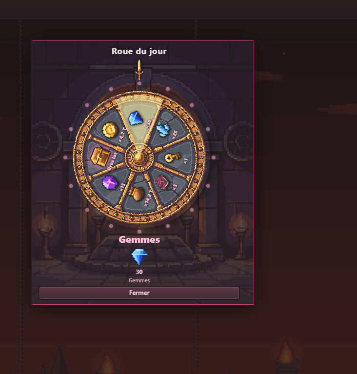

1. **L'épée est à l'envers.**
   - Dans `src/ui/style.css`, ligne 4256, `.wh-pointer-img` applique `rotate(180deg)`, alors que l'image `wheel_pointer.png` pointe déjà vers le bas. Retirer la rotation.
   - Corriger aussi `@keyframes wh-tic` (ligne 4258), qui part de 168°.
   - Résultat attendu : la pointe touche le haut de la roue.
2. **Les objets tournent avec la roue et s'arrêtent penchés.**
   - Les icônes (`.wh-ico`) sont dans `.wh-disc`, que `spinWheel()` fait tourner (`src/ui/ui.js`, vers la ligne 3100). Elles finissent donc inclinées, ainsi que leurs nombres « ×30 », « ×25 ».
   - Correction : contre-tourner chaque icône du même angle, avec la même durée et la même courbe. Par exemple, une variable `--spin` posée sur le disque, et `transform: rotate(calc(var(--a) + var(--spin))) translateY(-86px) rotate(calc(-1 * (var(--a) + var(--spin))))` sur l'icône, avec `transition: transform` identique.
   - Une icône et son nombre restent toujours droits, pendant et après le tour.
3. **La case gagnante** s'allume en haut, sous la pointe, et la récompense jaillit (déjà fait, à garder).

**Test** : après le tour, les 8 icônes ont un angle visuel de 0° (lu sur leur `getComputedStyle().transform`), et la pointe est orientée vers le bas.

---

## 2. Bastion : les maisons sont sur les remparts

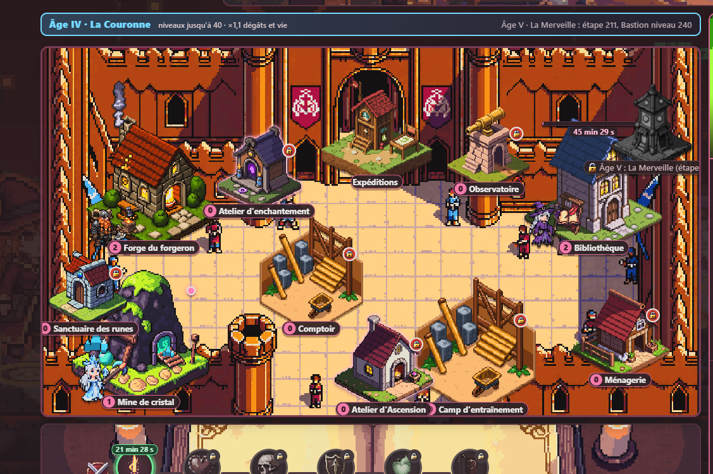

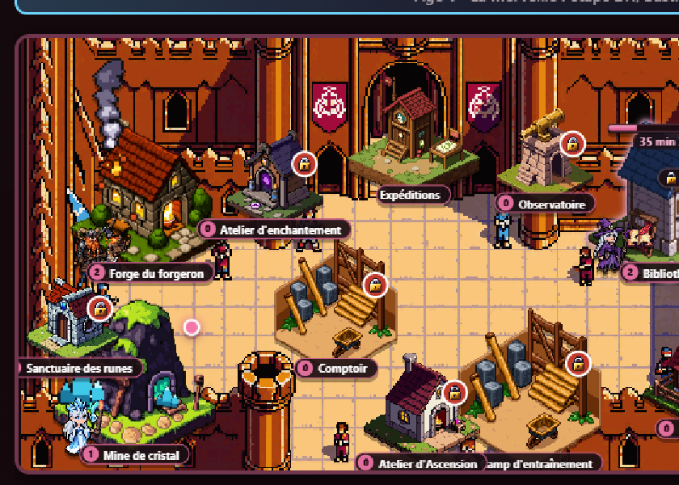

**Cause** : `src/ui/panels/camp.js`, ligne 66, `PLOTS` donne **les mêmes positions (en %) pour toutes les cartes d'âge**. Or la carte de l'Âge IV (`bastion_map_age4.png`) est dessinée autrement, avec des remparts, des tours et des portes. Résultat :
- l'Observatoire et les Expéditions sont sur les remparts ;
- le Sanctuaire des runes déborde à gauche, et son nom est coupé ;
- une tour du décor se dresse au milieu de la cour ;
- les étiquettes « Atelier d'Ascension » et « Camp d'entraînement » se chevauchent ;
- « Âge V : La Merveille (étape… » est coupé à droite, et un minuteur passe par-dessus le toit de la Bibliothèque.

**À faire** :
1. **Des emplacements propres à chaque carte** : `PLOTS_BY_AGE[age] = { forge: {x, y, w}, … }`, relevés sur l'image de chaque âge. Chaque bâtiment se pose **sur une parcelle dessinée au sol**, jamais sur un mur, une tour ou une porte.
2. **Refaire les cartes d'âge avec PixelLab** si elles n'ont pas assez de place au sol : une cour avec **12 parcelles vides bien visibles** (dalles ou fondations), des remparts seulement sur les bords, aucun élément haut au milieu.
3. **Étiquettes** : centrées sous le bâtiment, sur une ligne, et jamais l'une sur l'autre. Si deux étiquettes se touchent, décaler la seconde de sa hauteur. Le minuteur de chantier se place au-dessus du toit, dans le cadre du bâtiment.
4. **Rien ne sort de la carte** : chaque bâtiment et chaque étiquette tient à l'intérieur du cadre (marge de 8 px).
5. **Lisibilité** : à 12 bâtiments, la carte est chargée. Proposer un zoom avec la molette ou deux doigts, et un glissement, ou deux niveaux de carte (cour basse et cour haute).

**Test** : pour chaque âge (I à V), aucune étiquette ne chevauche une autre, aucun bâtiment ne sort du cadre, et une capture par âge est ajoutée à `docs/screenshots/v10.9/`.

---

## 3. Livre des recherches : mal cadré

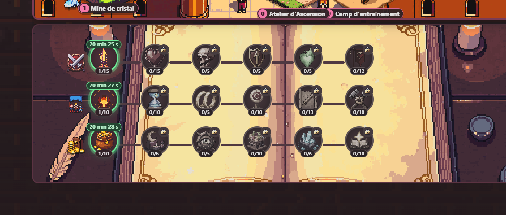

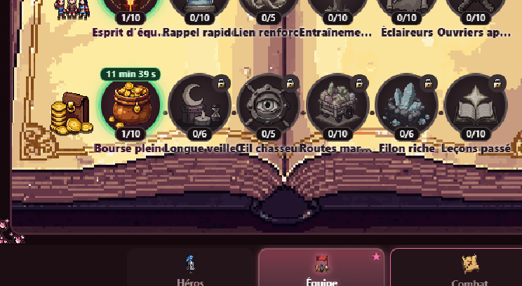

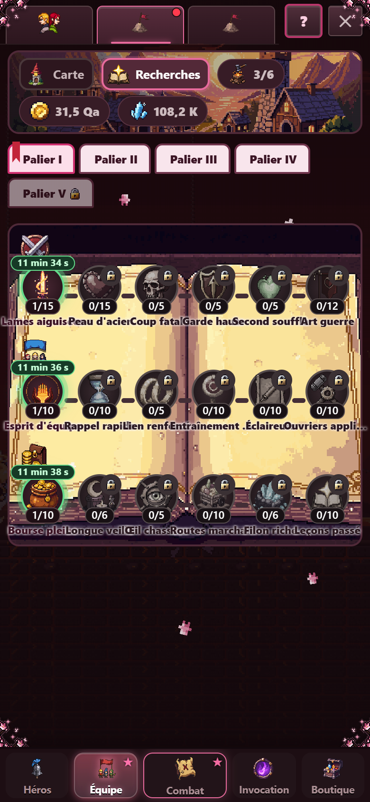

**Constat** :
- 6 médaillons par ligne sur deux pages : la 1re colonne sort de la page à gauche, et les médaillons passent sur la reliure du milieu.
- Les noms se collent les uns aux autres (« Bourse plein Longue veille Œil chasseu Routes mar… »).
- Sur téléphone, c'est illisible.

**À faire** :
1. **3 médaillons par page** : la page de gauche contient les 3 premiers nœuds d'une branche, celle de droite les 3 suivants. Garder une marge de 8 % depuis le bord de la page et depuis la reliure. Rien ne doit toucher la reliure.
2. **Noms sur 2 lignes au plus**, centrés sous le médaillon, dans une largeur égale à l'écart entre deux médaillons, jamais coupés au milieu d'un mot. Raccourcir les noms trop longs (« Œil du chasseur » → « Œil »), le nom complet s'affiche dans la fiche.
3. **Téléphone** : une seule page à la fois, avec 3 médaillons par ligne. On tourne la page avec une flèche, et l'onglet de la branche reste en haut.
4. Les minuteurs verts (« 11 min 35 s ») restent dans la page, au-dessus du médaillon, sans sortir du livre.

**Test** : en 1116 × 993 et en 390 × 844, aucun nom n'est tronqué ni collé à un autre, et aucun médaillon n'est sur la reliure.

---

## 4. Écran de jeu : une place fixe pour chaque chose

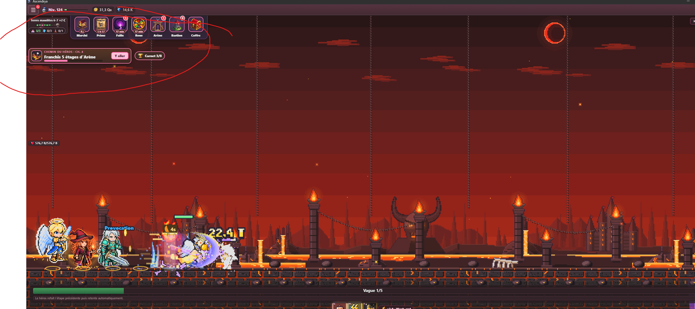

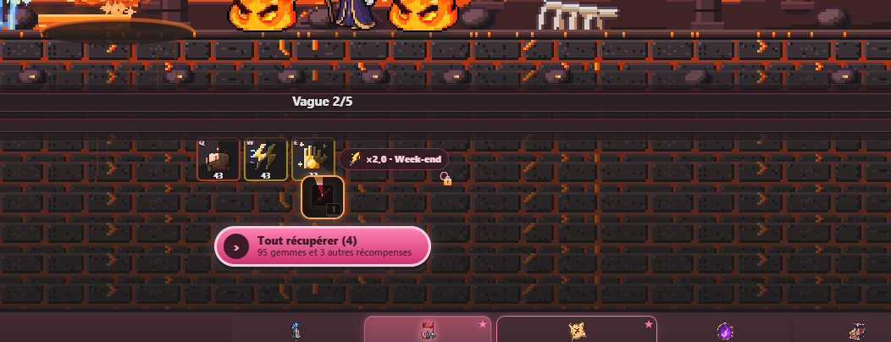

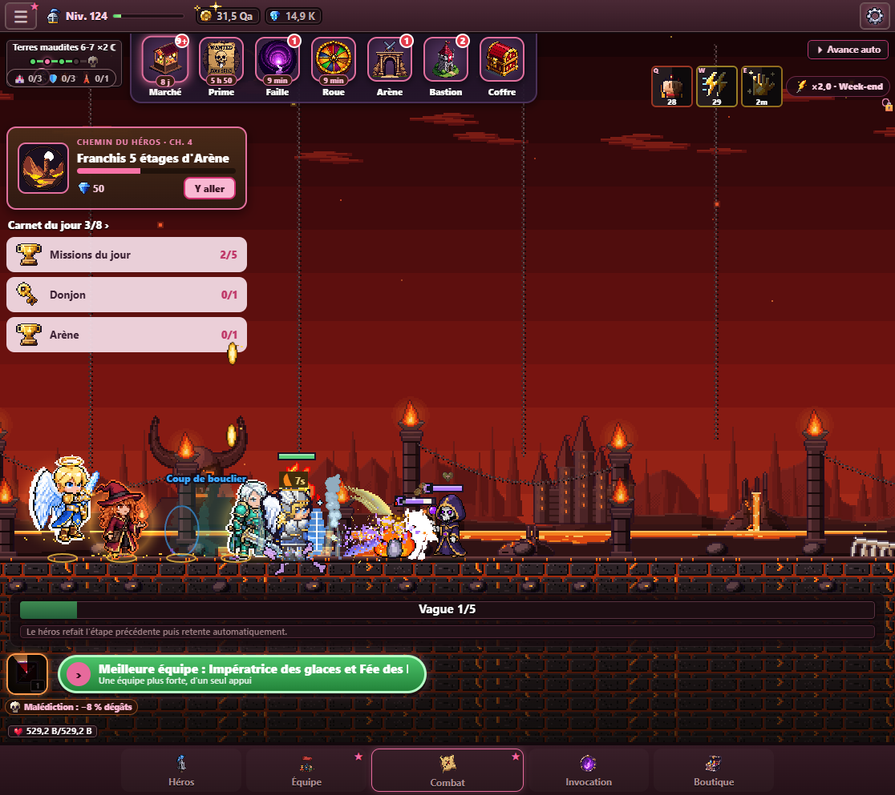

**Constat** :
- Les boosts (Q, W, E) sont en haut à droite en 1116 px, mais au milieu, sous la barre de vague, dans une autre taille. Le bouton de sort passe dessous.
- **Le coffre de butin n'est plus visible** : ni en 1116 × 993, ni en fenêtre large.
- **Le Sceau coupe son texte** : « Meilleure équipe : Impératrice des glaces et Fée des l ».
- **Une fois le Carnet du jour fini**, ses 3 lignes disparaissent. La puce de PV et les puces d'état (Malédiction) se retrouvent seules au milieu de l'écran : c'est « la barre de points de vie vide au milieu ».
- La carte de zone, la rangée d'événements et les boosts ne sont pas alignés en haut.

**Maquette** :

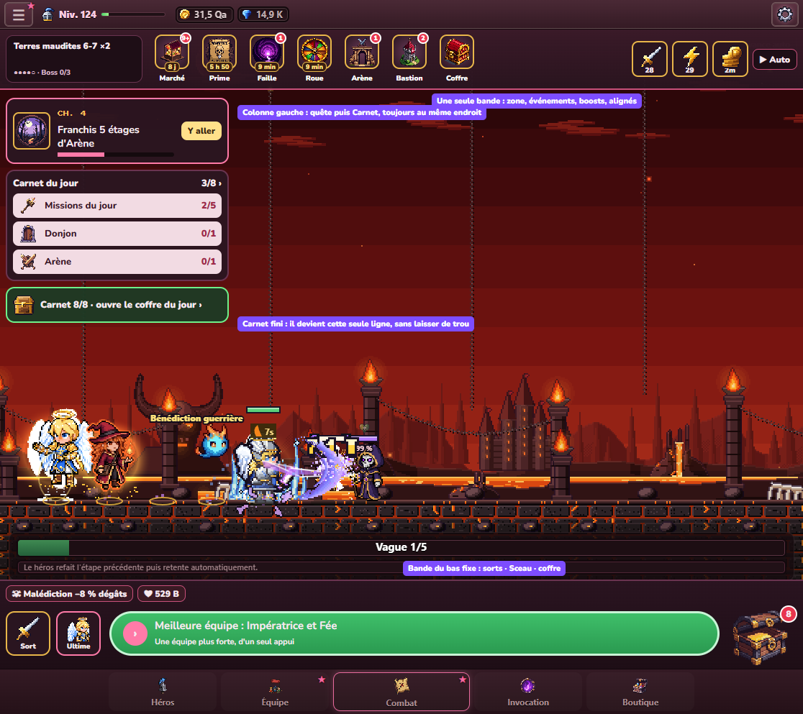

**À faire**, identique dans toutes les tailles :
1. **Bande d'en-tête** (sous la barre du haut), une seule ligne, même hauteur pour tout :
   - à gauche, la carte de zone ;
   - puis la rangée d'événements ;
   - à droite, les boosts Q, W, E et « Auto ».
2. **Colonne de gauche**, sous la bande :
   - la carte « Chemin du héros » ;
   - puis le Carnet du jour (3 lignes).

   **Quand le Carnet est fini**, il devient une seule ligne verte : « Carnet 8/8 · ouvre le coffre du jour › ». Rien d'autre ne bouge, et il ne reste aucun trou.
3. **Bande du bas, fixe**, posée sous la barre de vague :
   - au-dessus, les puces d'état (Malédiction, PV), sur une ligne ;
   - dessous, dans une grille de 3 colonnes : les sorts (Sort, Ultime) | le Sceau | le coffre de butin (toujours visible).
4. **Sceau** : 2 lignes au plus. Le titre est coupé avec « … » s'il est trop long, jamais au milieu d'un mot. Exemple : « Meilleure équipe : Impératrice et Fée ».
5. **Téléphone** : même ordre, voir la maquette `docs/prompt-v10.7/images/maquettes/05-telephone-ecran-de-jeu.png`.

**Test** : en 1116 × 993, 1280 × 720, 1920 × 1080, 2536 × 1011 et 390 × 844 :
- chaque bloc garde sa place et sa taille ;
- le coffre est visible ;
- aucun bloc n'en chevauche un autre ;
- Carnet fini : la puce de PV reste à sa place, dans la bande du bas.

---

## 5. Carnet du jour : icônes trop grandes

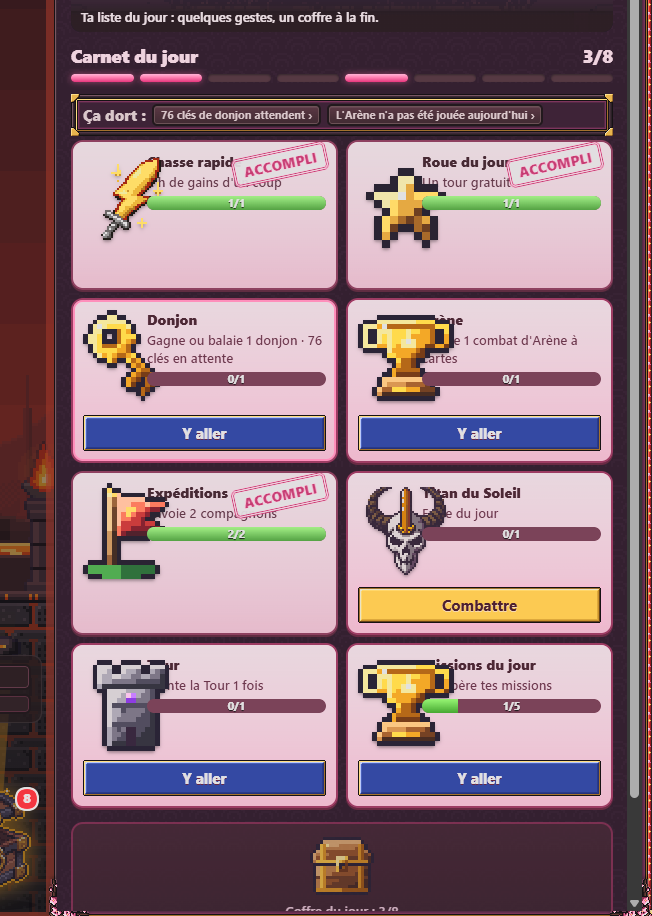

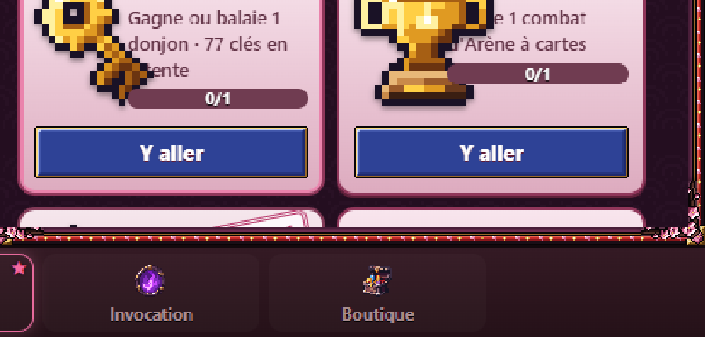

**Constat** :
- Les icônes font environ 80 px et dépassent sur le titre et la description (« Chasse rapid… », « Gagne 1 combat… » caché par la coupe).
- Le tampon « ACCOMPLI » couvre le titre.

**Maquette** :

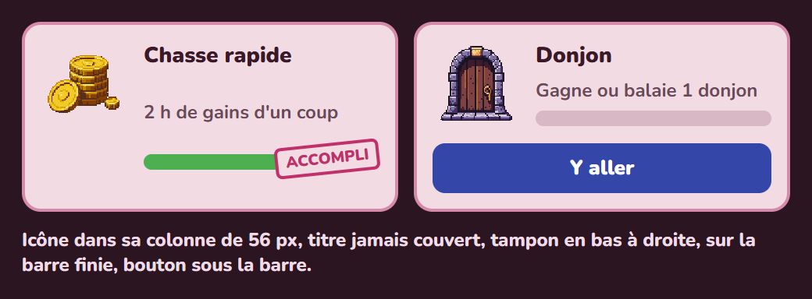

**À faire** :
- la tuile est une grille : une colonne icône de 56 px, puis le titre, la ligne et la barre ;
- l'icône ne sort jamais de sa colonne ;
- le tampon « ACCOMPLI » se pose en bas à droite, sur la barre finie ;
- le bouton prend toute la largeur, sous la barre.

---

## 6. Améliorations : colonnes trop étroites

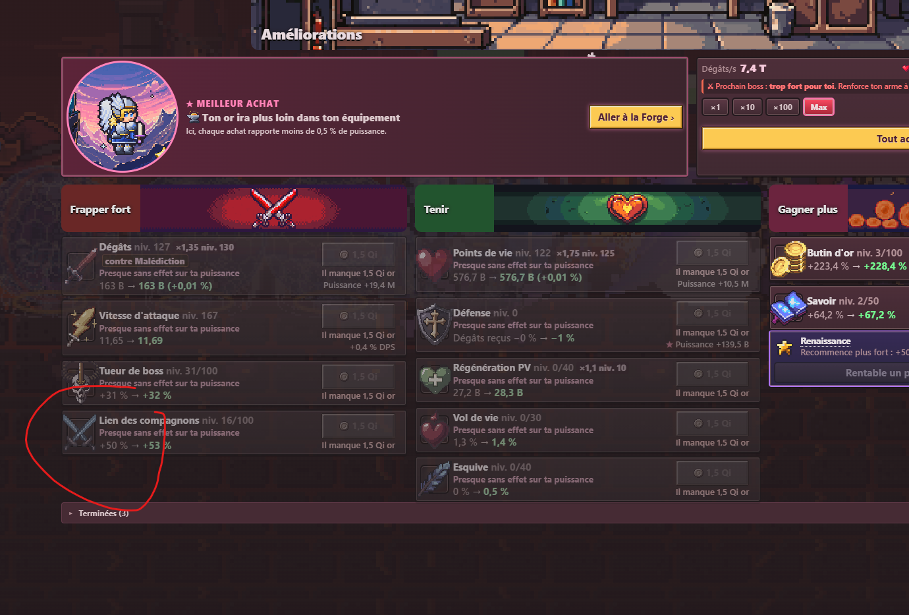

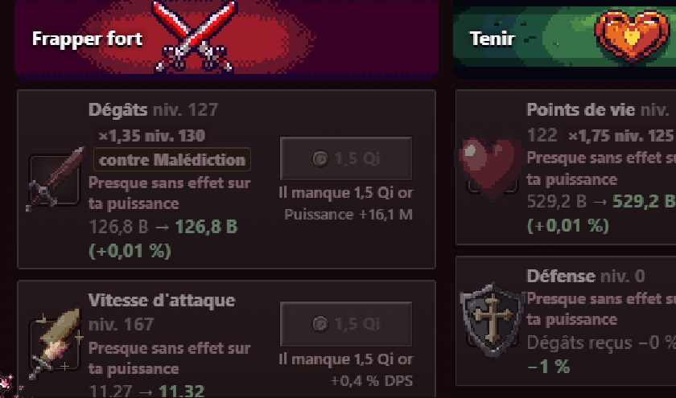

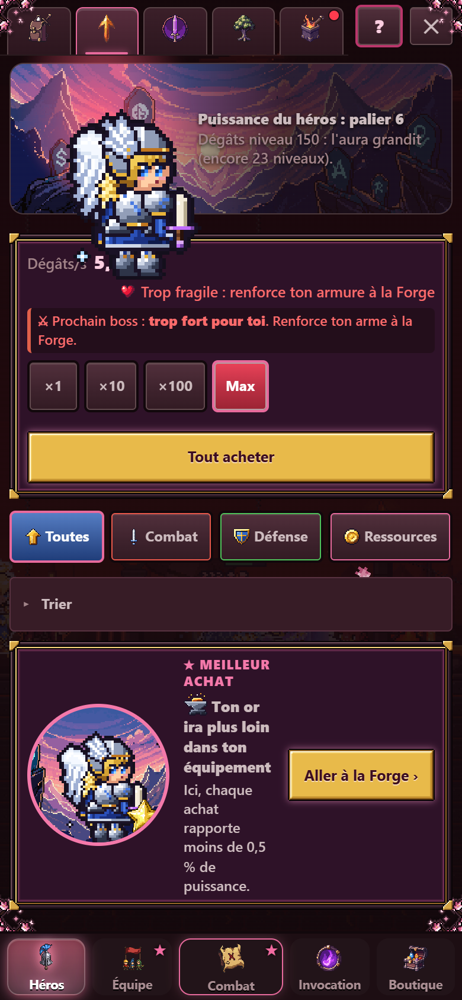

**Constat** :
- En 1116 px, les 3 colonnes ne font que 170 px de texte : les lignes se coupent mot par mot, et les icônes dépassent de 14 px de leur case (`upg-icon`).
- « Presque sans effet sur ta puissance » est répété sur chaque ligne.
- Les colonnes n'ont pas la même hauteur : un trou sous « Frapper fort ».
- Sur téléphone, la carte « Meilleur achat » affiche un mot par ligne.

**À faire** :
1. Moins de 1400 px de large : **2 colonnes** (Frapper fort + Tenir, puis Gagner plus en dessous). Moins de 700 px : 1 colonne.
2. Les icônes tiennent dans leur case de 48 px.
3. La phrase « Presque sans effet » s'affiche une seule fois, en tête de page. Les lignes concernées sont regroupées dans un bloc replié « Peu utiles maintenant (8) ▸ ».
4. Carte « Meilleur achat » : l'illustration à gauche (120 px), le texte à droite sur toute la largeur restante, et le bouton dessous sur téléphone.

---

## 7. Contrôle automatique du cadrage

Ajouter un test (Playwright) qui parcourt tous les onglets en 1116 × 993, 2536 × 1011 et 390 × 844, et signale :
- toute image qui dépasse de plus de 4 px la case qui la contient ;
- tout texte couvert à plus de 25 % par une image qui n'est pas son fond ;
- tout texte coupé sans « … » (`scrollWidth > clientWidth` avec `overflow: hidden`) ;
- deux étiquettes qui se chevauchent sur la carte du Bastion ;
- l'absence du coffre de butin sur l'écran de jeu.

Le test écrit une planche de captures dans `docs/screenshots/v10.9/`, pour que le joueur vérifie d'un coup d'œil.

---

## 7 bis. Remettre les images d'origine des tickets de compagnon et des lots de familiers

Le joueur : « pour les tickets des compagnons, remets-moi les premiers tickets comme sur le site, je n'ai pas demandé le changement, et pareil pour les familiers ».

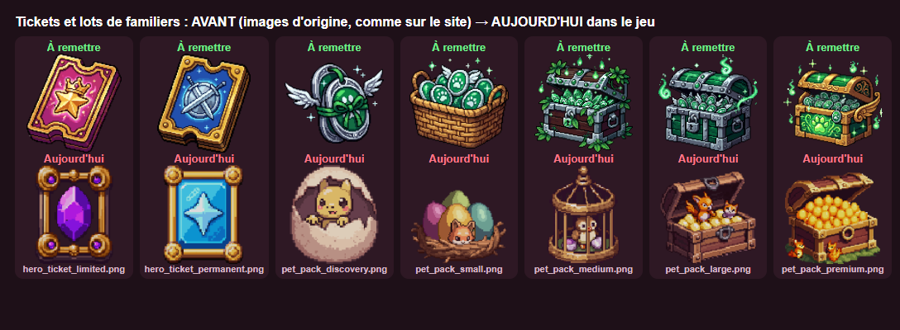

Ces images ont été remplacées en v9.8 (commit `a51ee822`, « visuels Boutique refaits »). Le lot de familiers grand a encore changé en 9.11 (`2e6ee275`). Le site, lui, montre toujours les images d'origine (`site/assets/shop/*.webp`).

**À faire** : remettre la version d'avant `a51ee822` (commit `9d4eb7b4`) pour ces fichiers de `assets/ui/shop/`, en gardant les mêmes noms, avec leurs vignettes `_s` :

```
git checkout 9d4eb7b4 -- assets/ui/shop/hero_ticket_limited.png assets/ui/shop/hero_ticket_limited_s.png   assets/ui/shop/hero_ticket_permanent.png assets/ui/shop/hero_ticket_permanent_s.png   assets/ui/shop/pet_pack_discovery.png assets/ui/shop/pet_pack_discovery_s.png   assets/ui/shop/pet_pack_small.png assets/ui/shop/pet_pack_small_s.png   assets/ui/shop/pet_pack_medium.png assets/ui/shop/pet_pack_medium_s.png   assets/ui/shop/pet_pack_large.png assets/ui/shop/pet_pack_large_s.png   assets/ui/shop/pet_pack_premium.png assets/ui/shop/pet_pack_premium_s.png
```

- Le ticket de familier (`pet_ticket.png`) n'a jamais changé, on le garde.
- Vérifier aussi les icônes de ticket du portefeuille (en haut de la Boutique et de l'Invocation), et des récompenses (Carnet, Missions, Prime, Roue) : elles doivent montrer les mêmes tickets que le site.
- Ne toucher à aucun autre visuel de la Boutique (cristaux, lots cosmétiques) sans demande du joueur.

**Test** : chacune de ces images est identique, au pixel près, à celle du commit `9d4eb7b4`. La Boutique, l'Invocation et les récompenses affichent le ticket doré à épées (permanent) et le ticket rose à couronne (limité).

---

## 7 ter. Équipement : c'est le joueur qui équipe, pas le jeu

Le joueur : « pareil pour les équipements, s'il faut mettre des meilleurs, il faudrait que je le fasse moi-même et pas en auto. J'y vais jamais, et j'ai pas l'impression d'avoir besoin de meilleur stuff ».

**Constat dans le code** : plusieurs chemins équipent le meilleur objet sans que le joueur ouvre l'équipement.
- `src/main.js`, `sessionReturn()` : au retour de session, `equipBest(state)` est appelé après « Tout récupérer ».
- `src/ui/ui.js`, lignes 2556 et 2572 : quand le Sceau propose `equip-best` (« Équiper … », « Meilleure équipe »), le toucher équipe directement.
- « Meilleure équipe » et `gearTeam` équipent toute l'équipe d'un coup.

Résultat : le joueur ne va jamais dans l'équipement et ne sent pas l'intérêt du butin.

**À faire** :
1. **Plus aucun équipement automatique.** `sessionReturn()` récupère les récompenses mais n'équipe rien. Le Sceau n'équipe plus en un toucher : il **ouvre la fenêtre de l'objet** (celle de la 10.6, avec le verdict « ▲ +12 % de puissance » et le bouton Équiper). C'est le joueur qui appuie sur « Équiper ».
2. **Faire sentir le besoin**, en images :
   - une pastille verte « ▲ » sur le bouton Héros (menu du bas) et sur la case concernée quand un meilleur objet attend ;
   - au retour de session, une ligne « 2 objets meilleurs que les tiens t'attendent › » qui ouvre l'équipement filtré sur ces objets ;
   - quand le joueur bloque sur un boss, la carte « Comment devenir plus fort » met en premier « Équipe le Croc de l'Alpha : +12 % » si c'est la meilleure action.
3. **Garder les raccourcis, mais à la main** : « Équiper le meilleur » reste un bouton dans la page Équipement (et « Meilleure équipe » dans Compagnons). Jamais lancé tout seul.
4. **Le coffre de butin** : « Garder le meilleur, recycler le reste » range le meilleur dans le sac, il ne l'équipe pas.
5. **Réglage** (Options) « Équiper automatiquement les meilleurs objets », **désactivé par défaut**, pour ceux qui le veulent.

**Test** : sur une partie avec un objet meilleur dans le sac, ni le retour de session, ni le Sceau, ni le tri du coffre ne change l'équipement porté. La pastille « ▲ » est visible sur le bouton Héros.

---

## 8. Tests de fin

- **Roue** : pointe vers le bas, icônes droites après le tour.
- **Bastion** : rien sur les murs, aucune étiquette en double ou coupée, dans les 5 âges.
- **Livre** : 3 médaillons par page, noms lisibles, rien sur la reliure.
- **Écran de jeu** : mêmes places dans 5 tailles, coffre visible, aucun trou une fois le Carnet fini.
- **Carnet et Améliorations** : aucune icône qui dépasse, aucun texte couvert.
- **Tickets** : les images d'origine sont revenues (tickets de compagnon et lots de familiers), comme sur le site.
- **Équipement** : rien n'est équipé sans un appui du joueur sur « Équiper ».
- **Revue complète des menus** : aucune erreur.
